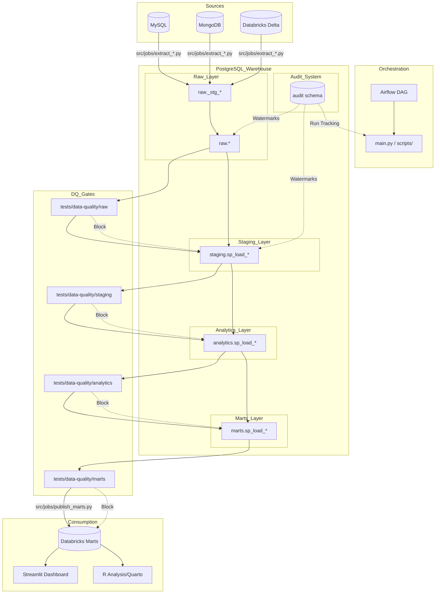

# System Map — Banking-Delta-Lakehouse

## Dependency & Flow Overview

## End-to-End Traces

### 1. Daily Data Landing (Source $\rightarrow$ Raw)
**User/Scheduler** $\rightarrow$ `Airflow DAG` $\rightarrow$ `main.py` $\rightarrow$ `scripts/run_jobs.py` $\rightarrow$ `src/jobs/extract_mysql.py` $\rightarrow$ `src/utils/spark_io.py` $\rightarrow$ `raw._stg_customers` $\rightarrow$ `raw.customers` $\rightarrow$ `audit.extract_watermarks`.

### 2. Gated Transformation (Raw $\rightarrow$ Marts)
`main.py` $\rightarrow$ `scripts/run_raw_tests.py` $\rightarrow$ `tests/data-quality/raw/*.sql` $\rightarrow$ `audit.dq_run` $\rightarrow$ (Pass) $\rightarrow$ `staging.sp_load_all()` $\rightarrow$ `staging.customers` $\rightarrow$ `analytics.dim_customer` $\rightarrow$ `marts.mart_customer_360`.

### 3. Publishing to Lakehouse (Warehouse $\rightarrow$ Databricks)
`main.py` $\rightarrow$ `src/jobs/publish_marts.py` $\rightarrow$ `psycopg2` (Read `marts.*`) $\rightarrow$ `pyarrow` (Local Parquet) $\rightarrow$ `databricks-sdk` (Upload to Volume) $\rightarrow$ `Databricks SQL` (INSERT OVERWRITE) $\rightarrow$ `Databricks Delta Table`.

### 4. Business Insight (Databricks $\rightarrow$ UI)
**Executive User** $\rightarrow$ `dashboard/app.py` $\rightarrow$ `dashboard/helpers/marts.py` $\rightarrow$ `databricks-sql-connector` $\rightarrow$ `SELECT` from `marts.mart_customer_360` $\rightarrow$ `Plotly Chart`.
