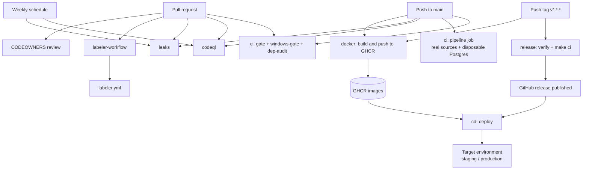

# `.github` — CI/CD, security and repository automation

This directory contains everything GitHub uses to lint, test, build, release and deploy
Banking-Delta-Lakehouse, plus the labels, owners and templates that shape a change before
it reaches `main`.

The same rules that humans follow (see the root `AGENTS.md` and `docs/CI-CD.md`) are
enforced here: least-privilege tokens, no `pull_request_target`, actions pinned by commit
SHA where possible, no secrets in the PR gate, and a red pipeline that actually fails.

---

## Directory map

```
.github/
├── README.md                     this file
├── CODEOWNERS                    default and per-path review owners
├── labeler.yml                   path globs -> PR labels
├── pull_request_template.md      PR checklist and evidence table
├── ISSUE_TEMPLATE/
│   ├── bug_report.yml            structured bug report
│   ├── feature_request.yml       structured feature proposal
│   └── config.yml                issue chooser links, blank issues disabled
└── workflows/
    ├── ci.yml                    lint/tests on PR, full pipeline on push to main
    ├── cd.yml                    deploy a release or a manually chosen ref
    ├── docker.yml                build and push the four images to GHCR
    ├── release.yml               verify a version tag, then create the GitHub release
    ├── codeql.yml                Python static analysis (security-and-quality)
    ├── leaks.yml                 gitleaks over the full git history
    └── labeler-workflow.yml      apply labels from labeler.yml on every PR
```

---

## How the pieces connect

GitHub workflows do not call each other directly. They are connected by **events** and by
**artifacts** left behind by earlier runs:

- Pull requests trigger `ci` (gate jobs), `codeql`, `leaks` and `labeler-workflow`.
- A push to `main` triggers `ci` (including the real `pipeline` job), `codeql`, `leaks`
  and `docker`.
- Pushing a tag like `v0.2.0` triggers `release` and `docker`.
- `release` creating a published GitHub release triggers `cd`.
- `cd` pulls the container images that `docker` pushed to GHCR.
- `CODEOWNERS`, `labeler.yml` and the PR/issue templates are not workflows; GitHub reads
  them automatically when a PR or issue is opened.



### Lifecycle in words

1. **Open a PR.** `labeler-workflow` labels it from `labeler.yml`. `ci` runs the hermetic
   gate (`gate`), the Windows parity gate (`windows-gate`) and the dependency audit
   (`dep-audit`). `codeql` and `leaks` run in parallel. The `pipeline` job does **not**
   run on PRs, because it needs real source credentials.
2. **Merge to `main`.** The same PR checks run again on the push. In addition, `ci` runs
   the `pipeline` job against real Mongo/MySQL/Databricks (repo secrets) and a disposable
   Postgres service. `docker` builds and pushes the `airflow`, `dashboard`, `reports` and
   `pipeline` images to GHCR.
3. **Tag a version.** `release` verifies the tag matches `pyproject.toml`, that the commit
   is on `main`, and runs `make ci`; then it creates the GitHub release. `docker` also
   builds on the tag. Publishing the release triggers `cd`, which pulls the pipeline image
   and runs it against the selected environment.
4. **Deploy manually.** Dispatch `cd` with an `environment` (`staging` or `production`)
   and a `ref`. The GitHub Environment's protection rules decide whether approval is
   required.
5. **Weekly.** `codeql` and `leaks` re-scan on Monday mornings even with no pushes.

---

## Workflows

### `ci.yml` — the merge gate and post-merge pipeline

| Property | Value |
|---|---|
| Workflow name | `ci` |
| Triggers | `pull_request`, `push` to `main`, `workflow_dispatch` |
| Concurrency | `ci-${{ github.ref }}`, cancels an older run on the same ref |
| Top-level permissions | `contents: read` |

Jobs:

| Job | Runner | Timeout | Purpose |
|---|---|---|---|
| `gate` | `ubuntu-latest` | 25 min | Hermetic quality gate: `uv lock --check`, `make install`, `make lint`, `make contracts`, `make sql-lint`, `make smoke`, `make cov`, `make report-fixture`. |
| `dep-audit` | `ubuntu-latest` | 10 min | Exports the locked dependency set and runs `pip-audit` against it. |
| `windows-gate` | `windows-latest` | 30 min | Same intent as `gate` through `tasks.bat`: install, lint, contracts, SQL lint, tests, coverage, report fixtures. Proves the Windows runner works without GNU Make. |
| `pipeline` | `ubuntu-latest` | 60 min | **Push to `main` only.** Bootstraps a disposable PostgreSQL 16 service, then runs `uv run main.py --keep-going` against real sources. Uploads audit/test/coverage artifacts. |

Key details:

- `gate`, `dep-audit` and `windows-gate` need no database, network or secrets. They are the
  fast, deterministic checks a PR must pass.
- `pipeline` declares `needs: [gate, dep-audit, windows-gate]`, so it only starts when all
  three pass, and only when `github.event_name == 'push'`.
- The Postgres service is ephemeral and uses throw-away credentials
  (`postgres` / `test-only` / `banking_delta`). The warehouse is not a production database.
- Source systems are supplied from repository secrets: `MONGO_URI`, `MONGO_DB_NAME`,
  `MYSQL_HOST`, `MYSQL_PORT`, `MYSQL_USER`, `MYSQL_PASSWORD`, `MYSQL_DB`,
  `DATABRICKS_HOST`, `DATABRICKS_TOKEN`, `DATABRICKS_HTTP_PATH`, `DATABRICKS_CATALOG`,
  `DATABRICKS_SCHEMA_PUBLIC`, `DATABRICKS_MARTS_SCHEMA`.
- `sql/scripts/0*.sql` is applied first to create schemas, audit tables, source registry
  and watermarks.
- `main.py` returns a non-zero exit code if **any** step fails, even with `--keep-going`.
  `--keep-going` means "run every step and report all failures", not "ignore failures".
  A missing `MONGO_URI` or an unavailable warehouse therefore turns the check red.
- The final step uploads `**/audit/**`, `**/test-results.xml` and `**/coverage.xml` with
  `if: always()`, so diagnostics survive a failed run.
- Because the `pipeline` job is guarded by `github.event_name == 'push'`, a manual
  `workflow_dispatch` runs the three gate jobs only.

### `cd.yml` — deploy a release or a chosen ref

| Property | Value |
|---|---|
| Workflow name | `cd` |
| Triggers | `release` (`published`), `workflow_dispatch` with `environment` and `ref` inputs |
| Concurrency | `cd-<environment or tag>`, does not cancel an in-progress deploy |
| Permissions | `contents: read`, `packages: read`, `id-token: write` |

Jobs:

| Job | Runs when | Purpose |
|---|---|---|
| `resolve` | Always | Resolves ref, sha, environment and image tag. Production guard: ref must be a stable semver tag and commit must be on origin/main. |
| `gate` | Release event or production dispatch | Re-verifies the release commit: `make lint`, `make contracts`, `make sql-lint`, `make cov`. |
| `deploy` | Published release, or manual dispatch | Pulls the pipeline image from GHCR by digest and runs it with the target environment's secrets. |

Key details:

- `deploy` sets `environment:` to the resolved environment (`staging` or `production`), never the tag name. That is what gives a production deployment its GitHub Environment protection and manual approval.
- The deploy step runs the `pipeline` image with `--keep-going`. Since `main.py` now returns `1` when a step fails, a failed deployment is visibly failed; it is no longer masked.
- Secrets consumed by the deploy step: `PG_HOST`, `PG_PORT`, `PG_DB`, `PG_USER`, `PG_PASS`, `DATABRICKS_HOST`, `DATABRICKS_TOKEN`, `DATABRICKS_CATALOG`, `DATABRICKS_MARTS_SCHEMA`, `PUBLISH_STAGE_VOLUME`, `MONGO_URI`, `MONGO_DB_NAME`, `MYSQL_HOST`, `MYSQL_PORT`, `MYSQL_USER`, `MYSQL_PASSWORD`.
- The workflow pulls `ghcr.io/<owner>/pipeline:sha-<first 7 chars of commit>` and runs by digest, connecting it to the images built by `docker.yml`.
- The final step is intentionally `if: failure()` — it prints the target and exits `1`, so the job cannot be mistaken for a success.
- Manual dispatch to `staging` skips the `gate` job; manual dispatch to `production` runs the gate. Release events always run the gate.

### `docker.yml` — container builds

| Property | Value |
|---|---|
| Workflow name | `docker` |
| Triggers | `push` to `main`, `push` tags `v*`, `workflow_dispatch` |
| Permissions | `contents: read`, `packages: write` |

The `build` job uses a matrix with `max-parallel: 4` and `fail-fast: false`, so one broken
image does not stop the others:

| Image | Dockerfile | Notes |
|---|---|---|
| `airflow` | `airflow/Dockerfile` | Build arg `AIRFLOW_VERSION=3.3.2`. |
| `dashboard` | `dashboard/Dockerfile` | Streamlit dashboard image. |
| `reports` | `reports/Dockerfile` | TeX/PDF report toolchain. |
| `pipeline` | `Dockerfile.pipeline` | The image `cd.yml` runs. |

Each image goes to `ghcr.io/<owner>/<image>` using Docker Buildx and GitHub Actions cache.
Metadata tags are `type=ref,event=branch` and `type=sha`. The workflow logs in with
`GITHUB_TOKEN` (hence `packages: write`).

### `release.yml` — verified version tags

| Property | Value |
|---|---|
| Workflow name | `release` |
| Triggers | `push` tags matching `v*.*.*` |
| Concurrency | `release-<ref>`, never cancels |
| Permissions | `contents: read` by default |

Jobs:

| Job | Purpose |
|---|---|
| `verify` | Checks tag == `project.version` in `pyproject.toml`, checks the tagged commit is an ancestor of `origin/main`, installs `uv`, then runs `make ci`. |
| `github-release` | Gets `contents: write` only for this job. Runs `gh release create` with `--verify-tag` and generated notes. Tags containing `-` (for example `v0.2.0-rc1`) become prereleases. |

Publishing this GitHub release is the event that starts `cd.yml`.

### `codeql.yml` — Python static analysis

| Property | Value |
|---|---|
| Workflow name | `codeql` |
| Triggers | `push`/`pull_request` on `main`, weekly schedule Monday 04:00 UTC |
| Permissions | `contents: read`; the job adds `security-events: write` and `actions: read` |

Runs `github/codeql-action` v4 with `languages: python`, `build-mode: none` and the
`security-and-quality` query pack. Findings appear in GitHub code scanning. Private
repositories need GitHub Advanced Security for this to work.

### `leaks.yml` — secret scanning

| Property | Value |
|---|---|
| Workflow name | `leaks` |
| Triggers | `pull_request`, `push` to `main`, weekly schedule Monday 03:00 UTC, manual dispatch |
| Permissions | `contents: read` |

Checks out the full history (`fetch-depth: 0`), downloads a pinned gitleaks release
(`8.28.0`), verifies it against the published checksums, and runs
`gitleaks git --redact -v --config .gitleaks.toml`. The redaction flag keeps a detected
secret out of the workflow log; the repository config decides what is allowed.

### `labeler-workflow.yml` — PR labels

| Property | Value |
|---|---|
| Workflow name | `labeler` |
| Triggers | PR `opened`, `synchronize`, `reopened` |
| Permissions | `contents: read`; the job adds `pull-requests: write` |

Runs `actions/labeler` v5 with `sync-labels: true`. Labels come from `labeler.yml`; when a
file is removed from a PR its label is removed too.

---

## Non-workflow files

### `CODEOWNERS`

Assigns review ownership. `* @Nitinx12` is the default, then `main.py`, `src/`, `scripts/`,
`sql/`, `airflow/`, `tests/`, `.github/`, `.githooks/`, `Makefile`, `tasks.bat`, the
governance docs and `docs/` are listed explicitly.

This file only has an effect when branch protection enables **Require review from Code
Owners**. Replace `@Nitinx12` with the real user/team (`@org/team-slug`) before relying on
it.

### `labeler.yml`

Maps changed paths to labels: `extract`, `publish`, `core-utils`, `sql-bootstrap`,
`sql-staging`, `sql-analytics`, `sql-marts`, `data-quality`, `tests`, `contracts`,
`airflow`, `dashboard`, `ci`, `dependencies`, `documentation`.

It is read by `labeler-workflow.yml`; it is not valid on its own.

### `pull_request_template.md`

Prefills every new PR with:

- what changed and why,
- a per-change list,
- a tested-with-commands table (`make ci`, `make cov`, extra tiers),
- risk and rollback,
- approvals used for restricted actions,
- a checklist covering branch naming, tests, secrets, docs and extra test tiers.

### `ISSUE_TEMPLATE/`

| File | Behaviour |
|---|---|
| `bug_report.yml` | Area dropdown, actual/expected behaviour, redacted evidence (`audit.pipeline_runs`, `audit.dq_run` statuses and counts only), environment. Warns never to paste credentials, `.env` values, row data or full connection strings. |
| `feature_request.yml` | Problem, proposal, alternatives, impact. Calls out watermarks, DQ thresholds, pools and registry schema as approval-bound. |
| `config.yml` | Disables blank issues and adds contact links for `docs/GITWORKFLOWS.md`, `docs/TROUBLESHOOTING.md` and `SECURITY.md`. |

---

## Secrets and permissions

| Workflow/job | Secrets | Write permissions |
|---|---|---|
| `ci` gate, windows-gate, dep-audit | none | none (`contents: read`) |
| `ci` pipeline | `MONGO_*`, `MYSQL_*`, `DATABRICKS_*` | none; Postgres credentials are local service credentials |
| `cd` deploy | `PG_*`, `DATABRICKS_*`, `PUBLISH_STAGE_VOLUME`; `GITHUB_TOKEN` for GHCR | `packages: read`, `id-token: write`; GitHub Environment approval |
| `docker` | `GITHUB_TOKEN` | `packages: write` |
| `release` | `GITHUB_TOKEN` | `contents: write` only in `github-release` |
| `labeler-workflow` | `GITHUB_TOKEN` | `pull-requests: write` only in `label` |
| `codeql` | none | `security-events: write` in `analyze` |
| `leaks` | none | none |

Rules that hold across the directory:

- No `pull_request_target` anywhere.
- Secrets are never exposed to PRs from forks.
- Permissions are declared at the workflow level and widened only on the job that needs
  them.
- Checkout, `setup-uv`, `setup-java`, CodeQL, Docker and labeler actions are pinned by
  commit SHA.

---

## Local equivalents

The workflows deliberately call the same local entry points so "green locally" means the
same thing as "green in CI":

| Workflow step | Local command |
|---|---|
| `make install` | `uv sync --group dev` |
| `make lint` | `uv run ruff check .` + `uv run ruff format --check .` |
| `make contracts` | `uv run python -m contracts.validate` |
| `make sql-lint` | `uv run sqlfluff lint sql tests --dialect postgres` |
| `make smoke` | `uv run pytest -m smoke` |
| `make cov` | `uv run pytest -m unit --cov ...` |
| `make ci` | lint + contracts + sql-lint + cov + smoke + report-fixture |
| `uv run main.py --keep-going` | full local pipeline against `.env` |
| Windows gate | `tasks.bat install`, `tasks.bat lint`, `tasks.bat test`, ... |

`tests/smoke/test_make_parity.py` fails if a Makefile target is missing from `tasks.bat`,
and `tests/smoke/test_repo_contract.py` fails if `make ci` ever gains a non-hermetic step.

---

## Required GitHub repository setup

These are settings, not files, and must be configured by a repository admin:

1. **Actions** enabled; workflows visible under the Actions tab.
2. **Branch protection for `main`**: require a PR and an approval, dismiss stale
   approvals, require status checks (`gate`, `windows-gate`, and ideally `leaks` and
   `codeql`), require branches to be up to date, block force pushes and deletions.
3. **Environments**: create `staging` and `production`; add required reviewers to
   `production` so `cd` waits for approval.
4. **Secrets**: add the `ci` source secrets and the `cd` warehouse/Databricks secrets
   listed above. Never add production credentials to the PR-accessible gate.
5. **Code security**: enable Dependabot alerts/security updates and private vulnerability
   reporting (see `SECURITY.md`).

---

## Known gaps and caveats

These are observable in the current files and are worth fixing before relying on the
automation end to end:

- `ci.yml`'s `pipeline` job needs all source secrets. Without them it fails at
  `raw-inject` with `Missing required environment variable: MONGO_URI` and the check is
  correctly red. Configure the secrets first.
- `cd.yml` deploys with only `PG_*` and `DATABRICKS_*`. It does not forward
  `MONGO_URI`/`MYSQL_*`, so a deployed full pipeline fails at `raw-inject` unless those
  secrets are added to the `docker run --env` list.
- `docker.yml` tags images with `type=ref,event=branch` and `type=sha`, but not
  `type=ref,event=tag`. A release tag therefore does not produce a `pipeline:vX.Y.Z`
  image, while `cd.yml` pulls `pipeline:<tag>`. Add `type=ref,event=tag` (or make `cd`
  pull the SHA tag) to align them.
- `docker.yml` declares a `workflow_dispatch` input `environment` that no later step
  reads.
- `docs/CI-CD.md` mentions `.github/workflows/nightly.yml` and
  `.github/dependabot.yml`; neither file currently exists in this directory.
- `actions/upload-artifact@v4` in `ci.yml` is a major-version reference rather than a
  commit SHA. Every other third-party action is SHA-pinned.
- `CODEOWNERS` still uses the placeholder maintainer handle `@Nitinx12`.
- The `pipeline` job publishes marts to the real Databricks workspace on every push to
  `main`. That is intentional real-time behaviour, but it means a merge is not a dry run.
