# Architecture — Banking-Delta-Lakehouse

> The blueprint of the project. Read this first; `AGENTS.md` holds the rules for
> working in the repo, and `docs/*.md` drill into each subsystem. If this file and
> the code disagree, the code wins — then fix this file.

Banking-Delta-Lakehouse is a **daily lakehouse pipeline**: three source systems are landed
into PostgreSQL with PySpark, transformed by SQL stored procedures through four
layers (`raw → staging → analytics → marts`), gated by data-quality suites at every
step, and finally published to Databricks Delta where a read-only dashboard serves
them. Airflow schedules it; `main.py` runs the identical steps by hand.

## 1. In one picture

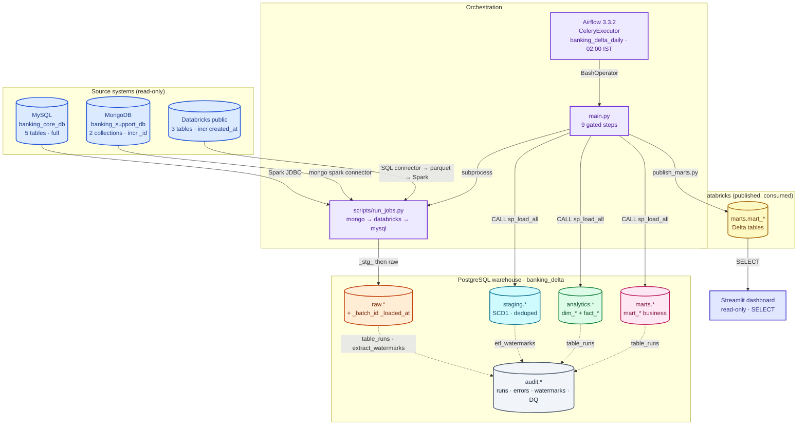

**Colour legend** (used in every diagram in this repo): blue = source systems,
violet = orchestration / entry points, orange = `raw`, cyan = `staging`, green =
`analytics`, pink = `marts`, yellow = Databricks Delta, slate = audit /
cross-cutting, red = DQ gates and failures, indigo = read-only consumers.

## 2. Design principles

1. **One way to run the pipeline.** `main.py` and the Airflow DAG call the *same*
   scripts and the *same* SQL. Airflow adds scheduling, retries, pools and alerting —
   it contains no pipeline logic of its own (`airflow/dags/banking_delta_daily.py`).
2. **Gate before the next layer.** A failing step stops the run; a critical data-quality
   failure blocks publish. Nothing downstream ever reads a half-loaded layer.
3. **Idempotent by construction.** Every load is safe to run twice with the same input.
4. **Watermarks move only with the data.** A watermark advances inside the *same
   transaction* as the write, so a crash never loses or double-counts rows.
5. **Audit survives failure.** Audit rows are written in their own short transactions;
   the DQ gate `COMMIT`s its verdict *before* it `RAISE`s.
6. **Correct types.** Money is `NUMERIC(18,2)` / `Decimal`, never `float`. All instants
   are timezone-aware UTC; Spark JVM + SQL session run in UTC.
7. **Layer ownership is strict.** Each schema is written by exactly one owner (see §5).
8. **Hermetic by default.** CI and the local gate need nothing external; anything that
   touches real data or credentials is scheduled, gated and approved.

## 3. Repository map

```text
Banking-Delta-Lakehouse/
├── main.py                     # 9 gated steps; the manual entry point
├── Makefile / tasks.bat        # single source of truth for dev tasks (Linux / Windows)
├── pyproject.toml              # deps, pytest markers, coverage floor, ruff config
├── AGENTS.md · ARCHITECTURE.md # rules for agents · this blueprint
│
├── src/
│   ├── jobs/                   # one extractor per source + the publisher
│   │   ├── extract_mysql.py · extract_mongo.py · extract_databricks.py
│   │   └── publish_marts.py    # PostgreSQL marts → Databricks Delta
│   └── utils/
│       ├── config.py           # THE only place .env is read (override=False)
│       ├── connection.py       # psycopg2 / pymysql / pymongo / databricks-sql + JDBC opts
│       ├── engine.py           # tuned, pre-flight-checked SparkSession
│       ├── session.py          # spark singleton + per-block pg/mysql/mongo transactions
│       ├── spark_io.py         # read window, staging write, promote, watermark, casts
│       ├── extract_runner.py   # shared batch-window / load / DQ / parallel-tables logic
│       ├── audit.py            # run tracking, errors, watermarks, DQ results
│       └── logger.py           # the project logger (no print, no row values)
│
├── scripts/                    # thin CLI wrappers used by main.py and Airflow
│   ├── run_jobs.py             # extracts in order (mongo → databricks → mysql)
│   ├── run_{raw,staging,analytics,marts}_tests.py   # data-quality runners
│   └── seed_watermarks.py      # first incremental run of a new table
│
├── sql/
│   ├── scripts/00–06           # bootstrap: DB, schemas, audit, registry, watermarks
│   ├── staging/                # sp_load_*_scd1.sql + 00_master_load.sql
│   ├── analytics/              # dim_* / fact_* + master load
│   ├── marts/                  # mart_* + master load
│   ├── raw / metadata          # exploration queries (not part of the run)
│
├── tests/
│   ├── data-quality/{raw,staging,analytics,marts}/  # SQL DQ suites (audit.dq_*)
│   ├── smoke/ · unit/          # Python code tests (hermetic)
│   └── conftest.py             # fake_env + autouse no_network
│
├── contracts/                  # source → raw landing contracts (validated)
├── airflow/                    # dags/, include/banking_airflow/, compose, Dockerfile
├── dashboard/                  # Streamlit read-only app (Databricks SQL)
├── r/                          # R analysis layer (read-only consumer; see docs/R.md)
├── docs/                       # per-subsystem guides
└── conf/ · notebooks/          # log4j2 config · source exploration notebooks
```

## 4. The daily run, step by step

`python main.py` runs nine steps in gate order (`--list` prints them). Airflow runs the
same names as tasks.

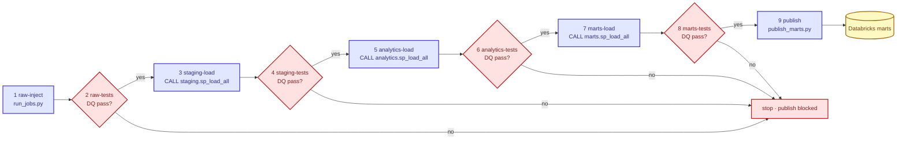

Only steps 1, 2, 4, 6, 8 and 9 are Python jobs; the three `*-load` steps are a single
`CALL <schema>.sp_load_all(...)` inside PostgreSQL (`main.py:run_load`). A failing step
stops the run unless `--keep-going` is passed.

### Extracts in detail (step 1)

The three extractors share `src/utils/extract_runner.py`. Each table follows the same
safe, twice-runnable loop (`src/utils/spark_io.py`):

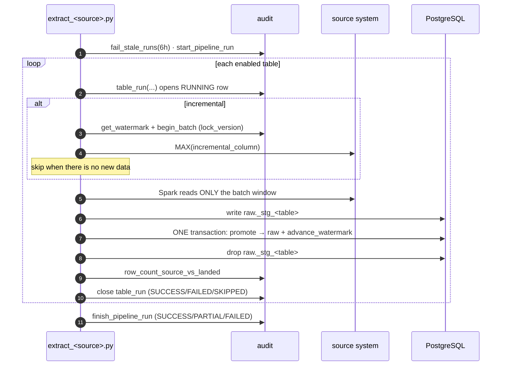

Key points:

- **Snapshot, read, promote, advance.** The window is `[last_watermark, MAX(source col)]`.
  Spark writes to a transient `raw._stg_<table>`, then one Postgres transaction promotes it
  to `raw.<table>` *and* advances the watermark. If anything fails before that commit, the
  target and watermark are untouched, so a retry simply re-extracts the same window.
- **Upper bound re-reads the boundary.** MySQL/Mongo use `>=` on the lower bound (dedupe
  happens in staging); Databricks uses strict `>` because `created_at` is often shared by a
  whole batch (`spark_io._dbx_where`).
- **Schemaless sources are tamed.** Mongo dates/ids arrive as strings; `cast_temporal`,
  `cast_integers`, and `prepare_for_jdbc` convert them (structs/maps → `jsonb`). MySQL
  columns get exact Postgres types from `information_schema`. Databricks results are
  streamed through Arrow to local Parquet (memory-flat, no JDBC driver).
- **Schema drift is absorbed.** `promote_staging` creates the target on first run and adds
  new source columns automatically (`ALTER TABLE ... ADD COLUMN`).

## 5. Layer model and ownership

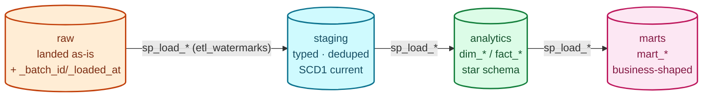

| Layer | Schema | Contents | Written by (owner) | Watermark |
|---|---|---|---|---|
| Landing | `raw` | source tables verbatim + `_batch_id`/`_loaded_at` (NOT NULL, `timestamptz`) | `extract_*.py` (Spark) | `audit.extract_watermarks` |
| Cleansing | `staging` | typed, deduped, SCD1 current state, `scd1_history` for overwrites | `staging.sp_load_*` procedures | `audit.etl_watermarks` |
| Modelling | `analytics` | `dim_*` dimensions + `fact_*` facts (star schema) | `analytics.sp_load_*` procedures | `audit.etl_watermarks` |
| Serving | `marts` | `mart_*` business tables (KPI, fraud, 360, portfolio…) | `marts.sp_load_*` procedures | `audit.etl_watermarks` |
| Consumption | Databricks | `marts.mart_*` Delta tables | `publish_marts.py` | read from the Delta target |

- **Analytics entities:** `dim_customer, dim_account, dim_branch, dim_employee, dim_card,
  dim_loan, dim_txn_profile`; `fact_card_transactions, fact_loan_payments,
  fact_transactions, fact_support_tickets`.
- **Marts:** `mart_customer_360, mart_branch_performance, mart_monthly_transactions,
  mart_loan_portfolio, mart_card_fraud, mart_support_performance, mart_kpi_monthly`.
- A schema is only ever written by its owner. Never hand-edit `raw`/`staging`/`analytics`/
  `marts`; go through the extractor or the `sp_load_*` procedures.
- `staging._stg_*` tables are transient: they exist only between the Spark write and the
  promote, and are excluded from DQ schema checks.

## 6. Watermarks and idempotency

Two **separate** watermark stores. They must never be conflated (`docs/AUDIT.md`).

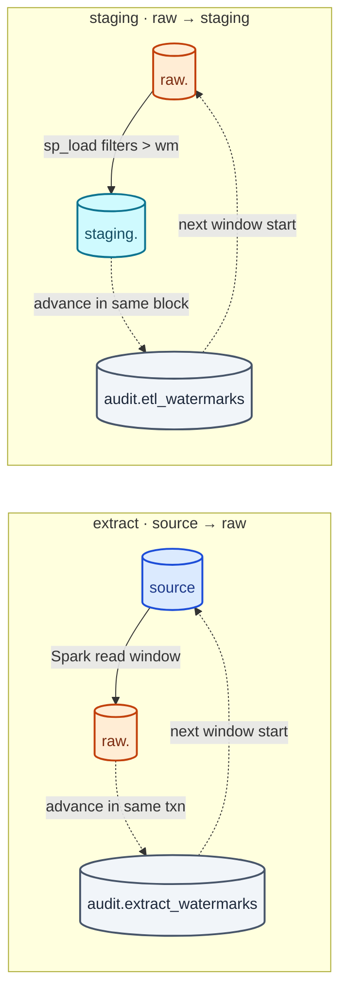

- `audit.extract_watermarks` — last **source** value landed into `raw`, advanced by
  `advance_watermark` inside the extract transaction; bootstrapped by
  `scripts/seed_watermarks.py`.
- `audit.etl_watermarks` — last **raw** value consumed into `staging`, advanced by each
  `staging.sp_load_*` (defaults to `_loaded_at`).
- Both use **optimistic locking** (`lock_version`): `begin_batch` snapshots it,
  `advance_watermark` updates `WHERE lock_version = expected` and raises a conflict
  (→ rollback) if a concurrent run won.
- Full loads (MySQL) have no watermark and `TRUNCATE` + `INSERT` atomically, so readers
  never see an empty table.

## 7. Audit model

Everything is recorded in the `audit` schema with plain `psycopg2`, in **its own**
transactions, so a FAILED record survives the data load's rollback.

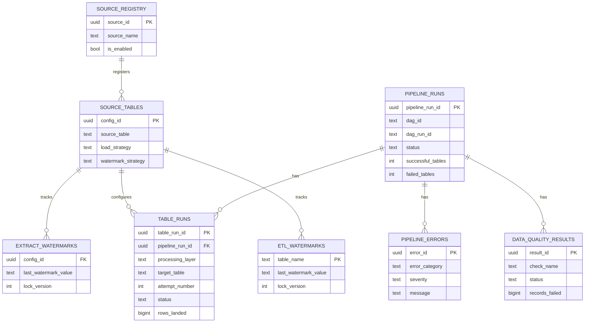

- **`audit.pipeline_runs`** — one row per execution. The three parallel per-source Airflow
  tasks share **one** row via `ON CONFLICT (dag_id, dag_run_id)`. `finish_pipeline_run`
  rolls up using only the **latest attempt per table**; `finalize_dag_run` first reaps
  orphaned `RUNNING` rows.
- **`audit.table_runs`** — one row per table **attempt** (`attempt_number` increments),
  with row counts, watermarks and `execution_metadata` jsonb. `fail_stale_runs(6h)` reaps
  crashed rows at job start.
- **`audit.pipeline_errors`** — classified (`CONNECTION` / `CONCURRENCY` / `SPARK` /
  `DATA` / `UNKNOWN`), secret-redacted, linked from `table_runs.error_id`.
- **`audit.source_registry` + `audit.source_tables`** — the config every extractor reads
  via `get_enabled_tables` (the runtime source of truth for the extract layer).
- DQ verdicts also land in `audit.dq_run` / `audit.dq_violation` (view `audit.v_dq_latest`).

### Pipeline run lifecycle

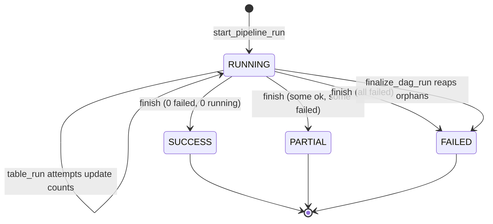

## 8. Data-quality gates

Each layer is gated by a SQL suite that runs **against the warehouse** before the next
layer may load. A critical failure blocks publish. This is *data* testing;
*code* testing lives in `docs/TESTING.md`.

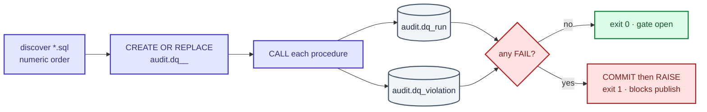

- Suites: `tests/data-quality/{raw,staging,analytics,marts}/` — 10 / 10 / 13 / 11 checks.
- Each file defines **one** procedure `audit.dq_<layer>_<check>()` that writes
  `audit.dq_run` + `audit.dq_violation`, updates the verdict, **`COMMIT`s, then `RAISE`s**
  on failure — the one intentional `COMMIT` inside SQL, so the reason survives the rollback.
- **Check catalogue:** `metadata_col, primary_keys, bad_dates, orphan_rows, business_rules,
  numeric_ranges, schema_contract, completeness, duplicate_rows, value_domains,
  date_key_integrity, derived_attributes, reconciliation`.
- The smoke suite (`tests/smoke/test_sql_contract.py`) enforces the per-file contract
  (master file present, unique numeric prefixes, `audit.dq_*` name, COMMIT-before-RAISE).

## 9. Publish to Databricks Delta (step 9)

```mermaid
flowchart LR
    PG[("PostgreSQL marts.mart_*")]
    WM["read Delta watermark<br/>SELECT max(wm) FROM target"]
    READ["Spark JDBC read<br/>windowed rows"]
    PQ["pyarrow Parquet<br/>local files"]
    VOL["upload to Unity Catalog volume<br/>Workspace SDK"]
    SQL["MERGE INTO … read_files<br/>or INSERT OVERWRITE"]
    DELTA[("Databricks marts.mart_*")]

    WM --> READ
    PG --> READ
    READ --> PQ --> VOL --> SQL --> DELTA
    DELTA -.->|watermark next run| WM

    classDef pg fill:#fce7f3,stroke:#be185d,color:#831843,stroke-width:2px
    classDef step fill:#e0e7ff,stroke:#4338ca,color:#312e81,stroke-width:2px
    classDef files fill:#fef9c3,stroke:#a16207,color:#713f12,stroke-width:2px
    classDef delta fill:#dcfce7,stroke:#15803d,color:#14532d,stroke-width:2px
    class PG pg
    class WM,READ,SQL step
    class PQ,VOL files
    class DELTA delta
```

- The watermark is read from the Delta target itself, so publishing self-increments. Date
  watermarks re-read the last N months (`--lookback` / `PUBLISH_LOOKBACK_MONTHS`); timestamp
  watermarks use strict `>`.
- `MART_CONFIG` in `publish_marts.py` defines each mart's key columns + watermark
  (date marts on `month_start`/`month_opened`, snapshot marts on `mart_refreshed_at`).
  Tables are MERGEd when keyed, `INSERT OVERWRITE` otherwise.
- pyarrow writes Parquet locally (no Hadoop), files are uploaded to a UC volume, and one
  `MERGE INTO … USING read_files(...)` runs straight from the files. Missing columns are
  added automatically.

## 10. Orchestration (Airflow)

Airflow 3.3.2 (CeleryExecutor) in Docker Compose. Two DAGs; the DAG holds no pipeline
logic, only task wiring.

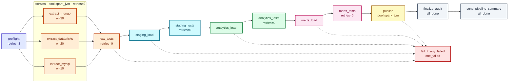

- `banking_delta_daily` — `0 2 * * *` Asia/Kolkata, `catchup=False`, `max_active_runs=1`,
  `max_active_tasks=4`, `dagrun_timeout=5h`, param `publish_full`; created **paused**.
- `banking_watchdog` — every 3 hours; reads `audit.pipeline_runs` directly and stays
  **silent when healthy**; mails `[MISSED]` / `[STUCK]` / `[WATCHDOG-ERROR]` otherwise.
- `preflight` fails in seconds if Java, disk, the warehouse, a source or Maven is missing.
- DQ-gate tasks use `retries=0` (a data problem does not fix itself); loads retry once.
- `finalize_audit` and `send_pipeline_summary` use `trigger_rule=all_done`;
  `fail_if_any_failed` (`one_failed`) makes the run red so Airflow state matches reality.

## 11. Configuration and secrets

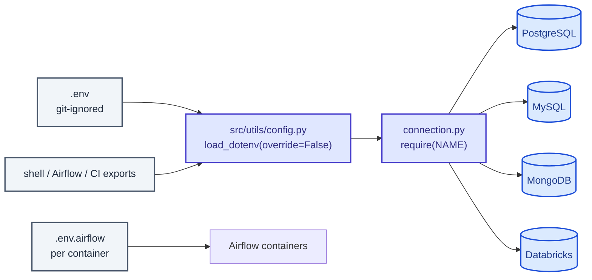

- `.env` is read in exactly one place — `src/utils/config.py`, with `override=False`, so
  shell / Airflow / CI exports always win. Credentials come only from the environment.
- Airflow containers use `airflow/.env.airflow`; Compose interpolation uses `airflow/.env`.
- Every `require()`d variable is listed in `.env.example`, enforced by
  `tests/smoke/test_env_contract.py`. Never commit `.env`, secrets or keys.

## 12. Testing and CI

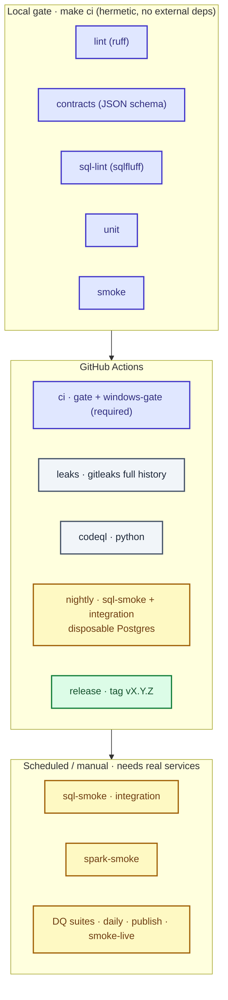

- **Markers** (`pyproject.toml`): `unit, smoke, spark, integration, live, spark_smoke`.
  Unmarked tests are silently never run.
- **Tiers.** `unit`/`smoke` are hermetic (conftest blocks sockets). `sql-smoke`,
  `integration`, `spark-smoke` and `smoke-live` need real services and are **out of the
  PR gate**.
- **Windows parity.** `tasks.bat` mirrors every Makefile target; `test_make_parity.py`
  fails if a target is missing or `ci` picks up a non-hermetic target.
- **Coverage.** `make cov` enforces `fail_under` in `pyproject.toml`. Never lower it to
  pass. `sql-lint` is currently red on pre-existing `sql/` violations (separate fix branch).
- Full detail: `docs/TESTING.md`, `docs/GITWORKFLOWS.md`.

## 13. Deployment topology

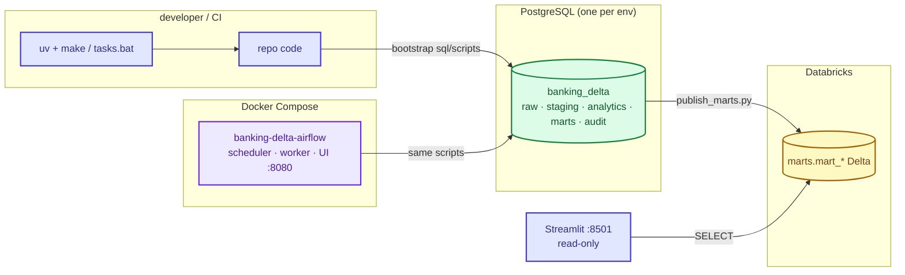

Four independently deployable pieces — the local toolchain, the PostgreSQL warehouse,
the Airflow stack and the Streamlit dashboard. Databricks is consumed, not deployed.
Detail: `docs/DEPLOYMENT.md`, `docs/AIRFLOW.md`, `docs/RUNBOOK.md`,
`docs/TROUBLESHOOTING.md`.

## 14. Cross-cutting contracts (do not break)

```mermaid
flowchart TB
    R1["Watermarks advance only inside the load/extract transaction"]
    R2["Every load is safe to run twice with the same input"]
    R3["A critical DQ failure blocks publish"]
    R4["Layers written only by their owners"]
    R5["Money is NUMERIC(18,2) · instants are timestamptz UTC"]
    R6["Audit survives failure (own txns · COMMIT before RAISE)"]
    R7["The two watermark stores are never mixed"]
    R8["Never weaken a test, hook or check to reach green"]

    classDef rule fill:#fee2e2,stroke:#b91c1c,color:#7f1d1d,stroke-width:2px
    class R1,R2,R3,R4,R5,R6,R7,R8 rule
```

1. Watermarks advance only inside the load/extract transaction; `extract_watermarks`
   (source→raw) and `etl_watermarks` (raw→staging) are never mixed.
2. Every load is safe to run twice with the same input.
3. A critical DQ failure blocks publish.
4. `raw`, `staging`, `analytics`, `marts` are written only by their owners.
5. Money is `NUMERIC(18,2)`; all instants are timezone-aware UTC.
6. Audit rows survive failure; the DQ gate commits before it raises.
7. Never weaken, skip or delete a test, hook or CI check to get green — fix the code
   or ask.

## 15. Where to go next

- R analysis layer: see `docs/R.md` and `r/` (read-only consumer; runs `main.R`).

| Question | Document |
|---|---|
| How does the daily pipeline work, end to end? | `docs/PIPELINE.md` |
| What is a source → raw data contract? | `docs/CONTRACTS.md` |
| How do the DQ gates work? | `docs/DATA-QUALITY.md` |
| What is in the audit schema? | `docs/AUDIT.md` |
| How does Airflow orchestrate it? | `docs/AIRFLOW.md` |
| How do I run, test and gate code? | `docs/TESTING.md` |
| What are the CI/CD workflows? | `docs/GITWORKFLOWS.md` |
| How do branches, commits and hooks work? | `docs/GITWORKFLOWS.md` |
| How is each piece deployed? | `docs/DEPLOYMENT.md` |
| The pipeline is failing right now | `docs/RUNBOOK.md` · `docs/TROUBLESHOOTING.md` |
| Rules for working in this repo | `AGENTS.md` |

## 16. Airflow Orchestration & Reports — Fix History (Oct 2026)

This section documents the critical fixes applied to make Airflow orchestration and the report subsystem fully operational. These were **not** design changes — they fixed bugs that prevented the pipeline from completing end-to-end.

### 16.1 Problem Summary

| Issue | Symptom | Root Cause |
|---|---|---|
| Report generation failure | `build_report` task `up_for_retry`, no PDF produced | `commands.py:report_command()` returned `python -m reports.scripts.build...` but `banking_cmd()` already prepends the interpreter → `exec "/opt/venv/bin/python" python -m ...` fails |
| False FAILED emails | `[FAILED]` subject on fully successful runs | `summary.py:decide_status()` used `task_states.get(t, "")` — missing keys returned `""` which is in `PENDING_STATES` |
| Missing email attachments | Emails sent but no PDF/LaTeX attached | 1) `summary.py` run_key sanitization ≠ `paths.py` run_key (per-char vs regex) 2) `send_pipeline_summary` runs in **scheduler** container but reports written to **worker**'s `report_output` volume 3) `notify.py` hardcoded `subtype="pdf"` for all attachments |

### 16.2 Files Modified

#### `airflow/include/banking_airflow/commands.py` (lines 63–68)
```python
# BEFORE (broken)
def report_command(kind: str = "daily") -> str:
    return f"python -m reports.scripts.build --kind {kind} ..."


# AFTER (fixed)
def report_command(kind: str = "daily") -> str:
    return f"-m reports.scripts.build --kind {kind} ..."
```
`banking_cmd()` wraps the command with `exec "{BANKING_PYTHON}" {args}` — the module flag `-m` is the correct argument.

#### `airflow/include/banking_airflow/summary.py` (lines 117–131)
```python
# BEFORE (false FAILED)
for task_id in CORE_STEPS:
    if task_states.get(task_id, "") in PENDING_STATES:
        return "FAILED"

# AFTER (correct)
for task_id in CORE_STEPS:
    state = task_states.get(task_id)
    if state in PENDING_STATES:
        return "FAILED"
```
Only tasks with an actual state are checked; missing/unset states no longer trigger failure.

#### `airflow/include/banking_airflow/summary.py` (lines 311–345)
```python
# BEFORE (mismatched run_key, no .tex)
run_key = "".join(c if c.isalnum() or c == "_" else "_" for c in run_id)
daily_path = output_root / "runs" / run_key / "report.pdf"

# AFTER (matches paths.run_key, includes .tex)
_UNSAFE = re.compile(r"[^A-Za-z0-9_]+")
run_key = _UNSAFE.sub("_", run_id or "").strip("_")
# ... finds both report.pdf and incident.pdf
for tex_file in (output_root / "runs" / run_key).glob("*.tex"):
    attachments.append(tex_file)
```
Uses the same regex as `paths.run_key()` (collapses sequences, strips). Also attaches all LaTeX source files.

#### `airflow/docker-compose.yml` (services: scheduler, apiserver)
```yaml
# ADDED volume mount so scheduler can read report files
airflow-scheduler:
    <<: *airflow-common
    command: scheduler
    volumes:
      - report_output:/opt/banking/reports/output
    ...

airflow-apiserver:
    <<: *airflow-common
    command: api-server
    ports: ["127.0.0.1:8080:8080"]
    volumes:
      - report_output:/opt/banking/reports/output
    ...
```
The `send_pipeline_summary` task runs in the **scheduler** container (it's a `@task` decorator, not a `BashOperator` on the worker). Without this mount, the scheduler couldn't see `/opt/banking/reports/output/runs/...` written by the worker.

#### `airflow/include/banking_airflow/notify.py` (lines 77–96)
```python
# BEFORE (hardcoded PDF subtype)
msg.add_attachment(data, maintype="application", subtype="pdf", filename=path.name)

# AFTER (MIME type by extension)
if path.suffix.lower() == ".tex":
    maintype, subtype = "application", "x-tex"
elif path.suffix.lower() == ".pdf":
    maintype, subtype = "application", "pdf"
else:
    maintype, subtype = "application", "octet-stream"
msg.add_attachment(data, maintype=maintype, subtype=subtype, filename=path.name)
```
LaTeX source files (`.tex`) now attach with correct MIME type `application/x-tex`.

#### `reports/scripts/build.py` (lines 279–319, `_build_kind`)
```python
# ADDED: copy .tex files to run directory for email attachment
run_dir = paths.run_dir(run_key, out_root)
run_dir.mkdir(parents=True, exist_ok=True)
for tex_file in paths.BUILD_DIR.glob("*.tex"):
    shutil.copy(tex_file, run_dir / tex_file.name)
```
After rendering (both normal and degraded builds), all `.tex` files are copied from the ephemeral `build/` directory to the persistent run directory so `_find_report_attachments()` can find them.

### 16.3 Verification Checklist

All fixes verified by running the pipeline end-to-end:

- [x] `build_report` task completes `SUCCESS` (not `up_for_retry`)
- [x] `send_pipeline_summary` task completes `SUCCESS`
- [x] Email subject shows `[SUCCESS]` when all tasks pass
- [x] Email subject shows `[FAILED]` only when a task actually fails
- [x] Email includes `report.pdf` attachment
- [x] Email includes all `.tex` chapter attachments (01_summary.tex … 09_appendix.tex, meta.tex, manifest.tex)
- [x] Scheduled run (02:00 IST) completes without manual intervention
- [x] Watchdog DAG stays silent when pipeline healthy
- [x] Report retention pruning works (30 days via `REPORT_RETENTION_DAYS`)

### 16.4 Runbook for Future Debugging

| Symptom | Check |
|---|---|
| `build_report` fails | `docker logs <worker>` → look for `reports.scripts.build` output; verify `commands.py` uses `-m` not `python` |
| Email says FAILED but tasks green | `summary.py:decide_status()` — ensure `task_states.get(t)` not `get(t, "")` |
| No attachments in email | 1) `docker exec scheduler ls /opt/banking/reports/output/runs/` — volume mounted? 2) `notify.py` MIME type logic 3) `build.py` copies `.tex` files? |
| Run key mismatch | `paths.run_key()` vs `summary.py` — both must use `_UNSAFE.sub("_", ...)` |

(End of file - total 798 lines)