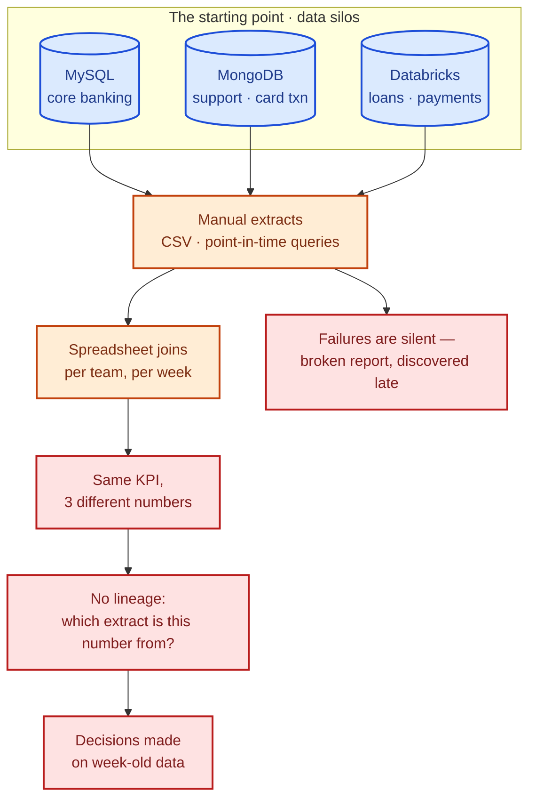
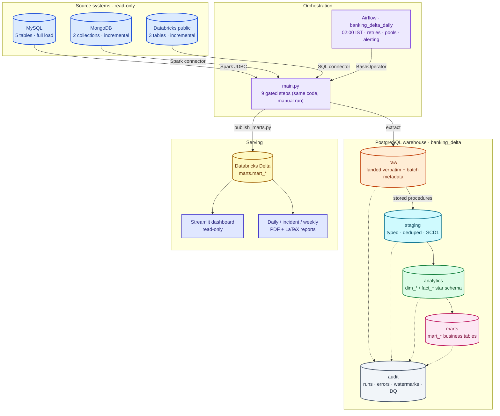
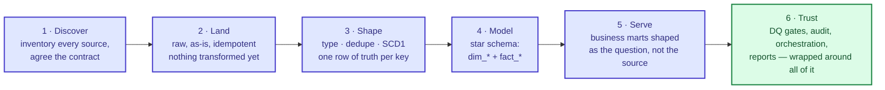
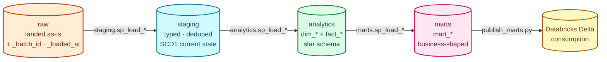
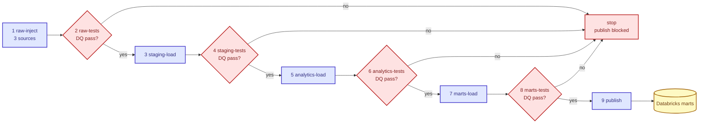
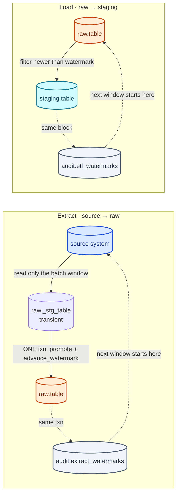
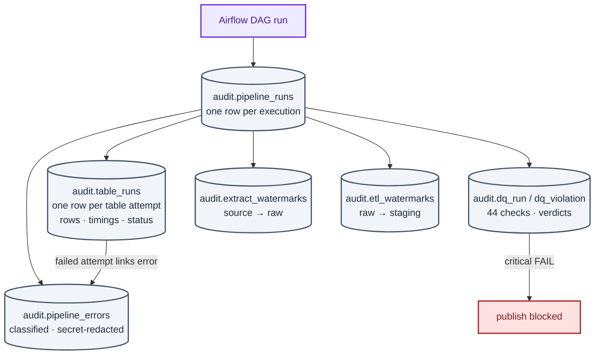
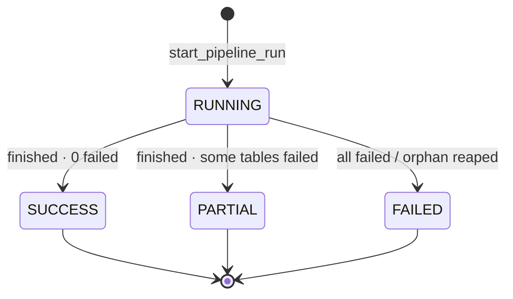
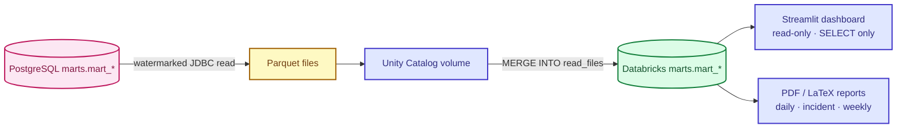

# The Problem We Solved — Banking-Delta-Lakehouse

> **Business problem in one line:** a bank's data lived in three disconnected systems,
> nobody agreed on a number, and decisions waited on manual reports — so we built one
> daily, audited pipeline that turns those systems into a single source of truth.

This document tells the story a business reader cares about: what was broken, what it
cost, how we approached it, and how the final design works. The engineering blueprint
lives in [ARCHITECTURE.md](ARCHITECTURE.md); this file explains *why* it looks that way.

**Colour legend** (used in every diagram here, same as `ARCHITECTURE.md`): blue =
source systems, violet = orchestration, orange = `raw`, cyan = `staging`, green =
analytics / success, pink = `marts`, yellow = Databricks Delta, slate = audit /
cross-cutting, red = pain points and DQ gates, indigo = read-only consumers.

---

## 1. The business problem

The bank ran its operations on several systems that were never designed to talk to
each other:

| System | What it holds | Shape |
|---|---|---|
| MySQL `banking_core_db` | customers, accounts, branches, employees, cards | OLTP, full-state tables |
| MongoDB `banking_support_db` | support tickets, card transactions | schemaless documents, append-only |
| Databricks `public` | loans, loan_payments, transactions | analytical, timestamped |

Operations, risk, and leadership each needed the *same* answers — a customer's full
relationship, a branch's performance, whether fraud was rising — but the answers had
to be assembled by hand from three engines with three different query languages,
three different consistency models, and no shared history.

### What this actually cost

| Symptom | Business consequence |
|---|---|
| Three systems, three truths | Leadership meetings started with *"whose number is right?"* instead of decisions |
| Reports assembled by hand | Answering a new question cost days of analyst time, so most questions were never asked |
| Point-in-time extracts | Numbers changed depending on *when* you ran the query — no reproducible history |
| No data-quality checks | A null customer id or a negative balance reached a report before anyone noticed |
| No audit trail | After a bad report there was no way to say which run, which source, which rows |
| Failures were silent | A broken overnight job surfaced as a stale dashboard, hours later |

---

## 2. The goal

One pipeline, run every night, that answers the bank's standing questions the same way
every time — and can prove where every number came from:

- **Who is this customer?** every product, account, card and ticket in one row.
- **How is each branch performing?** balances, transactions, growth, staff load.
- **Is fraud increasing?** card fraud signals surfaced daily, not monthly.
- **What is the state of the loan book?** outstanding principal, delinquency, payments.
- **Are customers being served well?** ticket volume, resolution, agent performance.
- **What are the monthly KPIs?** one governed set of numbers for leadership.

---

## 3. The solution at a glance

A **daily lakehouse pipeline**: land the three sources *as-is* into PostgreSQL, shape
them through four controlled layers, gate every step with data-quality checks, then
publish the finished business tables to Databricks Delta for the dashboard and
reports. Airflow schedules it at 02:00; `main.py` runs exactly the same steps by hand.

---

## 4. How we approached it

We did not start by building dashboards. We started by making the *data* trustworthy,
then earned the right to serve it.

1. **Discover before you move.** Every source table got a JSON contract
   (`contracts/`): columns, types, business key, load strategy, incremental column.
   The contract is validated in CI, so a silent upstream schema change breaks the
   build instead of the report.
2. **Land first, transform later.** `raw` copies the source verbatim plus
   `_batch_id` / `_loaded_at`. Whatever happened downstream, we can always replay or
   re-derive from the original rows.
3. **Shape once, in SQL.** Stored procedures in `staging` type, dedupe and keep the
   current state (SCD1) — so every downstream consumer sees the same cleaned data.
4. **Model for questions, not for tables.** `analytics` holds a star schema
   (dimensions + facts); `marts` holds exactly the shape each business question asks
   for.
5. **Gate everything.** Data-quality suites run between layers and a critical failure
   blocks publish — bad data stops at the layer where it was found.
6. **Wrap with observability.** Audit tables record every run, every error, every
   watermark and every DQ verdict; Airflow retries, alerts and a watchdog DAG make
   failures loud instead of silent.

---

## 5. The design

### 5.1 Four layers, one owner each

The medallion shape, with strict ownership: only one writer may touch a schema, so
two jobs can never fight over the same table.

| Layer | Answers | Written by |
|---|---|---|
| `raw` | *What did the source actually give us?* | the extractors (PySpark) |
| `staging` | *What is the clean, current state of each entity?* | `staging.sp_load_*` |
| `analytics` | *How do the entities relate?* (star schema) | `analytics.sp_load_*` |
| `marts` | *What does the business question look like?* | `marts.sp_load_*` |
| Databricks Delta | *Where do consumers read from?* | `publish_marts.py` |

### 5.2 A run is a chain of gates

Nine steps in order; a failing data-quality check stops the run before the next layer
loads, so nothing downstream ever reads a half-loaded table.

- **44 SQL data-quality checks** across the four suites (metadata, primary keys, bad
  dates, orphan rows, business rules, duplicates, completeness, reconciliation…),
  each writing its verdict to `audit.dq_run` / `audit.dq_violation`.
- The gate **commits its verdict, then raises** — so the reason for a failure survives
  the rollback and is still queryable afterwards.
- A critical failure **blocks publish**: bad data never reaches the dashboard.

### 5.3 Safe to run twice: watermarks, not trust

The most expensive class of pipeline bug is *duplicated or lost rows after a crash*.
The design removes it structurally: the data and its watermark move in **one
transaction**, with optimistic locking so two concurrent runs cannot both win.

**Properties this buys the business:**

- **Idempotent** — re-running yesterday's job adds no duplicates (incremental layers
  dedupe on the business key; full loads `TRUNCATE` + `INSERT` atomically).
- **Crash-safe** — a failure before commit leaves both the table and the watermark
  untouched; the retry simply re-reads the same window.
- **Incremental** — only the new slice of each source is read, so the daily run stays
  minutes, not hours.
- **Two separate watermark stores** (source→raw, raw→staging) that are never mixed.

### 5.4 Everything is recorded

Audit rows are written in their **own** transactions, so a `FAILED` record survives
the data load's rollback — the history of a bad night is never lost with it.

Run lifecycle — always know whether the night was green:

### 5.5 Orchestration without logic

Airflow adds schedule, retries, pools and alerting — and *nothing else*. The DAG
contains no pipeline logic; it calls the same scripts `main.py` calls, so a manual run
and a scheduled run can never diverge.

```mermaid
flowchart LR
    PRE["preflight<br/>fails fast if env is broken"]
    subgraph EXT["extracts · pool spark_jvm"]
        EM["extract_mongo"]
        ED["extract_databricks"]
        EX["extract_mysql"]
    end
    RT["raw_tests"] --> SL["staging_load"] --> ST["staging_tests"]
    ST --> AL["analytics_load"] --> AT["analytics_tests"]
    AT --> ML["marts_load"] --> MT["marts_tests"]
    MT --> PB["publish"] --> FIN["finalize_audit"]
    FIN --> SUM["send_pipeline_summary<br/>email + PDF report"]
    GATE["fail_if_any_failed<br/>run turns red"]

    PRE --> EM & ED & EX
    EM & ED & EX --> RT
    RT -.-> GATE
    PB -.-> GATE

    classDef pre fill:#e0e7ff,stroke:#4338ca,color:#312e81,stroke-width:2px
    classDef raw fill:#ffedd5,stroke:#c2410c,color:#7c2d12,stroke-width:2px
    classDef staging fill:#cffafe,stroke:#0e7490,color:#164e63,stroke-width:2px
    classDef analytics fill:#dcfce7,stroke:#15803d,color:#14532d,stroke-width:2px
    classDef marts fill:#fce7f3,stroke:#be185d,color:#831843,stroke-width:2px
    classDef delta fill:#fef9c3,stroke:#a16207,color:#713f12,stroke-width:2px
    classDef audit fill:#f1f5f9,stroke:#475569,color:#1e293b,stroke-width:2px
    classDef gate fill:#fee2e2,stroke:#b91c1c,color:#7f1d1d,stroke-width:2px
    class PRE pre
    class EM,ED,EX,RT raw
    class SL,ST staging
    class AL,AT analytics
    class ML,MT marts
    class PB delta
    class FIN,SUM audit
    class GATE gate
```

- DQ-gate tasks use `retries=0` — a data problem does not fix itself by retrying.
- A `banking_watchdog` DAG checks the audit tables every 3 hours and stays **silent
  when healthy**, mailing only `[MISSED]` / `[STUCK]` otherwise.
- A daily incident/weekly report summarises the run, with KPI cards and the exact
  checks that passed or failed.

### 5.6 Serving the business

Publishing reads its own watermark from the Delta target, so it self-increments; the
dashboard is strictly read-only, and reports ship as PDF plus the LaTeX source.

---

## 6. What the business gets

| Mart | The question it answers |
|---|---|
| `mart_customer_360` | Who is this customer across every product? |
| `mart_branch_performance` | How is each branch performing, and vs its peers? |
| `mart_monthly_transactions` | What is the transaction volume and value trend? |
| `mart_loan_portfolio` | What is the state of the loan book? |
| `mart_card_fraud` | Is card fraud increasing, and where? |
| `mart_support_performance` | Are tickets being resolved fast and well? |
| `mart_kpi_monthly` | The single set of monthly KPI numbers for leadership |

**Before → after:**

| | Before | After |
|---|---|---|
| Source of truth | three systems, per-team extracts | one warehouse, one governed mart layer |
| Time to a new answer | days of manual joining | a query against a ready-made mart |
| Numbers reproducible? | no — depends when you ran it | yes — watermarks, batch ids, audit history |
| Data quality | discovered after publication | 44 checks gate every layer, publish blocked on critical failure |
| Failure visibility | stale dashboard, discovered late | Airflow turns red, watchdog mails, report explains |
| Trust | *"whose number is right?"* | *"here is the run, the rows and the checks behind this number"* |

---

## 7. Design decisions and why

| Decision | Why | Alternative rejected |
|---|---|---|
| Land verbatim into `raw` first | replayable, auditable, source changes never corrupt history | transform straight from source — no rollback path |
| PostgreSQL for the transform layers | stored procedures give set-based transforms inside one transaction with row locking and advisory locks | doing transforms in Spark — distributed, harder to make transactional |
| One writer per schema | structural guarantee against concurrent-writer corruption | allow any job to write any layer |
| Watermark advances in the same txn as the data | crash can neither lose nor double-count rows | separate watermark update — the classic split-brain bug |
| Two watermark stores (extract vs ETL) | they answer different questions and must never be conflated | one shared table — silently mixes source and warehouse positions |
| DQ gates between layers, commit-then-raise | verdict survives rollback; publish blocked on critical failure | validate after publish — the report is already wrong |
| `main.py` and Airflow share the same code path | manual debugging reproduces the scheduled run exactly | separate Airflow-only logic — drifts within weeks |
| Money as `NUMERIC(18,2)` / `Decimal`, times as UTC `timestamptz` | float rounding is unacceptable on a balance; UTC removes server-locality bugs | `float` — off by cents, and off by hours |
| Contracts validated in CI | an upstream schema change breaks the build, not a report | discover at runtime — failure lands on the analyst |
| Retry on loads, never on DQ gates | transient infra fixes itself; a data defect does not | retry everything — hides real data problems |

---

## 8. Guardrails that make it hold

Non-negotiable rules encoded in code, hooks and CI — not in a wiki:

1. Watermarks advance only inside the load/extract transaction.
2. Every load is safe to run twice with the same input.
3. A critical DQ failure blocks publish.
4. `raw`, `staging`, `analytics`, `marts` are written only by their owners.
5. Money is `NUMERIC(18,2)`; all instants are timezone-aware UTC.
6. Audit rows survive failure (own transactions; the DQ gate commits before it raises).
7. Never weaken a test, hook or CI check to get green.

---

## 9. Where to go next

| Question | Document |
|---|---|
| The blueprint, layer by layer | [ARCHITECTURE.md](ARCHITECTURE.md) |
| The daily run end to end | [docs/PIPELINE.md](docs/PIPELINE.md) |
| Source → raw contracts | [docs/CONTRACTS.md](docs/CONTRACTS.md) |
| How the DQ gates work | [docs/DATA-QUALITY.md](docs/DATA-QUALITY.md) |
| Audit, watermarks, lineage | [docs/AUDIT.md](docs/AUDIT.md) |
| Orchestration and alerts | [docs/AIRFLOW.md](docs/AIRFLOW.md) |
| Reports and the dashboard | [docs/REPORTING.md](docs/REPORTING.md) |
| Operating it day to day | [docs/RUNBOOK.md](docs/RUNBOOK.md) |
