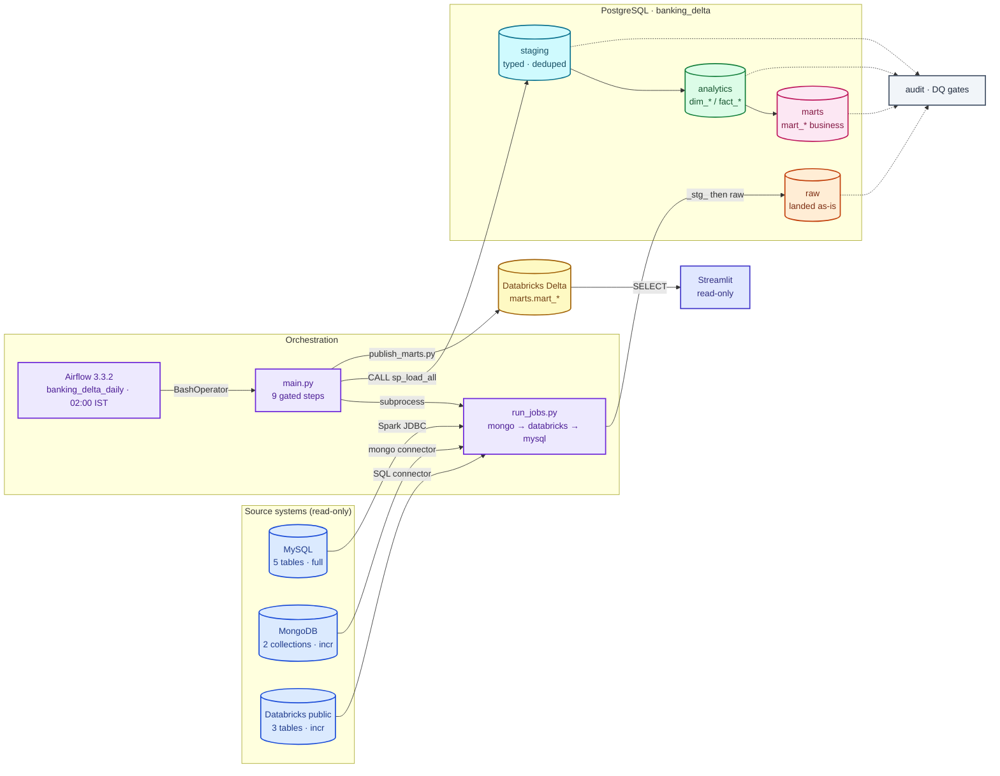

<p align="center">
  
</p>

# Banking-Delta

Daily lakehouse pipeline: MySQL, MongoDB and Databricks `public` → PySpark →
PostgreSQL (`landing → staging → core → mart`) → Databricks `core`/`mart`.
Airflow orchestrates, stored procedures transform, Great Expectations validates.

## Pipeline at a glance



Colour legend (same as `ARCHITECTURE.md`): blue = sources, violet = orchestration,
orange = `raw`, cyan = `staging`, green = `analytics`, pink = `marts`,
yellow = Databricks Delta, slate = audit / DQ, indigo = read-only consumers.

## Quick start

```bash
make install     # runtime + dev dependencies (uv)
make hooks       # enable the repo git hooks
make ci          # local gate: lint + contracts + sql-lint + coverage + smoke
make daily       # run the whole pipeline
```

On Windows use `tasks.bat <target>` instead of `make <target>`; the two are
kept in sync by `tests/smoke/test_make_parity.py`.

## Documentation

| Doc | What it covers |
| --- | --- |
| [ARCHITECTURE.md](ARCHITECTURE.md) | The blueprint: layers, flow, gates and contracts. |
| [docs/PIPELINE.md](docs/PIPELINE.md) | The daily pipeline end to end. |
| [docs/CONTRACTS.md](docs/CONTRACTS.md) | Data contracts: source → `raw` landing. |
| [docs/DATA-QUALITY.md](docs/DATA-QUALITY.md) | DQ contract per layer and how it gates publish. |
| [docs/AUDIT.md](docs/AUDIT.md) | Audit tables, watermarks and run lineage. |
| [docs/AIRFLOW.md](docs/AIRFLOW.md) | DAGs, schedule and task gating. |
| [docs/TESTING.md](docs/TESTING.md) | Test markers, layouts and how to run them. |
| [docs/CI-CD.md](docs/CI-CD.md) | Workflows, required checks and release flow. |
| [docs/GITWORKFLOWS.md](docs/GITWORKFLOWS.md) | Branching, commits and hooks. |
| [docs/DEPLOYMENT.md](docs/DEPLOYMENT.md) | Environments and rollout. |
| [docs/RUNBOOK.md](docs/RUNBOOK.md) | Operating the pipeline day to day. |
| [docs/TROUBLESHOOTING.md](docs/TROUBLESHOOTING.md) | Common failures and fixes. |

Contributing and security policies live in [CONTRIBUTING.md](CONTRIBUTING.md)
and [SECURITY.md](SECURITY.md).
