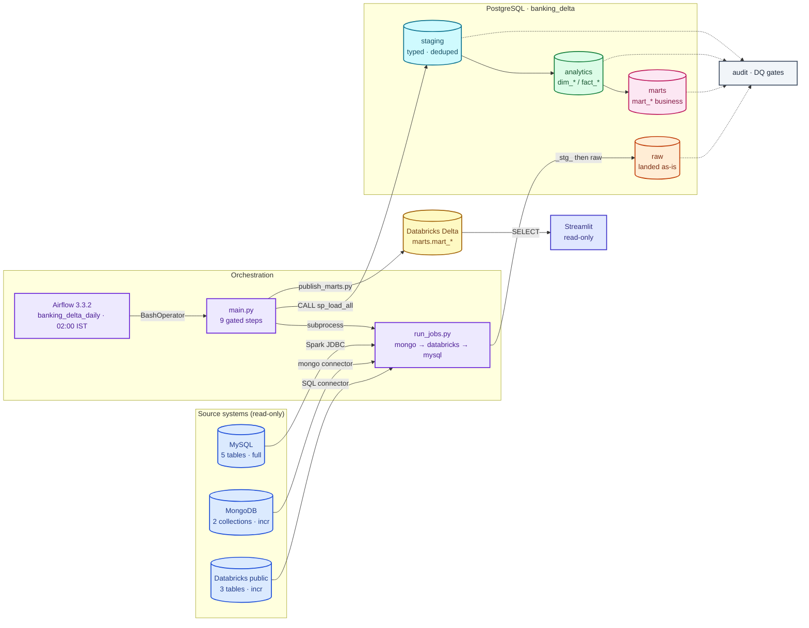
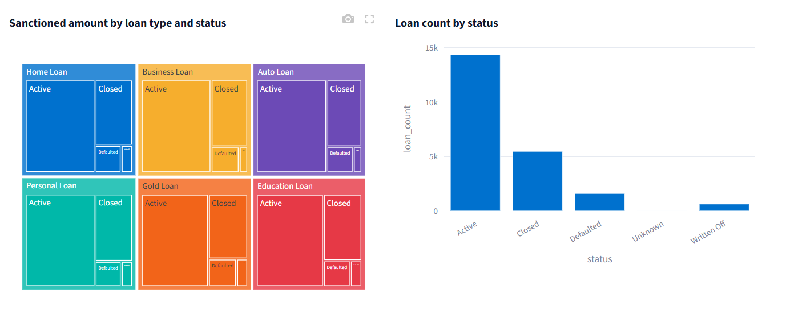

<p align="center">
  
</p>

<h1 align="center">Banking Delta Lakehouse</h1>

<p align="center">
  Banking-Delta-Lakehouse is a daily banking lakehouse pipeline that ingests data from MySQL, MongoDB, and Databricks using PySpark, transforms it in PostgreSQL through four layers (raw → staging → analytics → marts), and publishes curated Delta tables to Databricks. Apache Airflow        orchestrates the pipeline, PostgreSQL stored procedures handle transformations, and automated data-quality gates, audit logging, and a read-only Streamlit dashboard support reliable data delivery.
</p>

## Tech stack

<p align="center">
  
  
  
  
  
  
  
  
  
  
  
  
  
  
  
</p>

## Pipeline at a glance



Colour legend (same as `ARCHITECTURE.md`): blue = sources, violet = orchestration,
orange = `raw`, cyan = `staging`, green = `analytics`, pink = `marts`,
yellow = Databricks Delta, slate = audit / DQ, indigo = read-only consumers.

## Live Dashboard

<p align="center">
  <a href="https://walmartdbt-b3fdfqwyky3ghzr5syyxtu.streamlit.app/"><b>Live Demo</b></a> &mdash; interactive dashboard on the <code>marts</code> schema &middot; <a href="dashboard/README.md">docs</a>
</p>

<p align="center">
  <a href="https://walmartdbt-b3fdfqwyky3ghzr5syyxtu.streamlit.app/">
    
  </a>
</p>

</p>

<p align="center">
  <sub><code>Python</code> · <code>PySpark</code> · <code>R</code> · <code>PostgreSQL</code> · <code>MongoDB</code> · <code>Apache Airflow</code> · <code>Docker</code> · <code>MySQL</code> · <code>Databricks</code> · <code>Streamlit</code> · <code>Plotly</code> · <code>uv</code> · <code>Ruff</code> · <code>Latex</code></sub>
</p>

## Quick start

For a step-by-step guide see [docs/QUICKSTART.md](docs/QUICKSTART.md).

```bash
make install     # runtime + dev dependencies (uv)
make hooks       # enable the repo git hooks
make ci          # local gate: lint + contracts + sql-lint + coverage + smoke
make daily       # run the whole pipeline
```

## Common commands

```bash
# Full gated pipeline (writes to warehouse + Databricks)
make daily                      # or: python main.py
make run-jobs                   # extracts only: mongo -> databricks -> mysql

# Data quality gates
make dq                         # raw -> staging -> analytics -> marts
make dq-raw                     # single layer

# One layer at a time
make staging && make dq-staging
make analytics && make dq-analytics
make marts && make dq-marts
make publish                    # publish marts to Databricks Delta

# Tests
make ci                         # lint + contracts + sql-lint + coverage + smoke
make test                       # unit + smoke
make unit / make smoke

# Airflow stack
make up                         # docker compose up -d
make down

# Dashboard (Streamlit, read-only against Databricks marts)
cd dashboard && streamlit run app.py

# Reports
make report-fixture             # render all fixtures, no TeX, no DB
make report                     # daily PDF against the warehouse in .env
```
On Windows use `tasks.bat <target>` instead of `make <target>`; the two are
kept in sync by `tests/smoke/test_make_parity.py`.

## Documentation

| Doc | What it covers |
| --- | --- |
| [docs/QUICKSTART.md](docs/QUICKSTART.md) | Step-by-step guide to running the project locally. |
| [ARCHITECTURE.md](ARCHITECTURE.md) | The blueprint: layers, flow, gates and contracts. |
| [docs/PIPELINE.md](docs/PIPELINE.md) | The daily pipeline end to end. |
| [docs/CONTRACTS.md](docs/CONTRACTS.md) | Data contracts: source → `raw` landing. |
| [docs/DATA-QUALITY.md](docs/DATA-QUALITY.md) | DQ contract per layer and how it gates publish. |
| [docs/AUDIT.md](docs/AUDIT.md) | Audit tables, watermarks and run lineage. |
| [docs/AIRFLOW.md](docs/AIRFLOW.md) | DAGs, schedule and task gating. |
| [docs/TESTING.md](docs/TESTING.md) | Test markers, layouts and how to run them. |
| [docs/CI-CD.md](docs/CI-CD.md) | Workflows, required checks and release flow. |
| [docs/GITWORKFLOWS.md](docs/GITWORKFLOWS.md) | Branching, commits and hooks. |
| [docs/DEPLOYMENT.md](docs/DEPLOYMENT.md) | Environments and rollout. |
| [docs/RUNBOOK.md](docs/RUNBOOK.md) | Operating the pipeline day to day. |
| [docs/TROUBLESHOOTING.md](docs/TROUBLESHOOTING.md) | Common failures and fixes. |

Contributing and security policies live in [CONTRIBUTING.md](CONTRIBUTING.md)
and [SECURITY.md](SECURITY.md).

---

<p align="center">
  <strong>Built with ❤️ for the data community</strong> · MIT License ·
  <a href="https://github.com/Nitinx12/Banking-Delta-Lakehouse/issues">Report a bug</a> ·
  <a href="https://github.com/Nitinx12/Banking-Delta-Lakehouse">⭐ Star on GitHub</a>
</p>

<p align="center">
  <a href="#">💬 Discord chat</a> ·
  <a href="#">💼 LinkedIn</a> ·
  <a href="#">🐦 Twitter</a>
</p>
