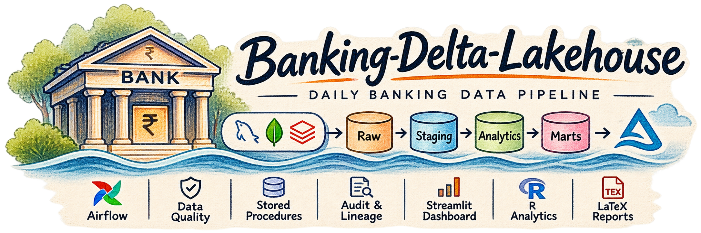
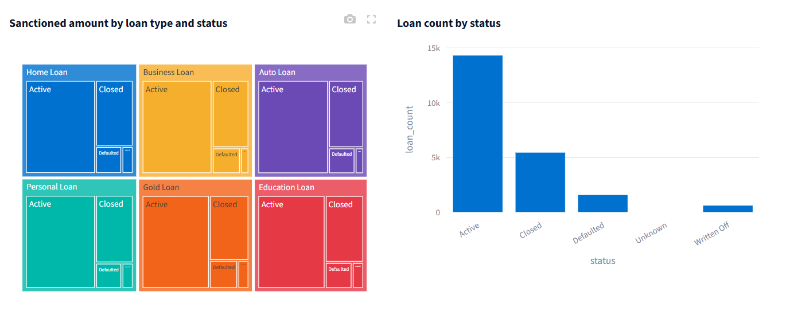

<p align="center">
  
</p>

<h1 align="center">Banking Delta Lakehouse</h1>

<!-- <p align="center"> -->
  Banking Delta Lakehouse is a daily PySpark pipeline that lands MySQL, MongoDB and Databricks `public` data into PostgreSQL `raw → staging → analytics → marts`, then publishes the marts to Databricks Delta. Airflow schedules the run; SQL DQ gates block bad data and audit tables record every step. Results surface in a read-only Streamlit dashboard and daily, weekly and incident LaTeX PDFs emailed by Airflow.
</p>

## Tech stack

| Layer | Tools |
|---|---|
| **Sources** |    |
| **Ingestion** |          |
| **Warehouse** |   |
| **Transformation** |    |
| **Data quality & audit** |    |
| **Serving copy** |    |
| **Orchestration** |    |
| **Presentation** |    |
| **Infra & dev tooling** |        |
| **CI, delivery & quality** |     |

## Pipeline at a glance

## Pipeline at a glance



```mermaid
flowchart TB
    %% ───────── SOURCES ─────────
    subgraph SRC["📥 SOURCE SYSTEMS · read-only"]
        direction LR
        MYSQL[("MySQL<br/>5 tables · full load")]
        MONGO[("MongoDB<br/>2 collections · incremental")]
        DBXPUB[("Databricks public<br/>3 tables · incremental")]
    end

    %% ───────── ORCHESTRATION ─────────
    subgraph ORCH["⚙️ ORCHESTRATION"]
        direction TB
        AF["Airflow 3.3.2<br/>banking_delta_daily · 02:00 IST"]
        MAIN["main.py<br/>10 gated steps"]
        RJ["run_jobs.py<br/>mongo → databricks → mysql"]
        AF -->|BashOperator| MAIN
        MAIN -->|subprocess| RJ
    end

    %% ───────── MEDALLION ─────────
    subgraph PG["🐘 PostgreSQL · banking_delta"]
        direction TB

        subgraph BRONZE["🥉 BRONZE · schema raw"]
            RAW[("raw.*<br/>landed as-is")]
        end

        subgraph SILVER["🥈 SILVER · schema staging"]
            STG[("staging.*<br/>typed · deduped · cleansed")]
        end

        subgraph GOLD["🥇 GOLD · analytics + marts"]
            ANA[("analytics<br/>dim_* / fact_*")]
            MRT[("marts<br/>mart_* business")]
            ANA --> MRT
        end

        RAW -->|"CALL sp_load_all"| STG
        STG --> ANA
    end

    %% ───────── SERVING ─────────
    DELTA[("☁️ Databricks Delta<br/>marts.mart_*")]
    DASH["📊 Streamlit Dashboard<br/>read-only"]

    %% ───────── GOVERNANCE ─────────
    AUD{{"🛡️ AUDIT · DQ GATES"}}

    %% ───────── FLOWS ─────────
    MYSQL -->|Spark JDBC| RJ
    MONGO -->|mongo connector| RJ
    DBXPUB -->|SQL connector| RJ
    RJ ==>|"_stg_ then raw"| RAW
    MRT ==>|publish_marts.py| DELTA
    DELTA ==>|SELECT| DASH

    MAIN -.->|"orchestrates"| STG
    RAW -.-> AUD
    STG -.-> AUD
    ANA -.-> AUD
    MRT -.-> AUD

    %% ───────── STYLES ─────────
    classDef src fill:#dbeafe,stroke:#1d4ed8,color:#1e3a8a,stroke-width:2px
    classDef orch fill:#ede9fe,stroke:#6d28d9,color:#4c1d95,stroke-width:2px
    classDef bronze fill:#f4d9b8,stroke:#8c5523,color:#5a3410,stroke-width:3px
    classDef silver fill:#e5e7eb,stroke:#6b7280,color:#1f2937,stroke-width:3px
    classDef gold fill:#fde68a,stroke:#b45309,color:#78350f,stroke-width:3px
    classDef delta fill:#fef08a,stroke:#a16207,color:#713f12,stroke-width:2px
    classDef ui fill:#e0e7ff,stroke:#4338ca,color:#312e81,stroke-width:2px
    classDef audit fill:#f1f5f9,stroke:#475569,color:#1e293b,stroke-width:2px,stroke-dasharray:4 3

    class MYSQL,MONGO,DBXPUB src
    class AF,MAIN,RJ orch
    class RAW bronze
    class STG silver
    class ANA,MRT gold
    class DELTA delta
    class DASH ui
    class AUD audit

    style SRC    fill:#eff6ff,stroke:#1d4ed8,stroke-width:2px,stroke-dasharray:6 4,color:#1e3a8a
    style ORCH   fill:#f5f3ff,stroke:#6d28d9,stroke-width:2px,stroke-dasharray:6 4,color:#4c1d95
    style PG     fill:#f8fafc,stroke:#334155,stroke-width:2px,color:#0f172a
    style BRONZE fill:#fbeedc,stroke:#8c5523,stroke-width:2px,color:#5a3410
    style SILVER fill:#f3f4f6,stroke:#6b7280,stroke-width:2px,color:#1f2937
    style GOLD   fill:#fffbeb,stroke:#b45309,stroke-width:2px,color:#78350f

    linkStyle default stroke:#64748b,stroke-width:2px
```

| Metric | Value | How measured |
| --- | --- | --- |
| Source tables / collections | 10 | 5 MySQL + 2 MongoDB + 3 Databricks contracts |
| Marts published | 9 | `mart_*` files in `sql/marts/` |
| DQ checks across layers | 48 | 11 raw + 11 staging + 14 analytics + 12 marts |
| Automated tests | 786 | 732 unit + 54 smoke tests (`make test`) |
| Test coverage | 91.0% | `make cov` coverage output (732 unit tests) |
| Typical full-run time | ~9 min (median 8 min 37 s) | `audit.pipeline_runs`, 13 full scheduled runs (6:14–19:01) |
| Largest table loaded | 3,005,000 rows | warehouse row count, `analytics.fact_card_transactions` (tied with `raw`/`staging.card_transactions`) |

Colour legend (same as `ARCHITECTURE.md`): blue = sources, violet = orchestration / entry points,
orange = `raw`, cyan = `staging`, green = `analytics`, pink = `marts`,
yellow = Databricks Delta, slate = audit / cross-cutting, red = DQ gates and failures,
indigo = read-only consumers.

## Live Dashboard

<p align="center">
  <a href="https://banking-delta-lakehouse-a8rrtbxdaeacw2rsckfpyf.streamlit.app/"><b>Live Demo</b></a> &mdash; interactive dashboard on the <code>marts</code> schema &middot; <a href="dashboard/README.md">docs</a>
</p>

<p align="center">
  <a href="https://banking-delta-lakehouse-a8rrtbxdaeacw2rsckfpyf.streamlit.app/">
    
  </p>

## About the data

The warehouse is built from the ten source tables listed in
`contracts/registry.json` (5 MySQL, 2 MongoDB, 3 Databricks `public`). The repo
ships full gzipped CSV snapshots of all ten under `data/raw/{mysql,mongo,databricks}/`
(commit `edb2248`); maintainers refresh them from the live sources with
`make export-raw-csv` (one full read per table, no watermarks), and a clone with
no source access loads them with `make load-raw-csv` (polars + `COPY`,
truncate-and-replace per table).

**What the snapshots look like.** Observed directly in
`data/raw/mysql/*.csv.gz`: sequential integer primary keys, addresses like
`customer0@mailbank.com`, branch names like `Pune Branch 1`, IFSC codes like
`BNK0000000`. These patterns are typical of generated data — an observation
about the shipped files, not proof of their origin.

**Limits.** Every figure in [docs/INSIGHTS.md](docs/INSIGHTS.md) — including the
0.499% card-fraud rate, the 12.01% late-payment rate and the 22.55% top-decile
value concentration — describes this dataset only. They are not real-world
benchmarks: fraud rates, payment behaviour and value distributions here are not
calibrated to any real bank, so the insights demonstrate analytical method on a
banking-shaped dataset rather than findings about a real institution.

## Business insights

Full index in [docs/INSIGHTS.md](docs/INSIGHTS.md), including segment views and a
"So what" line per finding.

| Question | Finding | Source |
| --- | --- | --- |
| Is transaction value concentrated in a few customers? | Top 10% of active customers hold 22.55% of transaction value (mild concentration, since an even split would be 10%). | `marts.mart_customer_360` |
| How often are loan payments late? | 12.01% of 600,005 loan payments are late. | `marts.mart_loan_portfolio` |
| How much fraud is in card spend? | 0.499% of 3,005,000 card transactions (fraud amount: 28,608,185.59). | `marts.mart_card_fraud` |

## Quick start

For a step-by-step guide see [docs/QUICKSTART.md](docs/QUICKSTART.md).

```bash
make install         # runtime + dev dependencies (uv)
make hooks           # enable the repo git hooks
make ci              # local gate: lint + contracts + sql-lint + coverage + smoke
make load-raw-csv    # raw layer from the bundled data/ CSVs (no source systems needed)
make daily           # run the whole pipeline
```

## Common commands

```bash
# Full gated pipeline (writes to warehouse + Databricks)
make daily                      # or: python main.py
make run-jobs                   # extracts only: mongo -> databricks -> mysql

# No source-system access? The repo ships gzipped CSVs under data/raw/
make load-raw-csv               # land them into raw (polars + COPY, idempotent)
make export-raw-csv             # maintainers: refresh data/raw from live sources

# Data quality gates
make dq                         # raw -> staging -> analytics -> marts
make dq-raw                     # single layer

# One layer at a time
make staging && make dq-staging
make analytics && make dq-analytics
make marts && make dq-marts
make publish                    # publish marts to Databricks Delta

# Tests
make ci                         # lint + contracts + sql-lint + coverage + smoke
make test                       # unit + smoke
make unit / make smoke

# Airflow stack
make up                         # docker compose up -d
make down

# Dashboard (Streamlit, read-only against Databricks marts)
cd dashboard && streamlit run app.py

# Reports
make report-fixture             # render all fixtures, no TeX, no DB
make report                     # daily PDF against the warehouse in .env
```
On Windows use `tasks.bat <target>` instead of `make <target>`; the two are
kept in sync by `tests/smoke/test_make_parity.py`.

## Documentation

| Doc | What it covers |
| --- | --- |
| [docs/QUICKSTART.md](docs/QUICKSTART.md) | Step-by-step guide to running the project locally. |
| [ARCHITECTURE.md](ARCHITECTURE.md) | The blueprint: layers, flow, gates and contracts. |
| [docs/PIPELINE.md](docs/PIPELINE.md) | The daily pipeline end to end. |
| [docs/CONTRACTS.md](docs/CONTRACTS.md) | Data contracts: source → `raw` landing. |
| [docs/DATA-QUALITY.md](docs/DATA-QUALITY.md) | DQ contract per layer and how it gates publish. |
| [docs/INSIGHTS.md](docs/INSIGHTS.md) | Business questions, findings and reproducible queries. |
| [docs/DECISIONS.md](docs/DECISIONS.md) | Architecture decision log: what was chosen, what was rejected and why. |
| [docs/AUDIT.md](docs/AUDIT.md) | Audit tables, watermarks and run lineage. |
| [docs/AIRFLOW.md](docs/AIRFLOW.md) | DAGs, schedule and task gating. |
| [docs/TESTING.md](docs/TESTING.md) | Test markers, layouts and how to run them. |
| [docs/GITWORKFLOWS.md](docs/GITWORKFLOWS.md) | Branching, commits, hooks and the CI/CD release flow. |
| [docs/DEPLOYMENT.md](docs/DEPLOYMENT.md) | Environments and rollout. |
| [docs/RUNBOOK.md](docs/RUNBOOK.md) | Operating the pipeline day to day. |
| [docs/TROUBLESHOOTING.md](docs/TROUBLESHOOTING.md) | Common failures and fixes. |

The documentation is also served on GitHub Pages: production from `main` at the
site root, previews from `dev`/`staging`/`qa` under `/preview/<branch>/`
(`docs/DEPLOYMENT.md` §5).

Contributing and security policies live in [CONTRIBUTING.md](CONTRIBUTING.md)
and [SECURITY.md](SECURITY.md).

---

<p align="center">
  <strong>Built with ❤️ for the data community</strong> · MIT License ·
  <a href="https://github.com/Nitinx12/Banking-Delta-Lakehouse/issues">Report a bug</a> ·
  <a href="https://github.com/Nitinx12/Banking-Delta-Lakehouse">⭐ Star on GitHub</a>
</p>

<p align="center">
  <a href="#">💬 Discord chat</a> ·
  <a href="#">💼 LinkedIn</a> ·
  <a href="#">🐦 Twitter</a>
</p>
