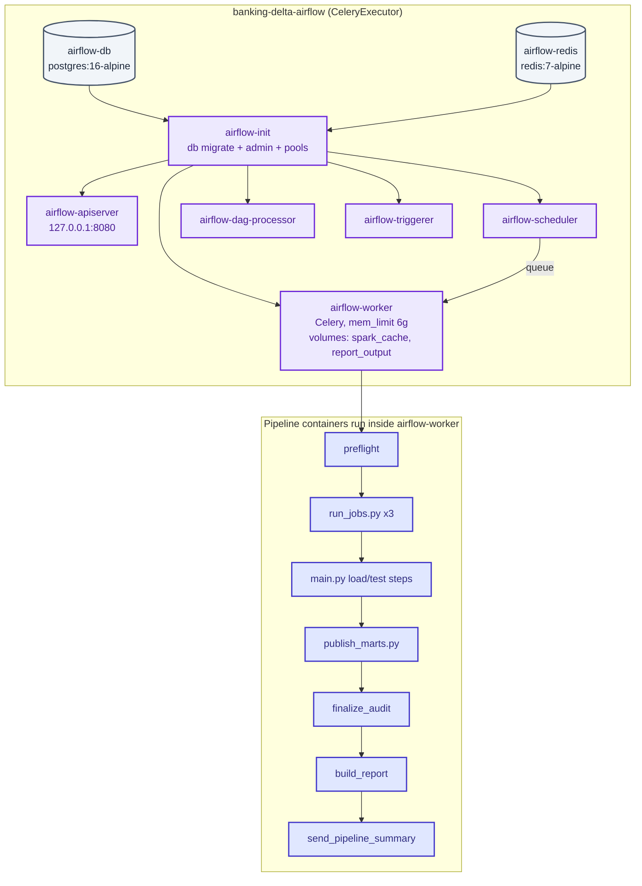
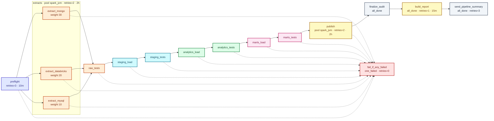
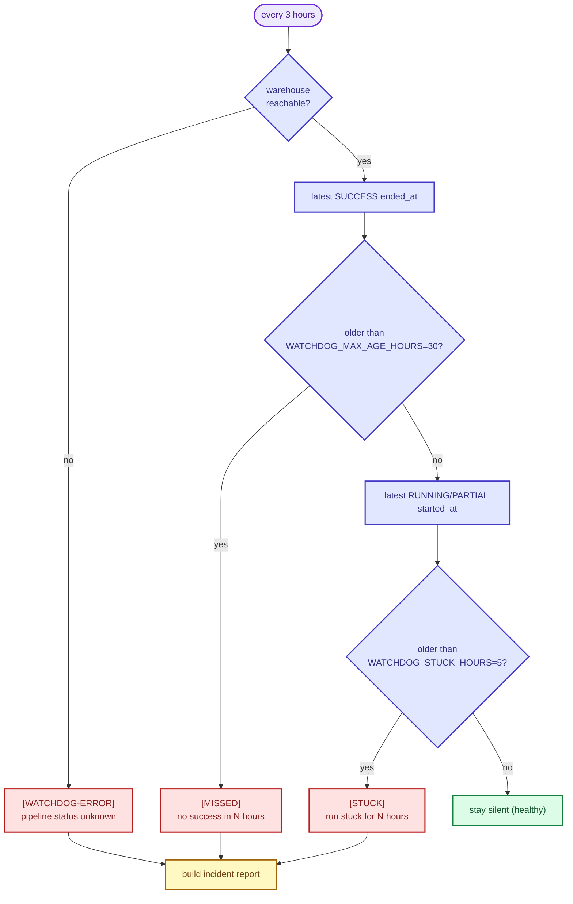
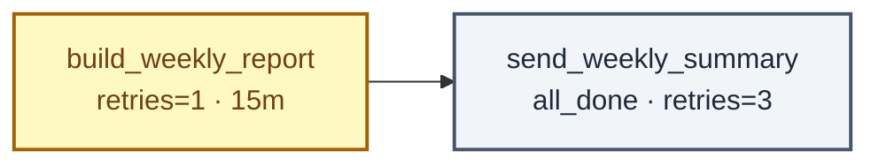
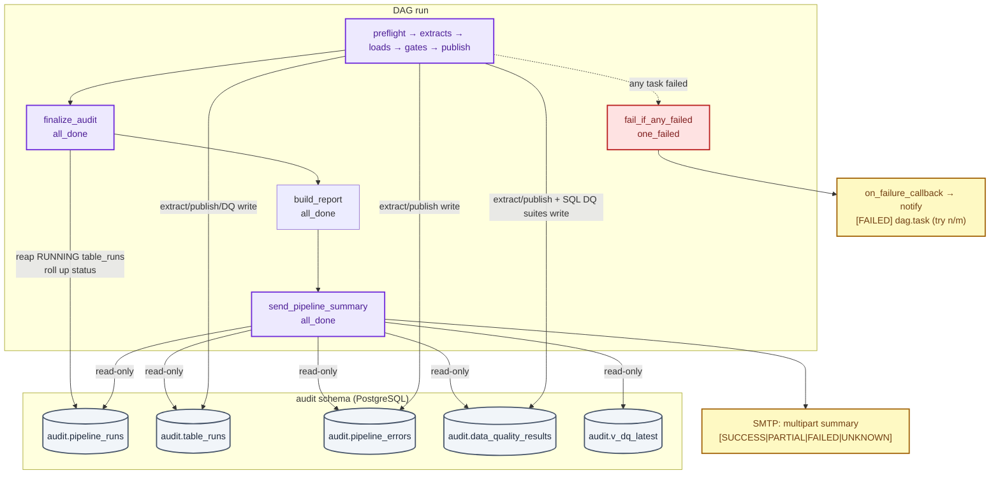

# Airflow — Banking-Delta-Lakehouse

Airflow 3.3.2 (CeleryExecutor) in Docker Compose orchestrates the daily run. It contains
**no pipeline logic**: every task calls the same scripts and SQL as `python main.py`
(`docs/PIPELINE.md`). Two DAGs live in `airflow/dags/`.

Colour legend: `docs/PIPELINE.md` (violet = Airflow services, indigo = pipeline steps run
inside the worker, slate = audit, red = gates/failures, yellow = mail).

## Compose stack

Image (`airflow/Dockerfile`, build context = repo root): `apache/airflow` + JRE +
project venv (`uv sync --frozen`) + `main.py`, `src/`, `scripts/`, `sql/`,
`tests/data-quality/`, `airflow/{dags,include,scripts}`. The Dockerfile-specific
`Dockerfile.dockerignore` keeps `.env`, `.venv`, `.spark` and keys out of the context.



`airflow-init` runs `airflow db migrate`, creates the admin user and pool `spark_jvm`
(3 slots — the extracts and publish share it). The worker mounts `spark_cache` at
`.spark` so Ivy jars survive restarts.

### Environment split (easy to get wrong)

| File | Loaded by | Holds |
|---|---|---|
| `airflow/.env.airflow` | `docker compose --env-file .env.airflow` (interpolation) and every container (`env_file:`) | `AIRFLOW_VERSION`, `PYTHON_VERSION`, image tag, DB/Redis settings, pipeline secrets (`PG_*`, `MYSQL_*`, `MONGO_*`, `DATABRICKS_*`, `SMTP_*`) |

`environment:` in `docker-compose.yml` beats `env_file:` for the same key, so
`ENVIRONMENT` (default `development`) and `GIT_SHA` (set by `make up` to the local
HEAD, `-dirty` when uncommitted) always come from the compose file; shell or CI
exports win over both. Copy `.env.airflow.example` → `.env.airflow` and fill it in.
Missing `AIRFLOW_VERSION` makes `docker compose config` fail immediately.
`docker-compose.dev.yml` bind-mounts code, sets `DAGS_ARE_PAUSED_AT_CREATION=false`
and adds `host.docker.internal` so containers can reach services on the host.

```bash
# from the repo root (GIT_SHA = local HEAD, ENVIRONMENT defaults to development)
make up
make down
# or from airflow/ with the explicit env file (always include the dev override):
cd airflow
cp .env.airflow.example .env.airflow          # fill secrets
docker compose -f docker-compose.yml -f docker-compose.dev.yml \
  --env-file .env.airflow up airflow-init     # must exit 0
docker compose -f docker-compose.yml -f docker-compose.dev.yml \
  --env-file .env.airflow up -d
# UI: http://127.0.0.1:8080 (login from .env.airflow)
```

## DAG `banking_delta_daily`

`schedule=0 2 * * *` Asia/Kolkata (`BANKING_DAG_SCHEDULE`), `catchup=False`,
`max_active_runs=1`, `max_active_tasks=4`, `dagrun_timeout=5h`, param `publish_full`
(default false). Created **paused** — un-pause deliberately.



| Task | Command | Retries / timeout | Notes |
|---|---|---|---|
| `preflight` | `python -m banking_airflow.preflight` | 3 / 10m | Java, disk, warehouse, sources, Maven — fails in seconds |
| `extract_mongo` / `extract_databricks` / `extract_mysql` | `scripts/run_jobs.py --sources <src> --dag-id … --dag-run-id …` | 2 / 2h | pool `spark_jvm` |
| `raw_tests` … `marts_tests` | `main.py --only <layer>-tests` | **0** / 30m | DQ gate — a data problem does not fix itself |
| `staging_load` … `marts_load` | `main.py --only <layer>-load` | 1 / 1h | `CALL <schema>.sp_load_all(...)` |
| `publish` | `src/jobs/publish_marts.py … [--full]` | 2 / 2h | `--full` from the `publish_full` param |
| `finalize_audit` | `python -m banking_airflow.finalize_audit` | 1 / 10m | `trigger_rule=all_done` |
| `build_report` | `python -m reports.scripts.build --kind daily --dag-id … --dag-run-id …` | 1 / 15m | `trigger_rule=all_done`; also builds `incident.pdf` on MAJOR+ events |
| `send_pipeline_summary` | `summary.build_and_send(context)` | 3 / 10m | `trigger_rule=all_done`; attaches PDFs |
| `fail_if_any_failed` | Python task | 0 | `trigger_rule=one_failed` — makes the run red so Airflow state matches reality |

Design rules: one task per `main.py` step name (UI, mail and `main.py` tell the same
story); `max_active_runs=1` queues duplicate triggers instead of overlapping;
`dagrun_timeout=5h` < watchdog `STUCK_HOURS=5` so a stuck run is detectable.

## DAG `banking_watchdog`

Runs every 3 hours; reads `audit.pipeline_runs` directly (independent of the scheduler)
and stays **silent when healthy**. On `[MISSED]`, `[STUCK]` or `[WATCHDOG-ERROR]` it
also triggers `python -m reports.scripts.build --kind incident` for the affected run
so the alert mail carries the incident PDF.



## DAG `banking_report_weekly`

`schedule=0 8 * * 1` Asia/Kolkata (Monday 08:00 IST), `catchup=False`,
`max_active_runs=1`. Created **paused** — un-pause deliberately.



| Task | Command | Retries / timeout | Notes |
|---|---|---|---|
| `build_weekly_report` | `python -m reports.scripts.build --kind weekly --dag-id … --dag-run-id …` | 1 / 15m | `trigger_rule=all_done` |
| `send_weekly_summary` | `summary.build_and_send(context)` | 3 / 10m | `trigger_rule=all_done`; attaches `weekly.pdf` |

## Summary, failure and audit flow



Mail modules: `include/banking_airflow/notify.py` (SMTP, `python -m banking_airflow.notify
--test`), `summary.py` (step table + audit sections; each section degrades independently),
`audit_reader.py` (read-only, parameterised, counts/names/statuses only — never row data),
`redact.py` (URL creds, `password=`/`token=`, PEM, long base64/hex, ≤ 300 chars).

## Operating commands

```bash
# bring up / tear down (from the repo root; make up exports GIT_SHA from git)
make up
make down
DC="docker compose -f airflow/docker-compose.yml --env-file airflow/.env.airflow"
$DC down -v                                            # drop metadata + logs

# trigger
$DC exec airflow-scheduler airflow dags trigger banking_delta_daily
# full republish:
$DC exec airflow-scheduler \
  airflow dags trigger banking_delta_daily --conf '{"publish_full": true}'

# inspect
$DC exec airflow-scheduler airflow dags list-runs -o table
$DC exec airflow-scheduler \
  airflow tasks states-for-dag-run banking_delta_daily "<run_id>"
$DC exec airflow-scheduler \
  airflow tasks logs banking_delta_daily "<run_id>" preflight
$DC exec airflow-scheduler airflow dags list-import-errors

# smoke tests
DC="docker compose -f airflow/docker-compose.yml --env-file airflow/.env.airflow"
$DC exec airflow-worker /opt/banking-venv/bin/python -m banking_airflow.preflight
$DC exec airflow-worker python -m banking_airflow.notify --test
```

Day-to-day operations: `docs/RUNBOOK.md`. Problems: `docs/TROUBLESHOOTING.md`.

## Tests

`airflow/tests/` (run by `make unit` / `make smoke`): `test_dag_integrity.py` (DagBag
loads both DAGs; graph, retries, pools, `max_active_runs=1`, `dagrun_timeout < 6h`),
`test_commands.py` (no secrets in command builders, `exec`/`cd`/ctx ids),
`test_no_secrets.py`, `test_notify_render.py` (template redaction),
`test_summary.py` (`decide_status` never SUCCESS on a missing state; audit rows plus
Task SDK states, `UNKNOWN` rendered on a gap).
`conftest.py` stubs POSIX-only hooks so tests import on Windows.

## Summary task states, env and build

`summary.collect_task_states()` merges three sources in order: `audit.table_runs`
(pipeline truth — `SKIPPED` means no data past the watermark, and it wins),
`context["task_states"]` (Airflow 2 only, absent in Airflow 3) and the Airflow 3
Task SDK (`ti.get_task_states(dag_id=…, run_ids=[run_id])` through the supervisor,
never the metadata DB). Step durations come from `ti.get_task_breadcrumbs`. A core
step with no state renders `UNKNOWN` and banners `[UNKNOWN]`, never `NOT_RUN` and
never a false green; the notes then list how many states were unavailable.

`env=` and `build=` in the mail and the report come from the container environment:
compose passes `ENVIRONMENT` (default `development`, set it explicitly outside
development) and `GIT_SHA`. `make up` exports the local HEAD (`-dirty` when
uncommitted); CI should export `GIT_SHA=$GITHUB_SHA`. The report prefers the
`GIT_SHA` environment variable and falls back to `.git/HEAD` on the host. Check a
running stack with:

```bash
docker compose -f airflow/docker-compose.yml --env-file airflow/.env.airflow \
  exec airflow-scheduler env | grep -E 'ENVIRONMENT|GIT_SHA'
```
