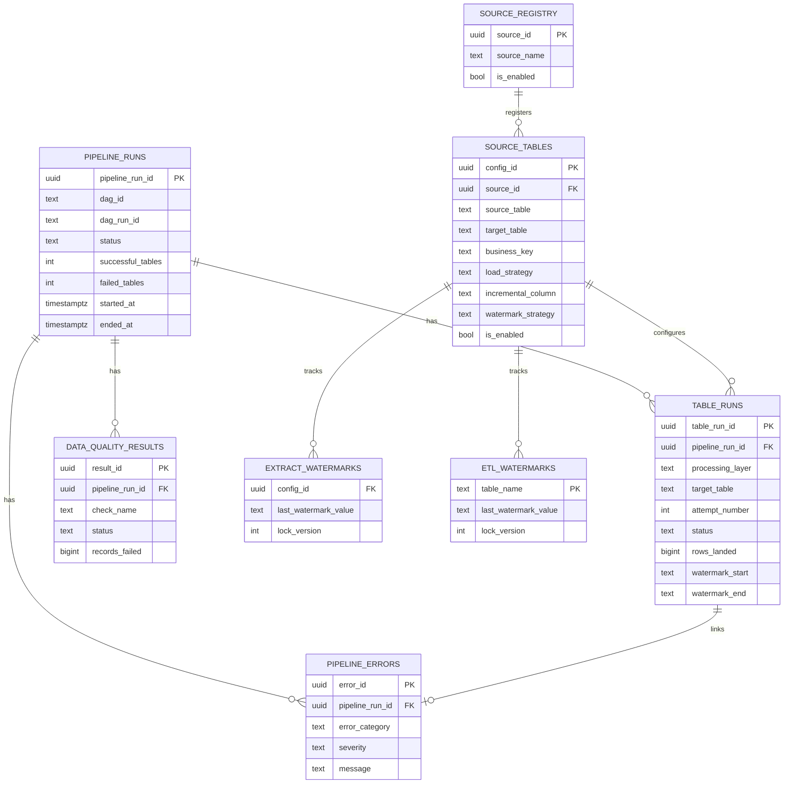
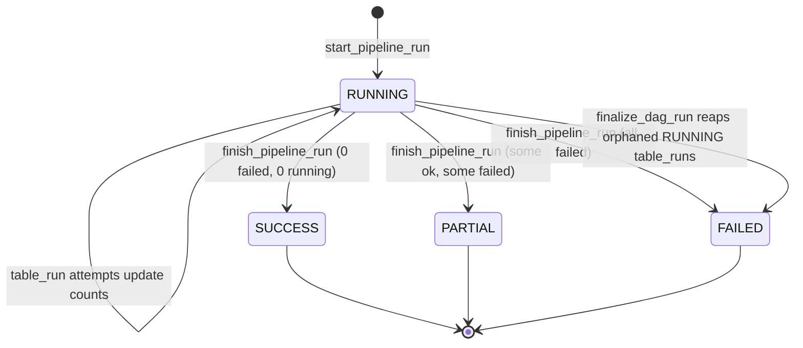
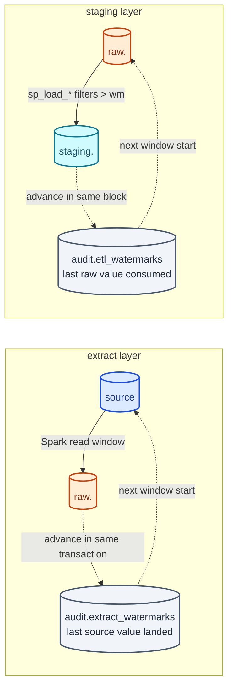
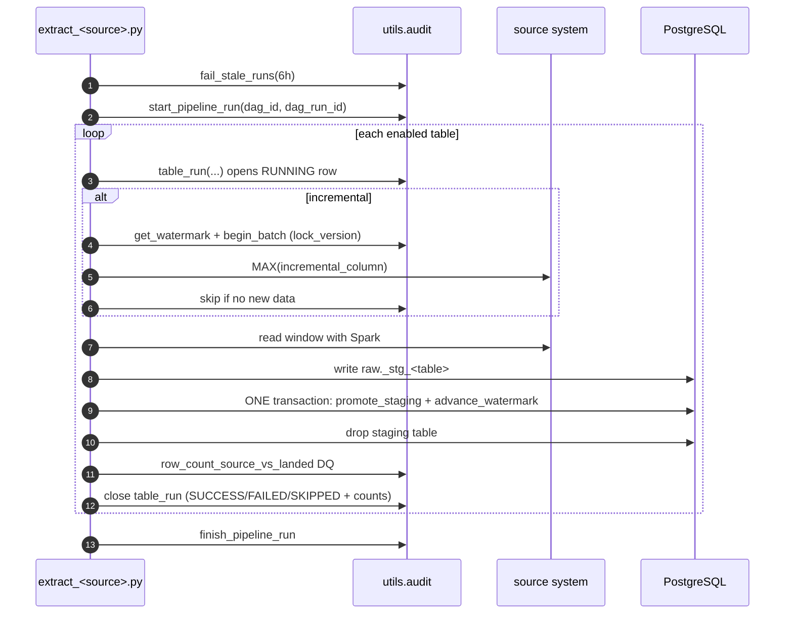

# Audit — Banking-Delta

Everything lands in the `audit` schema of the PostgreSQL warehouse, written with plain
`psycopg2`. Audit writes use their **own** short transactions, so a failed data
transaction still leaves a FAILED record behind. Redaction rules: never log row values or
credentials (`AGENTS.md`).

## Data model

Related tables written by the DQ gate: `audit.dq_run`, `audit.dq_violation`, view
`audit.v_dq_latest` (`docs/DATA-QUALITY.md`).

## Run lifecycle

- **`audit.pipeline_runs`** — one row per pipeline execution. From Airflow,
  `ON CONFLICT (dag_id, dag_run_id)` makes the three parallel per-source tasks share
  **one** row. `finish_pipeline_run` rolls table runs up using only the **latest attempt
  per table**; `finalize_dag_run` reaps `RUNNING` `table_runs` left by a killed worker
  first.
- **`audit.table_runs`** — one row per table **attempt** (`attempt_number` increments);
  `RUNNING → SUCCESS / FAILED / SKIPPED`, row counts, watermarks, duration,
  `execution_metadata` jsonb. `fail_stale_runs(6h)` reaps crashed rows at job start.
- **`audit.pipeline_errors`** — classified (`CONNECTION` / `CONCURRENCY` / `SPARK` /
  `DATA` / `UNKNOWN`), secret-redacted, linked from `table_runs.error_id`.

## The two watermark stores (never mix them)

| Table | Layer | Meaning | Advanced by |
|---|---|---|---|
| `audit.extract_watermarks` | extract (source → raw) | last source value landed into raw | `advance_watermark` inside the extract transaction; bootstrapped by `scripts/seed_watermarks.py` |
| `audit.etl_watermarks` | staging (raw → staging) | last raw value consumed into staging | each `staging.sp_load_*` (defaults to `_loaded_at`) |

Both use optimistic locking: `begin_batch` snapshots `lock_version`,
`advance_watermark` updates `WHERE lock_version = expected` and raises a conflict (→
rollback) if another run won. Watermarks advance **only inside the load transaction** —
never advance one by hand (`AGENTS.md`).

## Table registry

`audit.source_registry` + `audit.source_tables` are the config every extractor reads
through `get_enabled_tables`: source/target names, `business_key`, `load_strategy`
(`full`/`incremental`), `incremental_column`, `watermark_strategy`
(`timestamp`/`numeric`/`objectid`), Spark tuning, `is_enabled`.

| Source | Tables | Strategy | Watermark |
|---|---|---|---|
| mongodb_source | support_tickets, card_transactions | incremental | `_id` (objectid) |
| databricks_source | loans, loan_payments, transactions | incremental | `created_at` (timestamp) |
| mysql_source | accounts, branches, cards, customers, employees | full | — |

## Per-extract-run sequence

## DQ verdicts written by the pipeline

- `log_dq_result` → `audit.data_quality_results` (extract row-count checks, Mongo
  `temporal_values_parsed`, publish `row_count_source_vs_published`).
- The SQL DQ gate writes `audit.dq_run` + `audit.dq_violation`
  (`docs/DATA-QUALITY.md`).

## Rules that must not break

- Watermarks advance only inside the load/extract transaction; the two stores are never
  conflated.
- Every load is safe to run twice with the same input.
- Audit rows survive failure (own transactions; DQ commits before raising).
- `finish_pipeline_run` uses only the latest attempt per table — a regression here flips
  SUCCESS/PARTIAL/FAILED (`docs/TESTING.md`).
