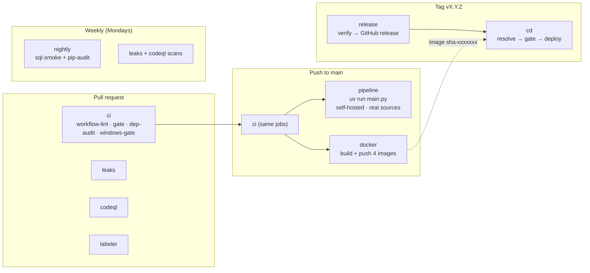

# CI/CD — Banking-Delta-Lakehouse

Everything runs the same `make` targets you run locally (`tasks.bat` on Windows), so
**green locally means green in CI**. Workflows live in `.github/workflows/`.
Restricted-action rules: `AGENTS.md`. Change loop: `docs/GITWORKFLOWS.md`.

## How it flows



In one sentence: PRs get fast checks with no secrets, `main` additionally runs the real
pipeline and builds images, and a version tag turns a verified commit into a release and a
deployment.

## Workflows at a glance

| Workflow | Runs on | What it does | Blocks merge |
|---|---|---|---|
| `ci` | PR, push to `main`, manual | Lint, tests, audits, Windows parity; full pipeline on `main` | **yes** |
| `leaks` | PR, push to `main`, Mon 03:00 UTC, manual | gitleaks over full git history | recommended |
| `codeql` | PR, push to `main`, Mon 04:00 UTC | CodeQL Python `security-and-quality` | recommended |
| `labeler` | PR opened / updated | Labels the PR by changed paths (`.github/labeler.yml`) | no |
| `nightly` | Mon 20:00 UTC, manual | `sql-smoke` on a disposable Postgres + full `pip-audit` | no |
| `docker` | push to `main`, tag `v*`, manual | Builds and pushes `airflow`, `dashboard`, `reports`, `pipeline` images to GHCR | no |
| `release` | tag `v*.*.*` | Verifies the tag, creates the GitHub release, triggers `cd` | n/a |
| `cd` | manual, release published | Gate, then deploy the `pipeline` image to staging / production | n/a |
| `dependabot` | weekly, Mon 02:00 UTC | Grouped update PRs for GitHub Actions, `uv`, and the 4 Dockerfiles | no |

## `ci` job by job

| Job | Runner | What it checks |
|---|---|---|
| `workflow-lint` | ubuntu | `actionlint` + `zizmor` on `.github/workflows` |
| `gate` | ubuntu | `uv lock --check`, ruff, data contracts, sqlfluff, smoke, unit + coverage gate, report fixture |
| `dep-audit` | ubuntu | `pip-audit` on the locked dependencies |
| `windows-gate` | windows | Same checks via `tasks.bat` (install, lint, contracts, sql-lint, test, cov, report fixture) |
| `pipeline` | **self-hosted** | Full `uv run main.py --keep-going` against real Mongo / MySQL / Databricks and a disposable Postgres |

`pipeline` needs `gate`, `dep-audit` and `windows-gate` to pass first, and runs **only on
push to `main`** (never on PRs). It applies `sql/scripts/0*.sql`, runs the daily pipeline, and
uploads audit files as an artifact for 7 days. Because it runs after the merge, it tells you
`main` is broken. It does not stop the merge.

## Release and deploy

```bash
# on main, with a clean CI run
git tag v0.1.0
git push origin v0.1.0
```

1. **`release`** checks that the tag matches the `pyproject.toml` version, that the commit is
   on `main`, and that `make ci` passes. Then it creates the GitHub release (a tag with `-`,
   like `v0.2.0-rc1`, becomes a prerelease) and triggers `cd`.
2. **`docker`** also fires on the tag and pushes images tagged `sha-xxxxxxx`.
3. **`cd`** runs three jobs:
   - `resolve`: picks the environment (prerelease → `staging`, stable → `production`) and the
     image tag. Production requires a stable `vX.Y.Z` tag on a commit that is on `origin/main`.
   - `gate`: re-runs lint, contracts, sql-lint and coverage on that ref.
   - `deploy`: waits for the `docker` run on the same commit, pulls the image, records its
     digest, and runs the container with the environment's secrets.
4. Production needs manual approval through the GitHub Environment protection rules.

**Manual deploy:** dispatch `cd` with `environment` and `ref`.
**Rollback:** dispatch `cd` with the previous stable tag. This redeploys code only. It does not
undo data side effects (watermarks, published marts), and any watermark reset needs owner
approval. See `docs/DESIGN.md`.

## Security rules

- Every workflow sets least-privilege `permissions:` (`contents: read` by default).
- No `pull_request_target` anywhere, so fork PRs never get secrets.
- Secrets are never available to the PR gate. They are used only by `pipeline` (push to `main`)
  and `cd` (environment secrets).
- Third-party actions are pinned by **full commit SHA** with a version comment. Dependabot
  bumps them. Copy SHAs from the action's releases page and never type them by hand, because a
  wrong SHA fails the run with "unable to find version".
- `zizmor` and `actionlint` lint the workflows themselves on every PR.
- `leaks` and `codeql` run on every PR and weekly.

## What runs where

| Tier | Where | Needs |
|---|---|---|
| lint, sql-lint, contracts, unit, smoke, coverage, report fixture | `ci` gate | nothing |
| Windows parity | `ci` windows-gate | nothing |
| dependency audit | `ci` and `nightly` | nothing |
| sql-smoke | `nightly` / manual | disposable Postgres (`ALLOW_SQL_SMOKE=1`) |
| full daily pipeline | `ci` `pipeline`, push to `main` | self-hosted runner + real source secrets |
| smoke-live, Airflow triggers | **never in CI** | real credentials + approval |

The PR gate must stay fast and need nothing external. Heavier work goes to `main` or the
weekly schedule. `tests/smoke/test_make_parity.py` fails if a Makefile target is missing from
`tasks.bat`, or if `ci` picks up a non-hermetic target.

## Self-hosted runner (for `pipeline`)

The runner needs the labels `self-hosted` and `linux`, Docker (for the Postgres service
container), and either `psql` installed or passwordless `sudo`. Java 17 and `uv` are set up
by the workflow. Keep the `if:` on `main` pushes only so PR code can never reach this machine.

## One-time setup (repo admin)

1. **Actions**: allow actions and confirm the workflows show up.
2. **Branch protection on `main`**: require a PR (1 approval, dismiss stale approvals), require
   up-to-date branches and resolved conversations, block force pushes and deletions. Required
   checks (names as shown in the PR checks list): `gate (lint + sql-lint + unit + smoke)`,
   `windows-gate (batch runner parity)`, `dependency vulnerability audit`, and later `leaks`
   and `codeql`.
3. **Secrets**:
   - Repository secrets for `pipeline`: `MONGO_*`, `MYSQL_*`, `DATABRICKS_*`.
   - Environment secrets for `cd` (set per environment): `PG_*`, `DATABRICKS_*`,
     `PUBLISH_STAGE_VOLUME`, `MONGO_*`, `MYSQL_*`.
4. **Environments**: create `staging` and `production`; add required reviewers on `production`.
5. **Code security**: enable Dependabot alerts + security updates and private vulnerability
   reporting (used by `SECURITY.md`).
6. **`CODEOWNERS`**: replace the placeholder handles with real people or teams.
7. **Self-hosted runner**: register it with the labels above.

Until step 2 is done, CI runs but nothing stops a direct push to `main`.

## Known gaps (fix before relying on CD, then delete this section)

- **`release` → `cd` handoff:** `trigger-cd` uses `if: always()`, so it fires even if `verify`
  fails. It also passes the commit SHA as `ref`, which `cd` rejects for production (it wants a
  `vX.Y.Z` tag), and it never sets `GH_TOKEN` / `GH_REPO` for `gh`.
- **Staging dispatch:** `cd` skips both `gate` and `deploy` when the environment is `staging`
  and the trigger is a manual dispatch, so nothing gets deployed to staging.
