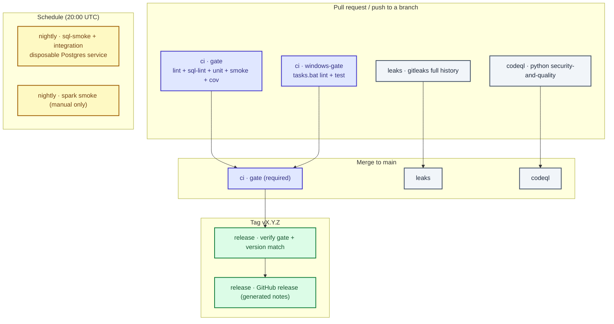

# CI/CD and automation — Banking-Delta-Lakehouse

Everything is driven by the same `make` targets developers run locally, so **green locally
means green in CI**. Workflow files live in `.github/workflows/`. Rules for restricted
actions: `AGENTS.md`. Change loop: `docs/GITWORKFLOWS.md`.

## Pipeline map



## Workflows

| File | Workflow | Triggers | What it runs | Blocks merges |
|---|---|---|---|---|
| `.github/workflows/ci.yml` | `ci` | PR, push to `main`, manual | `make lint`, `sql-lint`, `unit`, `smoke`, `cov`, `report-fixture` (ubuntu); `tasks.bat lint` + `test` + `report-fixture` (windows); on push to `main`, the full `uv run main.py --keep-going` pipeline against real Mongo/MySQL/Databricks secrets and a disposable Postgres | **yes** (`gate`, `windows-gate`) |
| `.github/workflows/leaks.yml` | `leaks` | PR, push to `main`, weekly, manual | gitleaks over full history with `.gitleaks.toml` | recommended |
| `.github/workflows/codeql.yml` | `codeql` | PR, push to `main`, weekly | CodeQL Python `security-and-quality` | recommended |
| `.github/workflows/nightly.yml` | `nightly` | schedule 20:00 UTC, manual | `make sql-smoke` + `make integration` on a disposable Postgres; `spark-smoke` on manual dispatch; **optional** `make report-pdf` via Docker (`report-docker` target) | no |
| `.github/workflows/release.yml` | `release` | tag `v*.*.*` | re-runs the gate, checks tag == `pyproject` version, creates a GitHub release | n/a |

`.github/dependabot.yml` opens weekly, grouped update PRs for `uv` (repo), `pip`
(`airflow/`, `dashboard/`), Docker (`airflow/`) and GitHub Actions.

## Actions supply chain rules

- Every workflow declares least-privilege `permissions:` (`contents: read` by default).
- **No `pull_request_target`** anywhere — PRs from forks must not get secrets.
- Secrets (`PG_*`, Databricks, SMTP, source credentials) are **never** available to the
  PR gate. The `pipeline` job uses them only on push to `main`, with a disposable
  Postgres service for the warehouse.
- Pin third-party actions by version; upgrade via Dependabot. Keep `astral-sh/setup-uv`
  and `github/codeql-action` current.
- Cache dependency downloads keyed on `uv.lock`.

## Hermetic vs infrastructure tiers

The PR gate must stay fast and need nothing external. Heavier tiers are scheduled:

| Tier | Where | Needs |
|---|---|---|
| lint, sql-lint, unit, smoke, cov | `ci` (gate) | nothing |
| report-fixture (render only, no TeX) | `ci` (gate) | nothing |
| windows parity | `ci` (windows-gate) | nothing |
| sql-smoke, integration | `nightly` / manual | disposable Postgres (`ALLOW_SQL_SMOKE=1`) |
| spark-smoke | `nightly` (manual dispatch) | Java 17 (`make spark-smoke`) |
| report-pdf, report-docker | manual / optional nightly | TeX Live or Docker (`make report-pdf`) |
| full daily pipeline (`raw-inject` → `publish`, incl. DQ and real data) | `ci` (`pipeline` job), push to `main` only | real Mongo/MySQL/Databricks secrets; disposable Postgres |
| smoke-live, Airflow triggers | **never in CI** | real credentials + approval |

## Windows parity

Windows developers use `tasks.bat` (no GNU Make required); CI runs the same commands on
`windows-latest`. `tests/smoke/test_make_parity.py` fails if a Makefile target is missing
from `tasks.bat`, or if `ci` ever picks up a non-hermetic target.

## Release

```bash
# on main, with a clean CI run
git tag v0.1.0
git push origin v0.1.0
```

The `release` workflow re-runs the gate, asserts the tag matches the `pyproject.toml`
version, then creates the GitHub release with generated notes. A release is only as good as
the commit it points at, so it never publishes an unverified tree.

## Setup checklist (one-time, needs repo admin)

These cannot be done from a branch — a repository admin must:

1. **Actions** → allow actions; confirm the workflows appear under the Actions tab.
2. **Settings → Branches → `main` protection**:
   - require a pull request before merging (1 approval), dismiss stale approvals
   - require status checks: `gate`, `windows-gate` (and `leaks`, `codeql` once stable)
   - require branches up to date before merge; require conversation resolution
   - block force pushes and deletions; restrict who can push
3. **Settings → Secrets and variables → Actions**: none needed for the gate. Only add
   secrets if you later enable a deploy job — never production credentials for PRs.
4. **Settings → Code security**: enable Dependabot alerts + security updates; enable private
   vulnerability reporting (referenced by `SECURITY.md`).
5. Set `CODEOWNERS` handles to real people/teams (currently `@Nitinx12`).
6. Optionally enable the `nightly` and `leaks` workflows as required checks after a few
   green runs.

Until step 2 is done, CI runs but nothing stops a direct push to `main` — do it deliberately.
