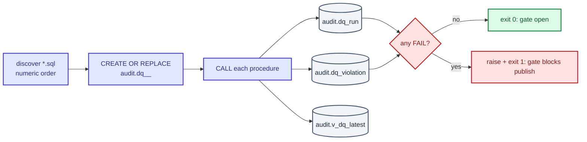

# Data quality — Banking-Delta-Lakehouse

Every layer is gated by a SQL data-quality suite that runs **against the warehouse**
before the next layer may load. A critical failure blocks publish. This is *data* testing;
code testing lives in `docs/TESTING.md`.

## Gate flow



Colour: indigo = runner steps, slate = audit tables, green = pass, red = fail.

The non-zero exit is the gate that blocks publish in Airflow and `main.py`.

## Suite layout

```text
tests/data-quality/
├── raw/        10 tests + 00_master_raw_tests.sql
├── staging/    10 tests + 00_master_staging_tests.sql
├── analytics/  13 tests + 00_master_analytics_tests.sql
└── marts/      11 tests + 00_master_marts_tests.sql
```

Runners: `scripts/run_{raw,staging,analytics,marts}_tests.py` (discover in numeric order,
Rich progress, exit non-zero on any
failure). Make targets: `make dq-raw` … `make dq-marts`, or `make dq` for all four in
layer order. Airflow runs the same runners as `*_tests` steps of `banking_delta_daily`.

```bash
python scripts/run_staging_tests.py --list     # what would run
python scripts/run_staging_tests.py --only 03  # one check
python scripts/run_staging_tests.py --master   # the layer's master procedure
```

## The per-file contract

Each file `NN_<check>.sql` defines **one** procedure `audit.dq_<layer>_<check>()` that:

1. inserts an `audit.dq_run` row (layer, script_name);
2. inserts one `audit.dq_violation` per bad row/message;
3. updates the run with `violation_count` and `PASS`/`FAIL`;
4. **`COMMIT`s, then `RAISE`s on failure** — the one place COMMIT is allowed inside SQL on
   purpose, so the audit reason survives the rollback.

The smoke suite (`tests/smoke/test_sql_contract.py`) enforces this: master file present,
unique numeric prefixes (excluding `00`/`99`), procedure named `audit.dq_*`, `dq_run` +
`dq_violation` written, procedure called by `00_master_<layer>_tests.sql`, and
COMMIT-before-RAISE (comment lines ignored).

## Check catalogue

| # | Check | What it proves |
|---|---|---|
| 01 | metadata_col | `_batch_id` / `_loaded_at` present, NOT NULL, timestamptz, not future, fresh |
| 02 | primary_keys | PK/unique columns are non-null and unique |
| 03 | bad_dates | no NULL/impossible/future dates |
| 04 | orphan_rows | every FK has a parent row (e.g. accounts → customers) |
| 05 | business_rules | amounts ≥ 0, valid statuses, plausible rates |
| 06 | numeric_ranges | numeric columns inside agreed min/max bands |
| 07 | schema_contract | columns and types match the expected contract |
| 08 | completeness | no unexpected NULLs / coverage thresholds met |
| 09 | duplicate_rows | no duplicate business keys or whole-row duplicates |
| 10 | value_domains | categorical values inside the allowed domain |
| 11 | date_key_integrity | (analytics) date keys resolve to the dim date |
| 12 | derived_attributes | (analytics) derived bands/attributes are consistent |
| 13 | reconciliation | (analytics + marts) fact totals reconcile with their sources |

## Adding or changing a check

1. File: `tests/data-quality/<layer>/NN_<check>.sql` — next free number; the runner
   discovers in numeric order.
2. One `CREATE OR REPLACE PROCEDURE audit.dq_<layer>_<check>()` following the contract
   above. Style: uppercase keywords, `snake_case`, explicit column lists
   (`make sql-lint`).
3. Exclude transient landing tables in raw-layer schema checks:
   `c.relname NOT LIKE '\_stg\_%'`.
4. Register it in `00_master_<layer>_tests.sql`.
5. Validate: `make sql-lint` (always) → `python scripts/run_<layer>_tests.py --only NN -v`
   against a **disposable or approved** DB (ask first).
6. **Prove it can fail:** insert one bad row on a disposable DB, confirm exit code ≠ 0,
   then remove it. A check that cannot fail is worthless.
7. Never relax a threshold to make a layer pass — investigate the data or ask.

## Rules that must not break

- A critical DQ failure blocks publish.
- Audit rows are committed **before** the failure is raised.
- Landing tables `_stg_%` are transient and excluded from schema checks.
- The suites are data tests: they need a populated warehouse, so they are **never** part of
  `make ci` and never run against production without approval.
