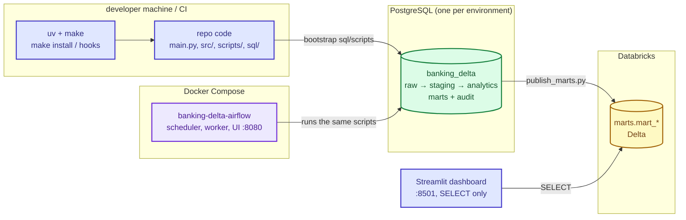

# Deployment — Banking-Delta

Four pieces deploy independently: the **local toolchain**, the **PostgreSQL warehouse**,
the **Airflow stack** (Docker Compose) and the **Streamlit dashboard**. Databricks is
consumed, not deployed. Nothing here runs without real credentials — see
`AGENTS.md` permissions first.

Colour legend: `docs/PIPELINE.md`.

## Overview



## 1. Local toolchain

```bash
make install        # uv sync --group dev (Python >= 3.13 pinned in pyproject.toml)
make hooks          # git config core.hooksPath .githooks — mandatory
make ci             # gate: lint + sql-lint + unit + smoke
```

Prerequisites: `uv`, GNU Make (Windows: choco `make`; no `tasks.bat` exists yet), Java
8/11/17/21 for Spark paths, `git`. Copy `.env.example` → `.env` and fill real values —
`.env` is git-ignored and must never be committed.

## 2. PostgreSQL warehouse

Bootstrap is ordered, idempotent SQL under `sql/scripts/` (apply in numeric order,
excluding `00_create_database` if the DB already exists, and `05_switch_*` once the flip
is done):

| # | Script | Purpose |
|---|---|---|
| 00 | `00_create_database.sql` | create `banking_delta` |
| 01 | `01_init_schemas.sql` | `raw`, `staging`, `analytics`, `marts`, `audit` (+ `exploration`) |
| 02 | `02_audit_tables.sql` | registry, runs, errors, `etl_watermarks`, `table_runs` |
| 03 | `03_register_sources.sql` | seed 3 sources + 10 tables (Mongo/Databricks incremental, MySQL full) |
| 04 | `04_dq_audit_tables.sql` | `dq_run`, `dq_violation`, `v_dq_latest` |
| 05 | `05_switch_mongo_databricks_incremental.sql` | one-time full → incremental flip (`03` cannot update existing rows) |
| 06 | `06_extract_watermarks.sql` | `extract_watermarks` (separate from `etl_watermarks`) |

Then the layer procedures and DQ suites:

```bash
make sql-smoke                 # disposable DB only: sql/** + tests/data-quality/** (ALLOW_SQL_SMOKE=1)
python scripts/seed_watermarks.py   # FIRST incremental run of a new table (never for MySQL)
```

Procedure layers: `sql/{staging,analytics,marts}/NN_*.sql` + `00_master_load.sql`, applied
in numeric order (parent → child). Merged migrations are never edited — add a new numbered
file (`AGENTS.md`).

## 3. Airflow stack

Full detail: `docs/AIRFLOW.md`. Short version:

```bash
cd airflow
cp .env.airflow.example .env.airflow                    # real secrets per environment
# airflow/.env must define AIRFLOW_VERSION (compose interpolation)
docker compose --env-file .env.airflow up airflow-init  # must exit 0
docker compose --env-file .env.airflow up -d
# UI: http://127.0.0.1:8080 — un-pause banking_delta_daily deliberately
```

- Image bakes the project venv + code (`airflow/Dockerfile`); `docker-compose.dev.yml`
  bind-mounts the repo for development.
- Environment per stage = `.env.airflow` content (`PG_*`, `MYSQL_*`, `MONGO_*`,
  `DATABRICKS_*`, `SMTP_*`). Keep it out of git.
- The worker needs the `spark_cache` volume (Ivy jars) and ~6 GB.

## 4. Dashboard

```bash
cd dashboard
python -m venv .venv && .venv\Scripts\activate     # or source .venv/bin/activate
pip install -r requirements.txt
cp .streamlit/secrets.toml.example .streamlit/secrets.toml   # fill real values
streamlit run app.py                               # http://localhost:8501
```

Docker: `docker build -t banking-dashboard .` → `docker run -p 8501:8501 banking-dashboard`
(secrets as env vars or a mounted secrets file). `.streamlit/secrets.toml` is git-ignored.
The app is read-only and shows only **published** Databricks marts.

## Configuration reference

`.env` is read in exactly one place (`src/utils/config.py`, `override=False` — shell /
Airflow / CI exports win). Airflow containers use `airflow/.env.airflow`.

| Group | Key variables |
|---|---|
| PostgreSQL | `PG_HOST/PG_PORT/PG_DB/PG_USER/PG_PASS` |
| MySQL | `MYSQL_HOST/PORT/USER/PASSWORD/DB`, `MYSQL_SERVER_TZ`, `MYSQL_SSL_MODE` |
| MongoDB | `MONGO_URI`, `MONGO_DB_NAME`, `MONGO_TIMEOUT_MS`, `MONGO_SAMPLE_SIZE` |
| Databricks | `DATABRICKS_HOST/TOKEN/HTTP_PATH/CATALOG`, `DATABRICKS_SCHEMA_PUBLIC`, `DATABRICKS_MARTS_SCHEMA` |
| Spark | `SPARK_DRIVER_MEMORY`, `SPARK_SHUFFLE_PARTITIONS` |
| Publish | `PUBLISH_WORKERS`, `PUBLISH_WORKER_MIN_ROWS`, `PUBLISH_FETCH_SIZE`, `PUBLISH_MAX_PARAMS`, `PUBLISH_LOOKBACK_MONTHS` |
| Alerts | `ALERT_EMAIL_FROM/TO`, `SMTP_HOST/PORT/USER/PASSWORD`, `SMTP_STARTTLS`, `SMTP_SSL`, `ALERT_ON_TASK_FAILURE` |
| Compose | `AIRFLOW_VERSION`, `PYTHON_VERSION`, `AIRFLOW_IMAGE_TAG`, `GIT_SHA`, `AIRFLOW_DB_*`, `REDIS_PASSWORD`, `WORKER_CONCURRENCY`, `WORKER_MEM_LIMIT` |
| DAG tuning | `BANKING_DAG_SCHEDULE`, `TIMEZONE`, `WATCHDOG_MAX_AGE_HOURS`, `WATCHDOG_STUCK_HOURS` |
| Misc | `ENVIRONMENT`, `LOG_LEVEL`, `PROJECT_ROOT`, `BANKING_HOME`, `BANKING_PYTHON` |

Every `require()`d variable is listed in `.env.example` — enforced by
`tests/smoke/test_env_contract.py`.

## Secrets rules

- Never commit `.env`, `airflow/.env.airflow`, `.streamlit/secrets.toml`, tokens or keys.
- Pre-commit blocks secret-like filenames; mail/audit redaction (`redact.py`,
  `src.utils.audit._redact`) is defense-in-depth, not a licence to log secrets.
- Production credentials never reach CI (`AGENTS.md`; `.gitleaks.toml` + `make leaks` are
  still to be added).

## Promotion checklist

- [ ] `make ci` green (note: `sql-lint` currently red — see `docs/TESTING.md`)
- [ ] new migrations added as numbered files, applied twice to confirm idempotence
- [ ] `.env.example` updated for new variables; smoke tests updated
- [ ] `docs/` updated if behaviour or targets changed
- [ ] restricted actions (warehouse runs, merges) approved per `AGENTS.md`
