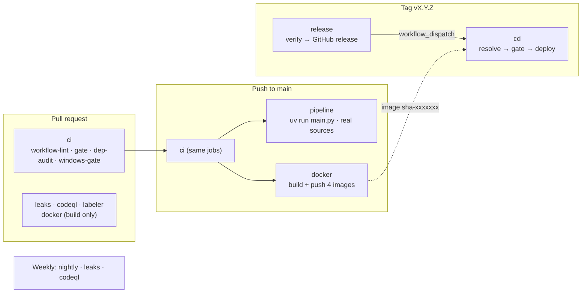

# CI/CD and Git workflow — Banking-Delta-Lakehouse

How a change travels from a branch to production. CI runs the same `make` targets you run
locally (`tasks.bat` on Windows), so **green locally means green in CI**. Workflows live in
`.github/workflows/`. Rules for AI agents (`AGENTS.md`) always win on conflict.

## 1. Git workflow

### Ground rules

1. One concern per branch, one logical change per commit, small diffs. Branches live days, not weeks.
2. Conventional Commits, hooks always on. `--no-verify` is forbidden.
3. Never commit `.env`, tokens, `*.pem`, `*.key`, `id_rsa`, `file.txt`.
4. Never force-push. Never edit an already-merged SQL migration; add a new numbered file.
5. Never weaken, skip or delete a test to get CI green. Tests ship with the behaviour they cover; a bug fix includes a regression test that fails first.

### Branches and setup

| Prefix | Use | Example |
|---|---|---|
| `feature/` | new capability | `feature/publish-lookback-config` |
| `fix/` | bug fix | `fix/summary-task-states` |
| `chore/` | tooling, deps, config, test scaffolding | `chore/test-scaffold` |
| `docs/` | documentation only | `docs/project-docs` |
| `test/` | tests only (use `chore/` if disallowed) | `test/audit-redact-unit` |

Lowercase kebab-case, always from an up-to-date `main` (`git pull --ff-only`). One-time setup per clone:

```bash
make install   # uv sync --group dev
make hooks     # git config core.hooksPath .githooks (mandatory; verify it prints .githooks)
```

Hooks (`.githooks/`): `commit-msg` enforces Conventional Commits; `pre-commit` blocks secrets and key
files and runs `ruff check` + `ruff format --check` on staged Python; `pre-push` runs a fast gate.
If a hook fails, fix the cause. `.pre-commit-config.yaml` (optional) adds sqlfluff and hygiene checks.

### Commits

Format `type(scope): imperative summary`, at most 72 chars, no trailing period; the body
explains *why*.

- **Types:** `feat fix refactor perf test docs chore build ci style revert`
- **Scopes:** `extract audit spark-io engine publish main airflow dags sql staging analytics
  marts dq dashboard make batch hooks deps tests repo reports`

Stage explicitly (`git add <paths>`, never blind `-A`) and review with `git diff --staged`.
Never commit scratch dirs (`.spark/ logs/ airflow/logs/ .venv/ .coverage htmlcov/ __pycache__/`).

### The change loop

```text
 1  Read AGENTS.md and the relevant docs/ page; sync main; create branch
 2  Write or adjust the test FIRST (red, see docs/TESTING.md)
 3  Implement the smallest change (green)
 4  Narrow test:  uv run pytest path/to/test_x.py -q
 5  Fast gate:    make unit smoke        Full gate: make ci (lint + sql-lint + unit + smoke)
 6  Extra tiers the change needs (DB/Spark/live: ask first)
 7  Update docs and Makefile together if targets changed
 8  git add <paths>; git commit          (hooks must pass)
 9  git fetch origin; git merge origin/main; re-run make ci
10  git push -u origin <branch>; open PR; STOP. Do not merge.
```

Keep a branch current by **merging** `origin/main`; rebasing needs a force-push, which is
forbidden. If history is messy, ask a human.

**Pull requests:** title is the Conventional Commit summary; aim for one concern under ~400 changed lines. Body:
what and why, how tested (commands and real results), risk, rollback, and any approval used.
Agents open the PR and stop; merging or pushing to `main` needs a human.

### Permissions

| Action | Allowed | Ask first | Never |
|---|---|---|---|
| Read; `make lint / sql-lint / unit / cov / smoke / test / ci`; code, tests, docs on a branch; commit; push your own branch; open PR | yes | | |
| `make spark-smoke / sql-smoke / integration / smoke-live`, `make daily`, `python main.py`, Airflow trigger | | yes | |
| Merge or push to `main`, tag, release, manual `cd` dispatch | | yes | |
| Commit secrets, write to Databricks `public`, edit a merged migration, force-push, test against production | | | never |

### SQL changes and invariants

- Changes to an existing database go in a **new numbered file** (`sql/scripts/NN_<what>.sql`),
  idempotent, applied in order; never edit `00`–`06` once merged. Procedure files
  (`sql/{staging,analytics,marts}/NN_*.sql`) are `CREATE OR REPLACE`; keep `00_master_load.sql`
  order parent → child.
- Run `make sql-lint`, and `make sql-smoke` (disposable PG, `ALLOW_SQL_SMOKE=1`, ask first) when
  procedures change. New or changed DQ checks go in `docs/DATA-QUALITY.md`.
- **Must not break:** watermarks advance only inside the load/extract transaction
  (`audit.extract_watermarks` vs `audit.etl_watermarks`, never mixed, see `docs/AUDIT.md`); every
  load is idempotent; a critical DQ failure blocks publish; each layer is written only by its owner.

## 2. CI/CD

### How it flows



### Workflows at a glance

| Workflow | Runs on | What it does | Blocks merge |
|---|---|---|---|
| `ci` | PR, push to `main`, manual | Lint, tests, audits, Windows parity; full pipeline on `main` | **yes** (`ci-success`) |
| `leaks` | PR, push to `main`, Mon 03:00 UTC | gitleaks over full git history | yes |
| `codeql` | PR, push to `main`, Mon 04:00 UTC | CodeQL Python `security-and-quality` | yes |
| `labeler` | PR opened / updated | Labels by changed paths (`.github/labeler.yml`) | no |
| `docker` | PR (Dockerfile or deps change), push to `main`, tag `v*`, manual | Builds `airflow`, `dashboard`, `reports`, `pipeline`; pushes to GHCR except on PRs | no |
| `nightly` | Mon 20:00 UTC, manual | `sql-smoke` on disposable Postgres + full `pip-audit`; opens an issue on failure | no |
| `release` | tag `v*.*.*` | Verifies the tag, creates the GitHub release, dispatches `cd` | n/a |
| `cd` | `workflow_dispatch` only | Gate (production), then deploy the `pipeline` image | n/a |
| `dependabot` | Mon 02:00 UTC | Grouped PRs for Actions, `uv`, four Dockerfiles; 7-day cooldown | no |

### `ci` jobs

| Job | What it checks |
|---|---|
| `workflow-lint` | `actionlint` + `zizmor` on `.github` (checksum-verified installs) |
| `gate` | `uv lock --check`, ruff, contracts, sqlfluff, smoke, unit + coverage gate, report fixture |
| `dep-audit` | `pip-audit` on the locked dependencies |
| `windows-gate` | The same checks via `tasks.bat` |
| `secrets-check` | Push to `main` only: are the source secrets configured? |
| `pipeline` | Full `uv run main.py --keep-going` on a GitHub-hosted runner with a disposable Postgres |
| `ci-success` | Aggregates every job above; **the one required check for branch protection** |

`pipeline` runs only on push to `main` (never on PRs, so PR code never sees secrets) and is
skipped while secrets are unset. Set the repo **variable** `SKIP_MAIN_PY=true` to skip it in an
emergency. It runs after the merge, so it flags a broken `main` but cannot stop the merge.
Superseded PR runs are cancelled; runs on `main` never are. The PR gate stays fast and
external-free; `tests/smoke/test_make_parity.py` fails if a Makefile target is missing from
`tasks.bat` or `ci` picks up a non-hermetic target. `smoke-live` and Airflow triggers never run in CI.

### Release and deploy

```bash
git tag v0.1.0 && git push origin v0.1.0   # on main, green ci; needs approval
```

1. **`release`** checks the tag matches `pyproject.toml`, the commit is on `main`, and `make ci`
   passes, then creates the GitHub release (a tag with `-`, like `v0.2.0-rc1`, is a prerelease;
   re-runs are safe) and dispatches `cd`: prerelease → `staging`, stable → `production`.
2. **`docker`** also fires on the tag and pushes `sha-xxxxxxx`, version (`1.2.3`, `1.2`) and branch
   tags, with provenance and SBOM.
3. **`cd`** runs one deploy at a time per environment:
   - `resolve`: the commit must be on `origin/main`; production also needs a stable `vX.Y.Z` tag.
   - `gate`: **production only**; re-runs lint, contracts, sql-lint, smoke and coverage.
   - `deploy`: waits for a green `docker` run on the same commit (fails after 5 minutes if none
     exists), pulls the image, checks its revision label matches the commit, checks required
     secrets, and runs the container by digest with `--keep-going`.
4. Production needs manual approval via GitHub Environment protection rules. A failed production
   deploy or gate opens an issue.

**Manual deploy:** run `cd` from the Actions tab with `environment` and `ref` (staging skips the gate).
**Rollback:** run `cd` with `production` and the previous stable tag. This redeploys code only;
it does not undo data side effects (watermarks, published marts), and a watermark reset needs
owner approval (`docs/DESIGN.md`). There is no `release: published` trigger, because a hand-made
release would deploy a tag that `release` never verified.

### Security rules

- Least-privilege `permissions:` everywhere (`contents: read` by default, widened per job).
- No `pull_request_target`, so fork PRs never get secrets. Secrets reach only `pipeline` and `cd`.
- Third-party actions are pinned by **full commit SHA** with a version comment; Dependabot bumps
  them. Copy SHAs from the releases page, since a wrong SHA fails with "unable to find version".
- No caches in the `release` and `cd` paths; downloaded tools are checksum-verified. `labeler` keeps
  the `dependencies` label on Dependabot PRs by matching the `dependabot/` branch.

### One-time setup (repo admin)

1. **Branch protection on `main`**: require a PR (1 approval, dismiss stale approvals), up-to-date
   branches, resolved conversations; block force pushes and deletions. Required checks:
   `ci-success`, `gitleaks`, `analyze (python)`. Until then, nothing stops a direct push.
2. **Secrets**: repository secrets for `pipeline` (`MONGO_*`, `MYSQL_*` incl. `MYSQL_DB`,
   `DATABRICKS_*` incl. `HTTP_PATH`, `SCHEMA_PUBLIC`). Environment secrets for `cd`: `PG_*`,
   `DATABRICKS_*`, `PUBLISH_STAGE_VOLUME`, `MONGO_*`, `MYSQL_*`. Point the pipeline's
   `DATABRICKS_MARTS_SCHEMA` at a CI-only schema if `publish_marts` writes there.
3. **Environments**: create `staging` and `production`, require reviewers on `production`, and
   restrict both to `main` and `v*` tags.
4. **Code security**: enable Dependabot alerts and security updates, and private vulnerability
   reporting (used by `SECURITY.md`). Replace placeholder handles in `CODEOWNERS`.
