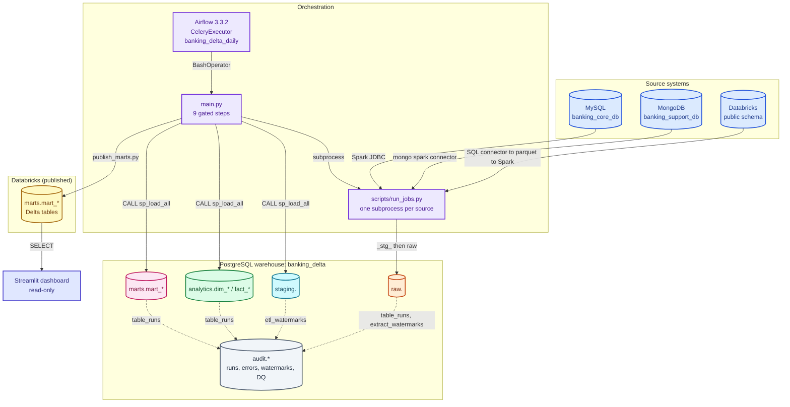
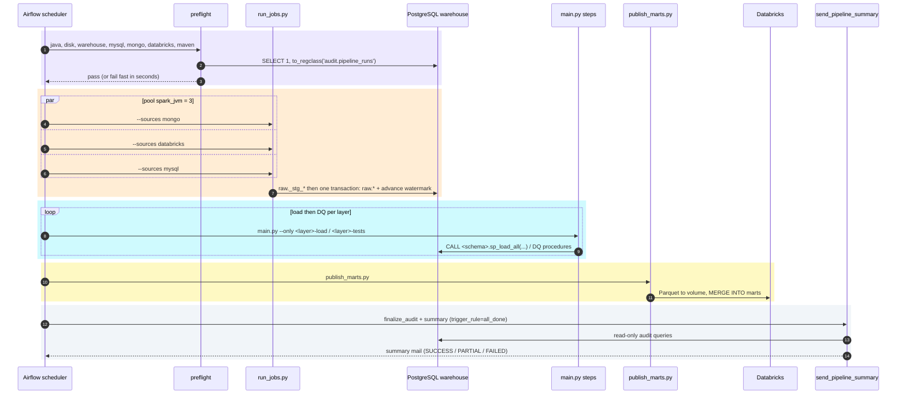

# Pipeline — Banking-Delta-Lakehouse

Daily pipeline: MySQL / MongoDB / Databricks `public` → PySpark → PostgreSQL
(`raw → staging → analytics → marts`) → Databricks Delta marts. SQL stored procedures do
the transformations, SQL data-quality suites gate every layer, Airflow orchestrates.

## Colour legend (used in every diagram)

| Colour | Meaning |
|---|---|
| Blue | source systems |
| Violet | orchestration / entry points |
| Orange | `raw` landing layer |
| Cyan | `staging` cleansing layer |
| Green | `analytics` dimensional layer |
| Pink | `marts` business layer |
| Yellow | Databricks Delta publish target |
| Slate | audit / cross-cutting concerns |
| Red | data-quality gates and failures |
| Indigo | read-only consumers (dashboard, preflight) |

## Architecture



## Layer flow with DQ gates

A DQ failure anywhere stops everything downstream — a critical failure blocks publish.

```mermaid
flowchart LR
    A[("MySQL<br/>5 tables<br/>full loads")] --> E1["extract_mysql.py"]
    B[("MongoDB<br/>2 collections<br/>incremental by _id")] --> E2["extract_mongo.py"]
    C[("Databricks public<br/>3 tables<br/>incremental by created_at")] --> E3["extract_databricks.py"]

    E1 --> RAW[("raw.*<br/>_batch_id, _loaded_at")]
    E2 --> RAW
    E3 --> RAW

    RAW -->|"DQ gate: raw_tests"| RAWOK{"raw DQ<br/>pass?"}
    RAWOK -->|yes| STG[("staging.*<br/>cleaned, deduped, SCD1")]
    RAWOK -->|no| STOP1["stop: publish blocked"]

    STG -->|"DQ gate: staging_tests"| STGOK{"staging DQ<br/>pass?"}
    STGOK -->|yes| ANA[("analytics.*<br/>dims + facts")]
    STGOK -->|no| STOP2["stop"]

    ANA -->|"DQ gate: analytics_tests"| ANAOK{"analytics DQ<br/>pass?"}
    ANAOK -->|yes| MRT[("marts.*<br/>business marts")]
    ANAOK -->|no| STOP3["stop"]

    MRT -->|"DQ gate: marts_tests"| MRTOK{"marts DQ<br/>pass?"}
    MRTOK -->|yes| PUB["publish_marts.py<br/>Parquet to volume to MERGE"]
    MRTOK -->|no| STOP4["stop"]
    PUB --> DELTA[("Databricks marts<br/>Delta tables")]

    classDef src fill:#dbeafe,stroke:#1d4ed8,color:#1e3a8a,stroke-width:2px
    classDef raw fill:#ffedd5,stroke:#c2410c,color:#7c2d12,stroke-width:2px
    classDef staging fill:#cffafe,stroke:#0e7490,color:#164e63,stroke-width:2px
    classDef analytics fill:#dcfce7,stroke:#15803d,color:#14532d,stroke-width:2px
    classDef marts fill:#fce7f3,stroke:#be185d,color:#831843,stroke-width:2px
    classDef delta fill:#fef9c3,stroke:#a16207,color:#713f12,stroke-width:2px
    classDef gate fill:#fee2e2,stroke:#b91c1c,color:#7f1d1d,stroke-width:2px
    classDef ext fill:#e0e7ff,stroke:#4338ca,color:#312e81,stroke-width:2px

    class A,B,C src
    class E1,E2,E3 ext
    class RAW raw
    class STG staging
    class ANA analytics
    class MRT marts
    class DELTA delta
    class RAWOK,STGOK,ANAOK,MRTOK,STOP1,STOP2,STOP3,STOP4 gate
    class PUB delta
```



Only extraction and publish are Python jobs; steps 2–5 run inside PostgreSQL/Databricks
as stored procedures. Every DQ suite writes its verdict to `audit.dq_run` /
`audit.dq_violation` **before** raising, so the reason survives the rollback
(`docs/DATA-QUALITY.md`).

## Two entry points, one set of steps

| Entry point | Use | Orchestrated by |
|---|---|---|
| `python main.py` | manual / CI full run, 9 gated steps in order | human, `make daily` |
| `airflow/dags/banking_delta_daily.py` | scheduled production run (02:00 IST) | Airflow scheduler |

Both call the **same** scripts (`scripts/run_jobs.py`, `scripts/run_*_tests.py`,
`src/jobs/publish_marts.py`) and the **same** SQL master loads
(`sql/{staging,analytics,marts}/00_master_load.sql`). Airflow adds retries, pools, per-task
state and alerting — it contains no pipeline logic of its own.

The 9 steps of `main.py` (`python main.py --list`):

```
1  raw        raw-inject        land MySQL, MongoDB, Databricks into raw
2  raw        raw-tests         DQ gate on raw
3  staging    staging-load      CALL staging.sp_load_all()
4  staging    staging-tests     DQ gate on staging
5  analytics  analytics-load    CALL analytics.sp_load_all()
6  analytics  analytics-tests   DQ gate on analytics
7  marts      marts-load        CALL marts.sp_load_all()
8  marts      marts-tests       DQ gate on marts
9  marts      publish           publish marts to Databricks Delta
```

## A scheduled Airflow run, end to end



The three extracts run in parallel (pool `spark_jvm` has 3 slots), each owning exactly one
Spark session; `publish` uses the same pool, so it runs alone after the extracts finish.

## Publish to Databricks Delta

```mermaid
flowchart LR
    PG[("PostgreSQL marts.mart_*")]
    WM["read Delta watermark<br/>SELECT max(wm) FROM target"]
    READ["Spark JDBC read<br/>windowed rows"]
    PQ["pyarrow Parquet<br/>local files"]
    VOL["upload to Unity Catalog volume<br/>Workspace SDK"]
    SQL["MERGE INTO target USING read_files<br/>or INSERT OVERWRITE"]
    DELTA[("Databricks marts.mart_*")]

    WM --> READ
    PG --> READ
    READ --> PQ --> VOL --> SQL --> DELTA
    DELTA -.->|watermark next run| WM

    classDef pg fill:#fce7f3,stroke:#be185d,color:#831843,stroke-width:2px
    classDef step fill:#e0e7ff,stroke:#4338ca,color:#312e81,stroke-width:2px
    classDef files fill:#fef9c3,stroke:#a16207,color:#713f12,stroke-width:2px
    classDef delta fill:#dcfce7,stroke:#15803d,color:#14532d,stroke-width:2px
    class PG pg
    class WM,READ,SQL step
    class PQ,VOL files
    class DELTA delta
```



The watermark is read from the Delta target itself, so publishing is self-incrementing:
date watermarks re-read the last N months (late arrivals, `--lookback`
/ `PUBLISH_LOOKBACK_MONTHS`); timestamp watermarks use strict `>`.

## Running it

```bash
make daily                          # full gated run (writes to warehouse + Databricks!)
python main.py                      # same, stops at first failing step
python main.py --only staging-load  # one layer
python main.py --list               # show the 9 steps

# one layer at a time (debugging)
python scripts/run_jobs.py                     # extracts: mongo -> databricks -> mysql
python scripts/run_raw_tests.py                # raw DQ gate
psql ... -f sql/staging/00_master_load.sql     # CALL staging.sp_load_all()
```

Pipeline targets act on the environment `.env` points at — see `AGENTS.md` before running
them. Airflow stack lives in `airflow/` (see `docs/AIRFLOW.md`).
