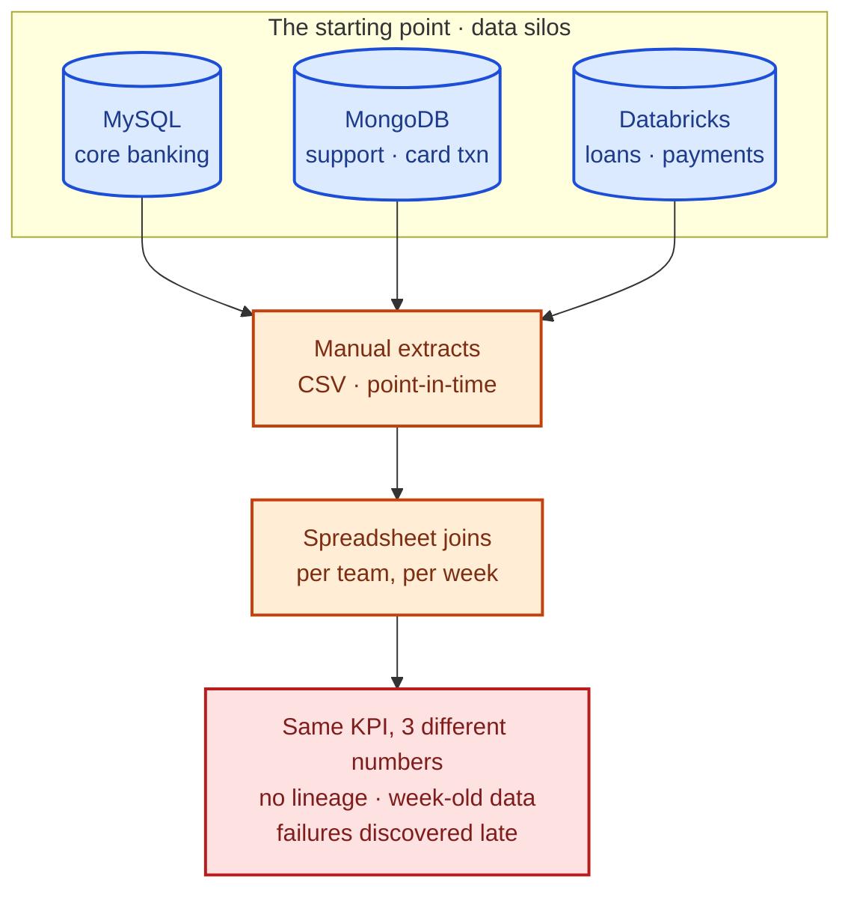
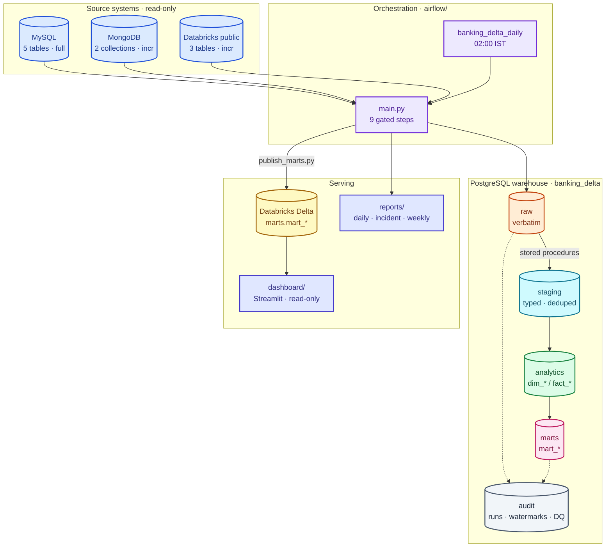
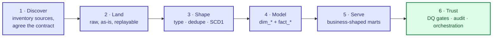
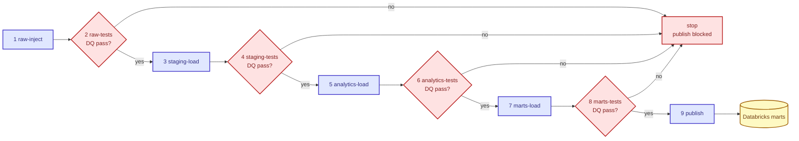
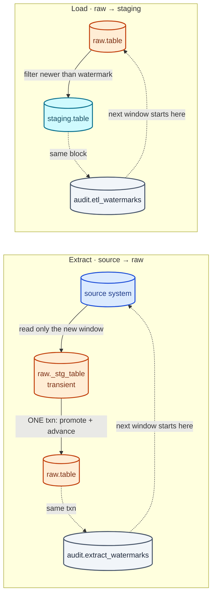
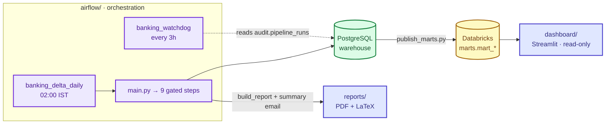

# The Problem We Solved — Banking-Delta-Lakehouse

> **Business problem in one line:** a bank's data lived in three disconnected systems,
> nobody agreed on a number, and decisions waited on manual reports — so we built one
> daily, audited pipeline that turns those systems into a single source of truth.

What was broken, how we approached it, how the design works, and what the three
deliverable components (`airflow/`, `dashboard/`, `reports/`) do. The engineering
blueprint is [../ARCHITECTURE.md](../ARCHITECTURE.md).

**Colour legend** (same as `ARCHITECTURE.md`): blue = sources, violet = orchestration,
orange = `raw`, cyan = `staging`, green = analytics / success, pink = `marts`,
yellow = Delta, slate = audit, red = pain / DQ gates, indigo = consumers.

---

## 1. The business problem

| System | What it holds | Shape |
|---|---|---|
| MySQL `banking_core_db` | customers, accounts, branches, employees, cards | OLTP, full-state tables |
| MongoDB `banking_support_db` | support tickets, card transactions | schemaless documents |
| Databricks `public` | loans, loan_payments, transactions | analytical, timestamped |

Operations, risk and leadership needed the *same* answers — a customer's full
relationship, branch performance, whether fraud was rising — but each answer had to be
assembled by hand from three engines with three query languages and no shared history.

**What it cost:** new questions took days to answer, numbers were irreproducible,
nobody could say which extract a figure came from, bad data surfaced only after a
report shipped, and a broken overnight job showed up as a stale dashboard.

---

## 2. What we built

A **daily lakehouse pipeline**: land the three sources *as-is* into PostgreSQL, shape
them through four controlled layers, gate every step with data-quality checks, then
publish the finished business tables to Databricks Delta for the dashboard and
reports. Airflow schedules it at 02:00; `main.py` runs exactly the same steps by hand.

---

## 3. The approach

We did not start with dashboards. We made the *data* trustworthy first, then earned
the right to serve it.

1. **Discover** — every source table got a JSON contract (columns, business key,
   load strategy) validated in CI, so an upstream schema change breaks the build, not
   a report.
2. **Land first** — `raw` copies the source verbatim plus `_batch_id`/`_loaded_at`;
   anything downstream can be replayed from the original rows.
3. **Shape once, in SQL** — `staging` procedures type, dedupe and keep current state.
4. **Model for questions** — a star schema in `analytics`, business-shaped tables in
   `marts`.
5. **Gate everything** — DQ suites run between layers; a critical failure blocks publish.
6. **Wrap with observability** — audit tables, Airflow retries/alerts, a watchdog DAG.

---

## 4. The design

### 4.1 Four layers, one owner each

| Layer | Answers | Written by |
|---|---|---|
| `raw` | *What did the source actually give us?* | the extractors (PySpark) |
| `staging` | *Clean, current state of each entity?* | `staging.sp_load_*` |
| `analytics` | *How do entities relate?* (star schema) | `analytics.sp_load_*` |
| `marts` | *What does the business question look like?* | `marts.sp_load_*` |
| Databricks Delta | *Where do consumers read?* | `publish_marts.py` |

Only one writer may touch a schema, so two jobs can never fight over the same table.

### 4.2 Every run is a chain of gates

Nine steps in order; a failing data-quality check stops the run before the next layer
loads, so nothing downstream ever reads a half-loaded table.

- **44 SQL checks** across four suites (keys, bad dates, orphans, business rules,
  duplicates, completeness, reconciliation…), verdicts stored in `audit.dq_*`.
- The gate **commits its verdict, then raises** — the reason for a failure survives
  the rollback.
- A critical failure **blocks publish**: bad data never reaches the dashboard.

### 4.3 Crash-safe by construction: watermarks

The expensive bugs — duplicated or lost rows after a crash — are removed structurally:
the data and its watermark move in **one transaction**, with optimistic locking so two
concurrent runs cannot both win.

- **Idempotent** — re-running adds no duplicates (incremental layers dedupe on the
  business key; full loads `TRUNCATE` + `INSERT` atomically).
- **Crash-safe** — a failure before commit leaves table and watermark untouched; the
  retry re-reads the same window.
- **Incremental** — only the new slice of each source is read, so the run stays minutes.
- Two watermark stores (source→raw, raw→staging) that are never mixed.

### 4.4 Everything is recorded

Audit rows are written in their **own** transactions, so a `FAILED` record survives the
data load's rollback: `audit.pipeline_runs` (one per execution), `audit.table_runs`
(per attempt, with row counts), `audit.pipeline_errors` (classified, secret-redacted),
`audit.dq_run` / `dq_violation`, and the two watermark tables. Runs always resolve to
`SUCCESS`, `PARTIAL` or `FAILED`.

---

## 5. The three moving parts

### `airflow/` — when it runs and who it tells

Docker Compose stack (scheduler, worker, API server on `:8080`, Celery + Redis) with
two DAGs — and **no pipeline logic**: it calls the same `main.py` entry points a human
would.

- `banking_delta_daily` — `02:00 IST`, one active run, 5h timeout; loads retry once,
  DQ gates never retry (`retries=0`) because a data defect does not fix itself.
- `banking_watchdog` — every 3 hours, reads `audit.pipeline_runs`, **silent when
  healthy**, mails `[MISSED]` / `[STUCK]` otherwise.
- `send_pipeline_summary` emails `[SUCCESS]` / `[FAILED]` with the report PDF and
  `.tex` attached; `fail_if_any_failed` turns the run red so Airflow matches reality.

### `dashboard/` — the read-only view

Streamlit + Plotly, six pages — Overview, KPI Explorer, Customers, Loans, Cards,
Branches — each mapped to one mart.

- Every chart is a **live `SELECT`** against Databricks Delta: no extracts, no cached
  copies; a 5-minute cache plus a manual refresh protect the warehouse.
- Read-only credentials; runs locally (`streamlit run app.py`) or in Docker.

### `reports/` — the paper trail

A LaTeX report builder (`reports/chapters/`, `reports/scripts/build.py`) producing
three kinds: **daily** (verdict banner, KPI cards, checks), **incident** (one run,
deep-dive) and **weekly** (digest).

- Built as an Airflow task right after the run; PDF + `.tex` source are attached to
  the summary email, kept 30 days.
- `make report`, `report-incident RUN=<id>`, `report-weekly`, `report-fixture` (no TeX,
  part of CI).

---

## 6. What the business gets

| Mart | The question it answers |
|---|---|
| `mart_customer_360` | Who is this customer across every product? |
| `mart_branch_performance` | How is each branch performing vs its peers? |
| `mart_monthly_transactions` | What is the transaction volume and value trend? |
| `mart_loan_portfolio` | What is the state of the loan book? |
| `mart_card_fraud` | Is card fraud increasing, and where? |
| `mart_support_performance` | Are tickets being resolved fast and well? |
| `mart_kpi_monthly` | The single set of monthly KPI numbers for leadership |

| | Before | After |
|---|---|---|
| Source of truth | three systems, per-team extracts | one warehouse, one governed mart layer |
| Time to a new answer | days of manual joining | a query against a ready-made mart |
| Reproducible? | no — depends when you ran it | yes — watermarks, batch ids, audit history |
| Data quality | found after publication | 44 checks gate every layer, publish blocked |
| Failure visibility | stale dashboard, discovered late | Airflow red, watchdog mails, report explains |
| Trust | *"whose number is right?"* | *"here is the run and the checks behind it"* |

---

## 7. Design decisions

| Decision | Why | Rejected |
|---|---|---|
| Land verbatim into `raw` first | replayable, auditable, no history lost | transform straight from source |
| PostgreSQL for transforms | set-based procedures in one transaction | Spark-side transforms |
| Watermark advances with the data | crash can neither lose nor double-count | separate watermark update |
| DQ gates between layers, commit-then-raise | verdict survives; publish blocked | validate after publish |
| `main.py` and Airflow share one code path | manual run reproduces the scheduled run | Airflow-only logic — drifts fast |
| `NUMERIC(18,2)` money, UTC `timestamptz` | float rounds a balance off; UTC ends tz bugs | `float`, server-local time |
| Contracts validated in CI | upstream change breaks the build, not a report | discover at runtime |
| Retry loads, never DQ gates | infra fixes itself, data defects do not | retry everything — hides defects |

---

## 8. Guardrails

1. Watermarks advance only inside the load/extract transaction.
2. Every load is safe to run twice with the same input.
3. A critical DQ failure blocks publish.
4. Each schema is written only by its owner.
5. Money is `NUMERIC(18,2)`; all instants are UTC.
6. Audit rows survive failure (own transactions; commit before raise).
7. Never weaken a test, hook or CI check to get green.

---

## 9. Where to go next

| Question | Document |
|---|---|
| The blueprint, layer by layer | [../ARCHITECTURE.md](../ARCHITECTURE.md) |
| The daily run end to end | [PIPELINE.md](PIPELINE.md) |
| Data contracts and DQ gates | [CONTRACTS.md](CONTRACTS.md) · [DATA-QUALITY.md](DATA-QUALITY.md) |
| Audit, watermarks, lineage | [AUDIT.md](AUDIT.md) |
| Orchestration and alerts | [AIRFLOW.md](AIRFLOW.md) · [../airflow/README.md](../airflow/README.md) |
| Reports and the dashboard | [REPORTING.md](REPORTING.md) · [../dashboard/README.md](../dashboard/README.md) |
| Operating it day to day | [RUNBOOK.md](RUNBOOK.md) |
