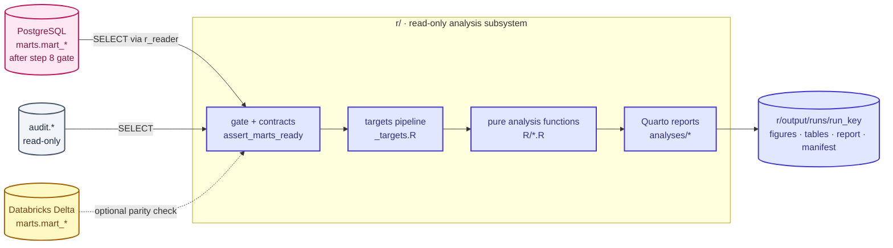

# R Analysis Guide — Banking-Delta-Lakehouse Marts

> How to build a production-grade R analysis layer on top of `marts.mart_*`: what the
> `r/` folder looks like, which analyses to run on which mart, and the standards that keep
> it reproducible, safe and testable. Read `ARCHITECTURE.md` first; this guide extends it
> and never overrides it. If this file and the code disagree, the code wins — then fix this file.

## 0. Scope and assumptions

**What this guide covers.** A read-only R subsystem that consumes the seven marts
(`mart_customer_360`, `mart_branch_performance`, `mart_monthly_transactions`,
`mart_loan_portfolio`, `mart_card_fraud`, `mart_support_performance`, `mart_kpi_monthly`)
and produces statistical analyses, models, forecasts and Quarto reports.

**What I took from `ARCHITECTURE.md`:** layer ownership (§5), the eight contracts (§14),
hermetic CI and Makefile/`tasks.bat` parity (§12), env-only secrets (§11), the existing
`reports/` LaTeX subsystem (§16), and the fact that marts exist in two places: PostgreSQL
(`marts.*`) and Databricks Delta (`marts.*`, published by step 9).

**What I could not see — confirm before coding:**

| Unknown | Where to confirm |
|---|---|
| Column names, grain and keys of each mart | `sql/marts/*.sql` — or run `scripts/dump_mart_schema.R` (§4.6) |
| Freshness column per mart | `MART_CONFIG` in `src/jobs/publish_marts.py` |
| Exact env-var names for the warehouse | `.env.example` and `src/utils/connection.py` |
| Columns of `audit.v_dq_latest` / `audit.pipeline_runs` timestamps | `docs/AUDIT.md`, `sql/scripts/` |

Every R snippet below uses column names as **function arguments or config values**, never
hard-coded guesses, for exactly this reason.

---

## 1. Principles — R inherits the pipeline's contracts

R is a **read-only consumer** (indigo in the repo legend, like the Streamlit dashboard).
It must not weaken any contract in `ARCHITECTURE.md` §14.

| Contract (§14) | What it means for R |
|---|---|
| Layers written only by owners | R has **no write grant** on `raw/staging/analytics/marts/audit`. Results go to files (`r/output/`), not tables. |
| A critical DQ failure blocks publish | R refuses to analyse marts that did not pass step 8 (`assert_marts_ready()`, §4.3). |
| Money is `NUMERIC(18,2)` | R reads money as `double` for modelling, but **reconciles to the cent in SQL** (or as integer cents), never with `==` on doubles. |
| Instants are `timestamptz` UTC | Connection sets `timezone = "UTC"` / `timezone_out = "UTC"`; every `POSIXct` carries `tz = "UTC"`. |
| Idempotent by construction | Same inputs + same `renv.lock` + same seed ⇒ identical outputs. Analyses are pure functions of their inputs. |
| Audit survives failure | Each run writes a `manifest.json` *before* analysis and updates it in a `finally`, so a failed run is still recorded. |
| Never weaken a test or check to get green | Same rule: no `skip_on_ci()` to dodge a failing test, no lowering `fail_under`. |
| Secrets only in the environment | R reads `Sys.getenv()` only. No credentials in code, `.Rprofile`, Quarto files or `renv.lock`. |

Four R-specific principles on top:

1. **Pure core, thin shell.** Analysis functions take data frames and return data frames,
   models or plots. Only `R/db.R` and `R/extract.R` touch the network (mirrors the thin
   `scripts/` wrappers on the Python side).
2. **SQL stays in SQL, statistics stay in R.** Aggregate and filter in the warehouse via
   `dbplyr`/`.sql` files; pull only what the statistic needs.
3. **Everything is pinned.** `renv.lock` for packages, a fixed seed for randomness,
   `targets` for the dependency graph.
4. **Aggregates leave the building, rows don't.** Reports contain aggregated, small-cell-suppressed
   results only (§10).

---

## 2. Where R fits



### 2.1 Which copy of the marts should R read?

| Option | Use when | Trade-off |
|---|---|---|
| **PostgreSQL `marts.*`** (default) | Analysis, modelling, anything you want to run right after step 8 | Source of truth; available even if publish (step 9) failed. Needs a read-only role. |
| **Databricks Delta `marts.*`** | You must match exactly what the dashboard shows | Only fresh after step 9; Databricks credentials; slower for iterative work. |
| **Both** (parity check only) | A scheduled reconciliation analysis (§5.1) | Doubles connections; run weekly, not daily. |

**Rule:** read `marts.*` only. If a mart is too aggregated for the question (e.g. you need
payment-level data for vintage analysis), the right fix is a **new or extended mart built by
`marts.sp_load_*`** — not reading `raw`/`staging` from R. If you must read `analytics.*`,
make that an explicit, documented, `SELECT`-only exception in `r/config/analysis.yml`.

### 2.2 `r/` vs `reports/`

`reports/` is the pipeline's **operational** report (per-run PDF/LaTeX attached to the daily
email). `r/` is **analytical** work (segmentation, forecasts, models). Keep them separate;
if an R result should appear in the daily PDF later, export a small table/figure into
`reports/` through its existing build script rather than coupling the two.

---

## 3. Folder layout

`r/` is a standard **R package** (so `devtools`, `testthat`, `lintr` and `R CMD check` work
out of the box) driven by a **`targets`** pipeline and rendered with **Quarto**.

```text
r/
├── DESCRIPTION                  # package metadata + Imports (the dependency contract)
├── NAMESPACE                    # generated by roxygen2 — never hand-edit
├── .Rbuildignore
├── .Rprofile                    # ONE line: source("renv/activate.R")
├── .lintr                       # lint rules (line length, naming)
├── .gitignore                   # output/ · .Renviron · _targets/ · *.rds
├── renv.lock                    # pinned package versions — committed
├── renv/                        # activate.R + settings.json committed; library/ ignored
├── main.R                       # ENTRY POINT: preflight → gate → extract → profile → report
├── Dockerfile                   # container image: pinned R, non-root, secrets at run time
├── .dockerignore · .env.r.example   # build context filter · variable names for --env-file
├── _targets.R                   # (next step) dependency-graph pipeline, called from main.R
│
├── config/
│   ├── analysis.yml             # marts list, freshness cols, thresholds, seeds, horizons
│   └── contracts.yml            # per-mart expected columns, keys, types, ranges
│
├── R/                           # FUNCTIONS ONLY — no side effects when sourced
│   ├── config.R                 # THE only place Sys.getenv() is read
│   ├── db.R                     # connect (read-only, UTC), query helpers
│   ├── gate.R                   # assert_marts_ready(), freshness, DQ verdict
│   ├── contracts.R              # assert_contract(): columns, keys, nulls, ranges
│   ├── extract.R                # read_mart(), mart_fingerprint()
│   ├── run_context.R            # run_key, git SHA, manifest read/write
│   ├── logging.R                # logger wrapper — no row values, ever
│   ├── privacy.R                # (planned) small-cell suppression, id hashing
│   ├── stats_helpers.R          # (planned) gini, psi, bootstrap CI, shrinkage, backtests
│   ├── plot_theme.R             # (planned) one ggplot theme + palette for every figure
│   ├── utils.R                  # %||%
│   ├── cross_mart.R             # profile_mart(), write_table() — Tier 0, works on any mart
│   └── mart_<name>.R            # (planned) pure analysis functions, ONE FLAT FILE PER MART
│                                #   e.g. mart_kpi_monthly.R, mart_card_fraud.R
│
├── inst/sql/                    # parametrised read queries — SQL out of R strings
│   ├── mart_freshness.sql
│   └── mart_schema_dump.sql
│
├── analyses/                    # Quarto narratives (thin: call package functions, show results)
│   ├── 00_data_trust/           #   profile · contracts · reconciliation · freshness
│   ├── 01_customer_360/
│   ├── 02_branch_performance/
│   ├── 03_monthly_transactions/
│   ├── 04_loan_portfolio/
│   ├── 05_card_fraud/
│   ├── 06_support_performance/
│   ├── 07_kpi_monthly/
│   └── _shared/                 #   _setup.qmd, _quarto.yml, brand CSS
│
├── scripts/
│   ├── check_gate.R             # exit 0/1 — usable from Make or Airflow
│   └── dump_mart_schema.R       # writes docs/DATA-DICTIONARY.md from information_schema
│
├── tests/
│   ├── testthat.R
│   └── testthat/
│       ├── setup.R              # unsets DB env vars — the R twin of conftest no_network
│       ├── fixtures/            # tiny synthetic mart frames (CSV/parquet), no real data
│       └── test-*.R             # one file per R/ file
│
├── docs/
│   ├── DATA-DICTIONARY.md       # generated: columns, types, grain per mart
│   ├── METHODS.md               # every method: assumptions, validation, known limits
│   └── MODEL-CARDS/             # one card per predictive model
│
└── output/                      # GIT-IGNORED
    └── runs/
        └── <run_key>/           # manifest.json · session_info.txt · figures/ · tables/ · report.html
```

### 3.1 Conventions

| Topic | Rule |
|---|---|
| File ↔ test | `R/foo.R` ⇒ `tests/testthat/test-foo.R`. A function without a test does not merge. |
| Function names | `snake_case`, verb first (`fit_`, `plot_`, `assert_`, `read_`). Exported functions have roxygen docs. |
| Quarto files | Thin: parameters + calls + narrative. **No analysis logic in `.qmd`** — it can't be unit-tested. |
| Config | Thresholds, horizons, seeds, mart lists live in `config/analysis.yml`, not in code. |
| `R/` is flat | R packages do not allow sub-folders under `R/` (they are ignored by `R CMD INSTALL`). Use a prefix instead: `mart_kpi_monthly.R`, `mart_card_fraud.R`. |
| ASCII only | Keep `R/`, `config/*.yml`, `main.R` and `Dockerfile` ASCII. A non-UTF-8 locale silently breaks YAML parsing on a stray em dash. |
| No globals | No `setwd()`, no `<<-`, no `source()` in `R/`, no `library()` in `R/` (use `pkg::fn`). |
| Output | Only under `output/runs/<run_key>/`. Nothing written into the repo tree. |
| Run key | Same sanitiser as `reports/` (`[^A-Za-z0-9_]+ → "_"`, trimmed) so a run can be correlated with `audit.pipeline_runs`. |

---

## 4. Core modules (the production skeleton)

### 4.1 `R/config.R` — the only env reader

```r
# Configuration. This is the ONLY file that reads environment variables.
# Credentials come from the environment only - never from code, .Rprofile or Quarto files.

#' Path relative to the project root
#'
#' The root is set once by `main.R` via `options(bankinganalytics.root = ...)`.
#' @param ... Path components.
#' @export
project_path <- function(...) {
  file.path(getOption("bankinganalytics.root", getwd()), ...)
}

#' Read an environment variable
#' @param name Variable name.
#' @param default Returned when the variable is unset or empty. If NULL, a missing
#'   variable is an error.
#' @export
cfg_env <- function(name, default = NULL) {
  val <- Sys.getenv(name, unset = NA_character_)
  if (is.na(val) || !nzchar(val)) {
    if (!is.null(default)) {
      return(default)
    }
    stop(sprintf("Missing required environment variable: %s", name), call. = FALSE)
  }
  val
}

#' Load config/analysis.yml
#' @param path Path to the YAML file.
#' @export
cfg_analysis <- function(path = project_path("config", "analysis.yml")) {
  if (!file.exists(path)) stop("Config not found: ", path, call. = FALSE)
  yaml::read_yaml(path)
}

#' Load config/contracts.yml
#' @param path Path to the YAML file.
#' @export
cfg_contracts <- function(path = project_path("config", "contracts.yml")) {
  if (!file.exists(path)) stop("Contracts not found: ", path, call. = FALSE)
  yaml::read_yaml(path)
}

#' Root folder for run outputs (R_OUTPUT_DIR, default <root>/output)
#' @export
output_dir <- function() {
  cfg_env("R_OUTPUT_DIR", project_path("output"))
}
```

The shipped variables are `R_PG_HOST`, `R_PG_PORT`, `R_PG_DATABASE`, `R_PG_USER`, `R_PG_PASSWORD`, `R_PG_SSLMODE` (see `r/.env.r.example`) - deliberately separate from the pipeline's own variables so R always uses the **read-only role** (`r_reader`). Set `R_PG_SSLMODE=require` outside local development. Document every new variable in `.env.example` so
`tests/smoke/test_env_contract.py` stays green.

### 4.2 `R/db.R` — read-only, UTC, time-boxed

```r
# Warehouse access: read-only, UTC, time-boxed. Only db.R and extract.R touch the network.

#' Open a read-only warehouse connection
#'
#' Uses the dedicated read-only role (R_PG_USER). The session is forced read-only,
#' UTC, with a statement timeout, so a bug in R cannot write or hang the warehouse.
#' @export
pg_connect <- function() {
  # Read every setting first so a missing variable fails fast, before any driver is touched.
  host     <- cfg_env("R_PG_HOST")
  port     <- as.integer(cfg_env("R_PG_PORT", "5432"))
  dbname   <- cfg_env("R_PG_DATABASE", "banking_delta")
  user     <- cfg_env("R_PG_USER")
  password <- cfg_env("R_PG_PASSWORD")
  sslmode  <- cfg_env("R_PG_SSLMODE", "prefer")

  con <- DBI::dbConnect(
    RPostgres::Postgres(),
    host             = host,
    port             = port,
    dbname           = dbname,
    user             = user,
    password         = password,
    sslmode          = sslmode,
    connect_timeout  = 10,
    application_name = "bankinganalytics-r",
    timezone         = "UTC",
    timezone_out     = "UTC",
    bigint           = "numeric"
  )
  DBI::dbExecute(con, "SET default_transaction_read_only = on")
  DBI::dbExecute(con, "SET statement_timeout = '120s'")
  con
}

#' Run `fn(con)` with a connection that is always closed
#' @param fn A function taking a DBI connection.
#' @export
with_pg <- function(fn) {
  con <- pg_connect()
  on.exit(DBI::dbDisconnect(con), add = TRUE)
  fn(con)
}
```

Database-side hardening (a one-time SQL script next to `sql/scripts/`, owned by the DBA/owner,
not by R):

```sql
CREATE ROLE r_reader LOGIN PASSWORD '...';        -- password from your secret store
GRANT CONNECT ON DATABASE banking_delta TO r_reader;
GRANT USAGE ON SCHEMA marts, audit TO r_reader;
GRANT SELECT ON ALL TABLES IN SCHEMA marts, audit TO r_reader;
ALTER DEFAULT PRIVILEGES IN SCHEMA marts GRANT SELECT ON TABLES TO r_reader;
-- deliberately NO access to raw, staging, analytics
```

### 4.3 `R/gate.R` — refuse to analyse un-gated data

```r
# The gate: refuse to analyse marts that are empty, unreadable or stale.

#' Stop unless every configured mart is readable, non-empty and fresh enough
#'
#' The freshness column per mart comes from config/analysis.yml (take it from
#' MART_CONFIG in publish_marts.py). If none is configured, only the non-empty
#' check applies and a warning is logged.
#'
#' Next gate to add once the audit columns are confirmed (docs/AUDIT.md): the latest
#' marts DQ verdict in `audit.v_dq_latest` must have no FAIL.
#' @param con A DBI connection.
#' @param cfg Parsed analysis.yml.
#' @param now Reference instant (injectable for tests).
#' @export
assert_marts_ready <- function(con, cfg = cfg_analysis(), now = Sys.time()) {
  problems <- character()
  default_age <- cfg$gate$default_max_age_hours %||% 30

  for (mart in names(cfg$marts)) {
    spec  <- cfg$marts[[mart]]
    col   <- spec$freshness_col
    stats <- tryCatch(mart_stats(con, mart, col), error = function(e) e)

    if (inherits(stats, "error")) {
      problems <- c(problems, sprintf("%s unreadable: %s", mart, conditionMessage(stats)))
      next
    }
    if (is.na(stats$n) || stats$n == 0) {
      problems <- c(problems, sprintf("%s is empty", mart))
      next
    }
    if (is.null(col)) {
      log_warn("no freshness_col configured for {mart}; only checking it is non-empty")
      next
    }

    max_age <- spec$max_age_hours %||% default_age
    age_h <- as.numeric(difftime(now, as.POSIXct(stats$latest, tz = "UTC"), units = "hours"))
    if (is.na(age_h) || age_h > max_age) {
      problems <- c(problems, sprintf("%s is stale (%s h old, limit %s h)",
                                      mart, format(round(age_h, 1)), max_age))
    }
  }

  if (length(problems)) {
    stop("Marts not ready:\n - ", paste(problems, collapse = "\n - "), call. = FALSE)
  }
  invisible(TRUE)
}
```

Two more gate checks to add once you have confirmed the audit columns (`docs/AUDIT.md`):

- the latest marts DQ verdict in `audit.v_dq_latest` has **no FAIL** (R must honour the same
  gate that blocks publish);
- the latest `audit.pipeline_runs` row is `SUCCESS` (or `PARTIAL` with marts tables succeeded).

Put those queries in `inst/sql/` and call them from `assert_marts_ready()`.

> **Date marts and `max()`:** a date-grain mart (`month_start`, `month_opened`) is "fresh"
> relative to the calendar month, not to hours. Give those marts `max_age_hours` ≈ 24 × 35.

### 4.4 `R/contracts.R` — fail loudly when a mart changes shape

```r
# R-side protection against silent schema drift. Complements (never replaces) the SQL
# DQ suites in tests/data-quality/marts/.

#' Validate a mart extract against its contract
#'
#' @param df The mart as a data frame.
#' @param mart Mart name (used in messages).
#' @param spec Contract for this mart: `required_cols`, `key`, `not_null`, `ranges`.
#' @return `df`, invisibly. Errors on the first violated rule.
#' @export
assert_contract <- function(df, mart, spec) {
  req <- unlist(spec$required_cols)
  if (length(req) == 0L) {
    log_warn("contract for {mart} has no required_cols yet - nothing is being enforced")
  }

  missing <- setdiff(req, names(df))
  if (length(missing)) {
    stop(sprintf("[%s] missing columns: %s", mart, paste(missing, collapse = ", ")),
         call. = FALSE)
  }

  key <- unlist(spec$key)
  if (length(key) && anyDuplicated(df[key]) > 0L) {
    stop(sprintf("[%s] duplicate rows on key (%s)", mart, paste(key, collapse = ", ")),
         call. = FALSE)
  }

  for (col in unlist(spec$not_null)) {
    if (!col %in% names(df)) {
      stop(sprintf("[%s] not_null column missing: %s", mart, col), call. = FALSE)
    }
    if (anyNA(df[[col]])) {
      stop(sprintf("[%s] NULL values in %s", mart, col), call. = FALSE)
    }
  }

  for (col in names(spec$ranges)) {
    if (!col %in% names(df)) {
      stop(sprintf("[%s] range column missing: %s", mart, col), call. = FALSE)
    }
    lo <- spec$ranges[[col]]$min %||% -Inf
    hi <- spec$ranges[[col]]$max %||% Inf
    bad <- sum(df[[col]] < lo | df[[col]] > hi, na.rm = TRUE)
    if (bad > 0L) {
      stop(sprintf("[%s] %d rows out of range in %s", mart, bad, col), call. = FALSE)
    }
  }
  invisible(df)
}
```

`config/contracts.yml` (illustrative — fill from the data dictionary):

```yaml
mart_kpi_monthly:
  required_cols: [month_start]      # + the KPI columns you rely on
  key: [month_start]
  not_null: [month_start]
  ranges: {}
```

This is **R-side** protection for the analyses; it complements (never replaces) the SQL
DQ suites in `tests/data-quality/marts/`.

### 4.5 `R/extract.R` — fingerprints make caching safe (and a name allow-list)

```r
# Reading marts. Marts are small by design, so a full read is fine.

.assert_mart_name <- function(mart) {
  if (!is.character(mart) || length(mart) != 1L || !grepl("^mart_[a-z0-9_]+$", mart)) {
    stop("Invalid mart name: ", format(mart), call. = FALSE)
  }
  invisible(mart)
}

#' Row count and latest freshness value of one mart (cheap change detector)
#' @param con A DBI connection.
#' @param mart Mart table name, e.g. "mart_kpi_monthly".
#' @param freshness_col Optional column whose maximum is the freshness marker.
#' @export
mart_stats <- function(con, mart, freshness_col = NULL) {
  .assert_mart_name(mart)
  tbl <- dplyr::tbl(con, dbplyr::in_schema("marts", mart))
  n <- dplyr::pull(dplyr::count(tbl), "n")
  latest <- NULL
  if (!is.null(freshness_col)) {
    col <- rlang::sym(freshness_col)
    latest <- dplyr::pull(
      dplyr::summarise(tbl, latest = max(!!col, na.rm = TRUE)),
      "latest"
    )
  }
  list(n = as.numeric(n), latest = latest)
}

#' Fingerprint a mart on its own connection
#' @inheritParams mart_stats
#' @export
mart_fingerprint <- function(mart, freshness_col = NULL) {
  with_pg(function(con) mart_stats(con, mart, freshness_col))
}

#' Read a whole mart
#' @param mart Mart table name.
#' @param token Unused value that lets a pipeline (e.g. targets) declare a dependency
#'   on a fingerprint so the read is repeated only when the mart changed.
#' @export
read_mart <- function(mart, token = NULL) {
  .assert_mart_name(mart)
  force(token)
  with_pg(function(con) {
    dplyr::collect(dplyr::tbl(con, dbplyr::in_schema("marts", mart)))
  })
}
```

### 4.6 `scripts/dump_mart_schema.R` — generate the data dictionary first

Before any analysis, generate `docs/DATA-DICTIONARY.md` from
`information_schema.columns` for the seven marts (column, type, nullable) and add a
hand-written **grain** line and **business definition** per measure. Every analysis cites
this file. Analyses written against an undocumented grain are the #1 source of wrong numbers.

### 4.7 `main.R` — the entry point

`main.R` is to the R subsystem what `main.py` is to the pipeline: **one entry point, steps in
gate order, stop at the first failure.** Manual runs, the Docker image and (later) Airflow all
call it - there is no second way to run the analysis.

| # | Step | What it does | Fails when |
|---|---|---|---|
| 1 | `preflight` | env vars, packages, config, writable output folder | any `R_PG_HOST/USER/PASSWORD` missing; package missing |
| 2 | `gate` | `assert_marts_ready()` on every configured mart | a mart is unreadable, empty or stale |
| 3 | `extract` | `mart_fingerprint()` + `read_mart()` + `assert_contract()` per mart | a contract rule is violated |
| 4 | `profile` | `profile_mart()` -> `tables/profile_<mart>.csv` | no mart data in memory |
| 5 | `report` | renders `analyses/*/index.qmd` if any exist | Quarto missing or render error |

```bash
Rscript main.R                    # run everything
Rscript main.R --list             # print the steps and exit
Rscript main.R --only=preflight,gate   # run selected steps (canonical order)
Rscript main.R --keep-going       # continue after a failed step
Rscript main.R --skip-report      # skip step 5
Rscript main.R --run-key=KEY      # e.g. an Airflow dag_run_id (sanitised like reports/)
```

**Exit codes:** `0` success - `1` failed - `2` partial (only with `--keep-going`) - `64` bad usage.

**What a run leaves behind** (`output/runs/<run_key>/`):

```text
manifest.json     # written BEFORE step 1 (RUNNING), rewritten after every step, finalised on exit
session_info.txt
tables/           # profile_<mart>.csv ... (aggregates only)
figures/
reports/          # <name>.html from Quarto
```

The manifest records `run_key`, `status` (`RUNNING | SUCCESS | PARTIAL | FAILED`), start/finish
time (UTC), `git_sha`, R version, per-step status/seconds/error (secret-redacted), per-mart row
count + latest freshness value, and the list of outputs. A failed run is therefore always on
record, the same "audit survives failure" idea as `ARCHITECTURE.md` section 7.

**Design rules baked into `main.R`:**

- Mart data lives **in memory only** (`ctx$data`); nothing row-level is written to disk.
- `--only=profile` alone fails with a clear message, because `profile` needs `extract` in the
  same invocation.
- Old run folders are pruned after the run (`output.retention_days`), never the current one.
- The package is loaded with `pkgload::load_all()` when the source tree is present, otherwise
  from the installed package (that is the Docker case).

**Adding an analysis** (the pattern for every mart in section 5):

1. Write a pure function in `R/mart_<name>.R` (data frame in, data frame/model out) with a
   test in `tests/testthat/test-mart_<name>.R`.
2. Add a `step_<name>(ctx)` function to `main.R` that reads `ctx$data[[mart]]`, calls your
   function and writes under `ctx$run_dir` (`write_table()`); append the relative path to
   `ctx$manifest$outputs`.
3. Register it in `STEP_INFO` and `STEP_FUNS` (the order of `STEP_INFO` is the run order).

### 4.8 Docker image

```bash
# build (GIT_SHA lands in manifest.json; WITH_QUARTO=true only if you render reports)
docker build -t banking-delta-r \
  --build-arg GIT_SHA=$(git rev-parse --short HEAD) r/

# run: secrets at run time, outputs on a volume
docker run --rm --env-file r/.env.r -v "$PWD/r/output:/app/output" banking-delta-r
docker run --rm banking-delta-r --list        # arguments go straight to main.R
```

| Decision | Choice | Why |
|---|---|---|
| Base image | `rocker/r-ver:${R_VERSION}` (default `4.5.1`, a build arg) | Pinned R; CRAN points at a dated package snapshot, so builds are repeatable |
| Packages | `renv.lock` if present, else `DESCRIPTION` | Commit `renv.lock` (section 8.3) for exact versions; the build **fails** if a core package did not install |
| Layering | dependencies copied and installed *before* the source | Code changes do not re-install packages |
| User | non-root (`uid 10001`) | The container never runs as root |
| Secrets | none in the image; `--env-file` / orchestrator secrets | `.env.r` is git-ignored and excluded by `.dockerignore`; gitleaks still scans the repo |
| Quarto | `--build-arg WITH_QUARTO=true` | Off by default to keep the image small |
| Entry point | `ENTRYPOINT ["Rscript", "/app/main.R"]` | One way to run it |
| Output | `VOLUME /app/output` (`R_OUTPUT_DIR`) | Results survive the container |
| Library | system R library (`renv/` and `.Rprofile` are not copied) | No renv auto-activation surprises inside the image |

**Reaching the warehouse from the container.** `R_PG_HOST=host.docker.internal` works on Docker
Desktop; on Linux add `--add-host=host.docker.internal:host-gateway`. To reach a Postgres that
runs in another Compose stack (e.g. the Airflow one), attach the container to that network with
`--network <name>` and use the service name as host. Use the read-only `r_reader` credentials.

**Known limits.** The image is single-stage (the `-dev` headers stay in); a multi-stage build
that copies only the R library and runtime `.so` files is a size optimisation for later. The
image runs one batch job and exits - there is deliberately no `HEALTHCHECK` or long-running server.

### 4.9 Scaffold status

What exists in `r/` today versus what this guide still describes as the target state:

| Area | Status |
|---|---|
| `main.R`, `Dockerfile`, `.dockerignore`, `.env.r.example`, `.gitignore`, `.lintr` | Done |
| `DESCRIPTION`, `NAMESPACE` (export-all pattern until roxygen2 is introduced) | Done |
| `R/`: `config`, `db`, `logging`, `run_context`, `gate`, `contracts`, `extract`, `cross_mart`, `utils`, `privacy`, `stats_helpers`, `plot_theme`, `figures`, `reconciliation`, `monitoring`, all 7 `mart_*` | Done |
| `config/analysis.yml` (`freshness_col`, thresholds, seed), `config/contracts.yml` (all 7 marts) | Done |
| `tests/testthat/` — one test file per `R/` file (config, run_context, contracts, cross_mart, gate, reconciliation, utils, privacy, monitoring, plot_theme, stats_helpers, all `mart_*`) | Done |
| `_targets.R`, Quarto `analyses/*/` (00–07), `docs/DATA-DICTIONARY.md`, `docs/METHODS.md` | Done |
| `docs/MODEL-CARDS/` (template + fraud / PD / attrition cards) | Done (cards marked *planned* until models are trained) |
| Makefile / `tasks.bat` `r-*` targets, `.github/workflows/r-ci.yml` | Done |
| `scripts/dump_mart_schema.R`, `scripts/check_gate.R`, `scripts/prune_runs.R`, `scripts/snapshot_renv.R` | Done |
| `renv.lock` | **To do** — run `Rscript r/scripts/snapshot_renv.R` on a machine with R (or via the rocker image) and commit the lockfile |

What was verified when the scaffold was written: all `R/`, test and `main.R` files parse; the
15 hermetic tests pass (R 4.3.3, with `RPostgres` stubbed and the DuckDB-based gate tests
skipped because DuckDB was unavailable); the gate (empty / stale / missing / fresh), the
profile and the contract checks were exercised against an in-memory database; `main.R --list`,
bad-usage exit code and a failed-preflight run (manifest written, later steps `SKIPPED`) behave
as documented. **Not verified:** the Docker build, a real PostgreSQL connection through
`RPostgres`, a Quarto render, `renv::restore()`, and the DuckDB gate tests. Run those once
before relying on the image.

---

## 5. What analyses to run

Think in five tiers. Each tier assumes the one before it passed.

| Tier | Goal | Typical output | Cadence |
|---|---|---|---|
| **0 · Data trust** | Can I believe these numbers? | Profile, contract result, reconciliation, freshness | Every run |
| **1 · Descriptive** | What happened? | KPI tables, trends, distributions, concentration | Every run |
| **2 · Diagnostic** | Why did it happen? Who differs? | Segmentation, benchmarking, variance bridges, driver models | Weekly / monthly |
| **3 · Predictive** | What will happen? Who is at risk? | Forecasts, risk/fraud/churn models, survival curves | Monthly / on retrain |
| **4 · Monitoring** | Is something drifting or broken? | Control charts, anomaly flags, PSI, model decay | Scheduled |

### 5.1 Tier 0 — cross-mart data trust (build this first)

| Analysis | Method | Why |
|---|---|---|
| **Profile** | Row counts, NULL %, distinct counts, min/max, per column per mart (`skimr`, `janitor`) | Baseline + data dictionary input |
| **Contract check** | `assert_contract()` per mart | Detect silent schema drift (the extractors auto-`ADD COLUMN`) |
| **Cross-mart reconciliation** | e.g. sum of a transaction measure in `mart_monthly_transactions` vs the same measure rolled up in `mart_kpi_monthly`, per month, **in SQL**, tolerance 0.00 for money | Marts are built from the same facts; they must agree |
| **PostgreSQL ↔ Delta parity** | Per-month row count + sums, both systems | Catches publish `MERGE`/lookback bugs |
| **Freshness / completeness** | Latest period present, no missing months in date marts | Gaps break forecasts and YoY |
| **Distribution shift vs last run** | PSI / KS on key measures (stored in previous `manifest.json`) | Early warning for upstream change |

### 5.2 `mart_kpi_monthly` — executive KPIs

| Analysis | Method / packages |
|---|---|
| Trend and seasonality | STL decomposition (`feasts::STL`), MoM/QoQ/YoY with `slider` |
| **Variance bridge** (why did KPI X move?) | Additive decomposition into volume / mix / rate effects → waterfall (`ggplot2`) |
| Process control | Individuals charts with 3σ limits (`qcc`) to separate noise from real shifts |
| Structural breaks | `strucchange::breakpoints`, `changepoint` — flag regime changes |
| KPI relationships | Rolling correlations, lead–lag cross-correlation (`ccf`), **not** causal claims |
| Forecast | ETS/ARIMA ensemble with rolling-origin backtest (§5.4 pattern) |

Pitfall: KPIs are ratios — average ratios by **re-computing from numerators and denominators**,
never by averaging the ratio column.

### 5.3 `mart_customer_360` — customer view

| Analysis | Method / packages | Output |
|---|---|---|
| **Concentration** | Lorenz curve, Gini, top-decile share (`ineq`) | "10% of customers hold X% of balances" |
| **RFM-style segmentation** | Recency/frequency/monetary features → quantile scoring or k-means / GMM (`tidyclust`, `mclust`); pick *k* via silhouette + stability across seeds | Segment profile table |
| **Product holding / cross-sell** | Association rules (`arules`) on product ownership; lift and confidence with min support | Next-best-product shortlist |
| **Lifetime value** | Contribution-margin-based CLV; if you only have balances/fees, label it a *proxy* | CLV deciles |
| **Attrition / dormancy risk** | Logistic / gradient-boosted model (`tidymodels`) with an **explicit, written outcome definition** (e.g. no activity N days) and a time-based split | Scored list + model card |
| **Segment drift** | Segment mix over time, PSI of features | Monitoring panel |

Pitfalls: define the label window *before* modelling; no features from after the label date;
this mart is the most PII-heavy — see §10.

### 5.4 `mart_monthly_transactions` — volumes and values

| Analysis | Method / packages |
|---|---|
| Seasonality & calendar effects | STL, month/weekday effects, working-day adjustment |
| **Forecast with honest validation** | `fable` (`ETS`, `ARIMA`, `SNAIVE` benchmark) with **rolling-origin** CV (`tsibble::stretch_tsibble`) |
| Anomaly detection | STL residual z-scores / IQR on residuals; flag, don't auto-delete |
| Mix analysis | Share of channel / type over time (compositional plots; log-ratio if you model shares) |
| Elasticity & growth | Log-difference growth, CAGR with bootstrap interval |

Reusable backtest scaffold (pure function, unit-testable):

```r
#' Rolling-origin backtest of ETS / ARIMA against a seasonal-naive benchmark
#' @param df data frame with one row per month
#' @param date_col,value_col column names (strings)
#' @export
backtest_forecast <- function(df, date_col, value_col, h = 3, initial = 24, step = 1) {
  ts <- df |>
    dplyr::transmute(month = tsibble::yearmonth(.data[[date_col]]),
                     y     = .data[[value_col]]) |>
    tsibble::as_tsibble(index = month)

  if (any(tsibble::has_gaps(ts)$.gaps)) {
    stop("Monthly series has gaps; fix upstream or handle explicitly.", call. = FALSE)
  }
  if (nrow(ts) < initial + h) stop("Series too short for requested backtest.", call. = FALSE)

  ts |>
    tsibble::stretch_tsibble(.init = initial, .step = step) |>
    fabletools::model(
      snaive = fable::SNAIVE(y),
      ets    = fable::ETS(y),
      arima  = fable::ARIMA(y)
    ) |>
    fabletools::forecast(h = h) |>
    fabletools::accuracy(ts)
}
```

**Rule:** a forecast model is only reported if it beats `SNAIVE` on the backtest. Report
prediction intervals, not just point forecasts.

### 5.5 `mart_loan_portfolio` — credit portfolio

| Analysis | Method / packages |
|---|---|
| Portfolio quality | Delinquency buckets, NPL ratio, coverage — **recomputed from counts/balances** |
| **Vintage analysis** | Cohort by `month_opened`, performance by months-on-book (cohort triangle heatmap) |
| **Roll rates / transition matrices** | Bucket-to-bucket Markov transition probabilities (needs a bucket history; may require a mart extension) |
| **Time-to-default / prepayment** | Kaplan–Meier + Cox PH (`survival`, `ggsurvfit`, `flexsurv`); handle censoring explicitly |
| **Probability-of-default scorecard** | WoE/IV binning + logistic (`scorecard`), then discrimination (AUC, KS, Gini) **and calibration** (`probably`) |
| Concentration | HHI by product / branch / segment; top-N exposure share |
| Expected loss | PD × LGD × EAD **only** if LGD/EAD inputs exist; otherwise label as indicative |
| Stress / sensitivity | Parametric shocks on PD or rates → delta in EL |

Pitfalls: right-censoring (open loans are not "good"); out-of-time validation is mandatory
for any PD model; never present an uncalibrated score as a probability.

### 5.6 `mart_card_fraud` — fraud

| Analysis | Method / packages |
|---|---|
| Fraud rate profile | By hour, merchant category, channel, amount band, with Wilson/Bayesian intervals |
| **Supervised model** | Gradient boosting / regularised logistic (`tidymodels`); **time-ordered split** (`rsample::initial_time_split`) |
| **Right metrics** | PR-AUC, recall at fixed alert budget, precision@k, expected cost — **not** accuracy or ROC-AUC alone |
| **Threshold by cost** | Choose the cut-off from cost of a missed fraud vs cost of a false alert |
| Unsupervised | Isolation forest (`isotree`) for novelty where labels lag |
| **Rule evaluation** | Per-rule precision / recall / overlap; find redundant rules |
| Explainability | Permutation importance, partial dependence (`vip`, `DALEX`) |
| Drift & decay | PSI on scores and features; monthly PR-AUC trend |

Pitfalls: class imbalance → use case weights or threshold tuning, and **never oversample
before splitting**; fraud labels often arrive late (chargebacks) so recent months look
artificially clean — exclude an immaturity window; a feature that encodes the label's
outcome (e.g. "blocked") is leakage.

### 5.7 `mart_branch_performance` — branches

| Analysis | Method / packages |
|---|---|
| **Fair ranking** | Empirical-Bayes (beta-binomial) shrinkage so small branches aren't over-ranked; funnel plots with control limits |
| Benchmarking | Peer groups by size/region; percentile rank within peers |
| **Efficiency** | Data Envelopment Analysis (`Benchmarking`) on inputs (staff, cost) vs outputs (volume, balances) |
| Variance decomposition | Mixed model `lme4::lmer(metric ~ ... + (1 | branch))` — how much is branch vs time vs region |
| Outlier detection | Robust z-scores (median/MAD) on key ratios |
| Trend per branch | Slope with CI; flag sustained decline (control chart rules) |

Pitfall: never rank on raw ratios without showing uncertainty — it punishes small branches.

### 5.8 `mart_support_performance` — support (MongoDB-sourced)

| Analysis | Method / packages |
|---|---|
| SLA compliance | Share within SLA by priority/queue, with intervals; trend control chart |
| **Resolution-time modelling** | Right-skewed → log-scale distributions, Kaplan–Meier for open tickets (`survival`) |
| Volume forecasting | Count models (`MASS::glm.nb`) or `fable` on weekly/monthly counts |
| Drivers of long resolution | Quantile regression (`quantreg`) or GAM (`mgcv`) |
| Workload balance | Agent/queue load vs resolution (mixed model) |
| Satisfaction drivers | Ordinal regression (`MASS::polr`) **if** a rating column exists |

Pitfall: tickets still open are censored, not "slow" — dropping them biases every average.

### 5.9 Cross-cutting analyses that connect marts

- **Customer ↔ support ↔ fraud:** do customers with repeated support tickets show higher
  attrition or fraud exposure? (join on customer key through `mart_customer_360`).
- **Branch ↔ loan quality:** does delinquency cluster by branch after adjusting for product mix?
- **KPI explainability:** drill each KPI move in `mart_kpi_monthly` back to the
  component marts (the variance bridge in §5.2).

---

## 6. The `targets` pipeline

> **Status:** `main.R` (section 4.7) is the entry point today and runs plain function calls.
> Adopt `targets` when you have several analyses with real dependencies: add one step to
> `main.R` that calls `targets::tar_make()`. The run key, gate, manifest and exit codes stay in
> `main.R`; `targets` only adds the dependency graph and caching.

`targets` gives you a dependency graph, caching, and "only re-run what changed". The
fingerprint targets make caching safe: a mart is re-read only if its row count or freshness
value changed.

```r
# r/_targets.R
library(targets)
library(tarchetypes)

tar_option_set(
  packages = c("bankinganalytics", "dplyr"),
  format   = "parquet",        # needs the arrow package
  seed     = 20261028,         # one global seed; targets derives a stable per-target seed
  error    = "stop"
)

cfg <- bankinganalytics::cfg_analysis()

list(
  # always re-evaluated: cheap checks that gate everything else
  tar_target(ctx,  bankinganalytics::run_context(), cue = tar_cue("always"), format = "rds"),
  tar_target(gate, bankinganalytics::with_pg(bankinganalytics::assert_marts_ready),
             cue = tar_cue("always"), format = "rds"),

  # change detector → re-read only when the mart actually changed
  tar_target(kpi_token, bankinganalytics::mart_fingerprint(
               "mart_kpi_monthly", cfg$marts$mart_kpi_monthly$freshness_col),
             cue = tar_cue("always"), format = "rds"),

  tar_target(kpi_raw, {
    gate; kpi_token
    bankinganalytics::read_mart("mart_kpi_monthly")
  }),
  tar_target(kpi_checked, bankinganalytics::assert_contract(
               kpi_raw, "mart_kpi_monthly", yaml::read_yaml("config/contracts.yml")$mart_kpi_monthly)),

  tar_target(kpi_backtest, bankinganalytics::backtest_forecast(
               kpi_checked, date_col = "month_start", value_col = cfg$kpi$forecast_measure),
             format = "rds"),

  # ... one block per mart: token → raw → checked → analysis targets ...

  tar_quarto(report, "analyses")      # renders after upstream targets are current
)
```

Run it through `main.R` (a `targets` step that calls `targets::tar_make()`), so the gate and
the manifest always apply.

**Quarto convention.** Each `analyses/NN_*/index.qmd` loads results with
`targets::tar_read()` and contains only narrative, plots and tables. Parameters
(`run_key`, `as_of`) come from the YAML header, never from hidden globals.

---

## 7. Statistical rigor standards

| Area | Standard |
|---|---|
| **Reproducibility** | `renv.lock` committed; global seed; `sessionInfo()` saved per run |
| **Splits** | Time-ordered splits for anything with a time dimension. Random splits only for genuinely i.i.d. data, and you must justify it. |
| **Leakage review** | Every model card lists the feature cut-off date vs label date and states "no post-outcome features". |
| **Uncertainty** | Every headline number carries an interval (bootstrap, Wilson, model-based). No bare point estimates. |
| **Baselines** | A model must beat a documented naive baseline (seasonal naive, base rate, logistic) on the **out-of-time** set. |
| **Calibration** | Probabilistic models report calibration, not just ranking quality (`probably::cal_plot_breaks`). |
| **Multiple comparisons** | When screening many segments/branches, control FDR (Benjamini–Hochberg) and say so. |
| **Effect size over p-value** | Report magnitude and interval; p-values alone are not a finding. |
| **Causal language** | Marts are observational. Say "associated with", never "caused by", unless a design supports it. |
| **Money** | Doubles are fine for modelling; reconciliations are done in SQL or integer cents. |
| **Documentation** | Each method in `docs/METHODS.md`: purpose, assumptions, validation, known limits. Each model has a card in `docs/MODEL-CARDS/`. |

A **model card** (one markdown file) contains: purpose and owner · outcome definition ·
training window · features and their cut-off · metrics (out-of-time) · calibration ·
fairness / segment checks · known limitations · retraining trigger · package versions.

---

## 8. Testing, linting and CI

Same philosophy as `docs/TESTING.md`: **hermetic by default, real services opt-in.**

| Tier | What | Needs DB? | Where it runs |
|---|---|---|---|
| **Unit** (`testthat`) | Every function in `R/` on synthetic frames | No | Local gate, PR CI |
| **Contract tests** | `assert_contract` / `assert_marts_ready` against an in-memory DuckDB | No | Local gate, PR CI |
| **Golden tests** | Fixed fixture + fixed seed ⇒ expected output (e.g. forecast shape, Gini of a known vector) | No | Local gate, PR CI |
| **Integration** | `read_mart()` against a disposable Postgres with the marts DDL | Yes | Nightly workflow (like `sql-smoke`) |
| **Live run** | Full `main.R` run against the real warehouse | Yes | Scheduled / manual, **not** in PR gate |

### 8.1 Hermetic guard — the R twin of `no_network`

```r
# tests/testthat/setup.R
# Any accidental pg_connect() fails fast instead of reaching a real database.
withr::local_envvar(
  c(R_PG_HOST = NA, R_PG_USER = NA, R_PG_PASSWORD = NA, R_PG_DATABASE = NA),
  .local_envir = teardown_env()
)
```

> **Never let the in-memory-database tests skip in CI.** `tests/testthat/test-gate.R` uses
> `skip_if_not_installed("duckdb")` so a laptop without DuckDB still runs the rest, but `duckdb`
> must be in `renv.lock` and installed in the CI image - otherwise the gate tests silently stop
> running, which is exactly what contract 7 (never weaken a check to get green) forbids.

### 8.2 Example unit test with an in-memory database

```r
# tests/testthat/test-gate.R
test_that("assert_marts_ready flags an empty mart", {
  con <- DBI::dbConnect(duckdb::duckdb())
  withr::defer(DBI::dbDisconnect(con, shutdown = TRUE))

  DBI::dbExecute(con, "CREATE SCHEMA marts")
  DBI::dbExecute(con, "CREATE TABLE marts.mart_demo (month_start DATE)")

  cfg <- list(marts = list(mart_demo = list(freshness_col = "month_start", max_age_hours = 24)))
  expect_error(assert_marts_ready(con, cfg), "empty")
})
```

### 8.3 Quality tooling

| Tool | Purpose | Gate |
|---|---|---|
| `lintr` | Style + common bugs (`.lintr` committed) | Required |
| `styler` | Auto-format | Pre-commit |
| `covr` | Coverage floor for `R/` | Required — never lower it to pass |
| `R CMD check` | Package integrity (docs, imports, examples) | Required |
| `renv::status()` | Lockfile in sync with code | Required |
| `gitleaks` | Already in CI — covers `r/` too | Existing |

### 8.4 Makefile / `tasks.bat` integration — mind the parity test

`tests/smoke/test_make_parity.py` fails if a target exists in one runner and not the other,
or if `ci` picks up a non-hermetic target. So:

```make
# Makefile (add the SAME targets to tasks.bat)
r-restore:   ## install pinned packages
	Rscript -e 'renv::restore(project = "r")'

r-lint:      ## style + static checks
	Rscript -e 'lintr::lint_package("r")'

r-test:      ## hermetic unit + contract tests — safe for ci
	Rscript -e 'testthat::test_local("r")'

r-run:       ## full analysis against the real warehouse — NOT part of ci
	Rscript r/main.R

r-docker-build:  ## build the image (needs Docker) — NOT part of ci
	docker build -t banking-delta-r --build-arg GIT_SHA=$$(git rev-parse --short HEAD) r/

r-docker-run:    ## run in the container against the real warehouse — NOT part of ci
	docker run --rm --env-file r/.env.r -v "$(CURDIR)/r/output:/app/output" banking-delta-r
```

- `r-lint` and `r-test` are hermetic and may join `ci`, **but only once every developer and the
  Windows gate have R installed**. Until then, give them a dedicated GitHub Actions workflow
  (`r-ci.yml`: `r-lib/actions/setup-r` + `setup-renv`, run lint, test, `R CMD check`).
- `r-run`, `r-docker-build` and `r-docker-run` need real services / Docker: keep them out of `ci`
  and out of the PR gate, and mirror all `r-*` targets in `tasks.bat`.

---

## 9. Outputs, manifest and retention

Each run writes to `output/runs/<run_key>/`:

```text
manifest.json        # run_key, git SHA, R + renv hash, params, mart fingerprints, row counts, status
session_info.txt
tables/              # aggregated CSV/Parquet (small-cell suppressed)
figures/             # PNG/SVG at fixed size and theme
report.html          # Quarto output (add PDF if needed)
```

`manifest.json` is written **before** analysis (`status: "RUNNING"`) and finalised in an
`on.exit()` / `tryCatch(finally = )` (`SUCCESS` / `FAILED` + error class, secret-redacted),
so a crashed run is still on record — the same "audit survives failure" idea as §7.

Retention: prune runs older than N days (mirror `REPORT_RETENTION_DAYS`) with a small
`scripts/prune_runs.R`. Model artefacts you intend to keep go to a versioned store
(`vetiver` + `pins`) with the model card, not into `output/`.

---

## 10. Security and data governance

| Concern | Control |
|---|---|
| Credentials | Environment variables only; `.Renviron` git-ignored; nothing in `.Rprofile`, `.qmd` or `renv.lock`. `gitleaks` already scans history. |
| Least privilege | `r_reader` role: `SELECT` on `marts` + `audit`, nothing else; read-only session (`default_transaction_read_only`). |
| PII | `mart_customer_360` and similar may contain identifiers. Hash IDs (`privacy.R`) before any export; never write row-level customer data to `output/` unless explicitly approved. |
| Small cells | Suppress groups below a threshold (set in `analysis.yml`, e.g. 10) in every table and chart. |
| Logging | Use the `logger` wrapper; log counts and names, **never row values** (same rule as `src/utils/logger.py`). |
| Sharing | Share `report.html`/PDF and aggregated tables, not extracts. |
| Retention | Output pruning plus `git`-ignored `output/` and `_targets/`. |

---

## 11. Optional: scheduling with Airflow

Start **manual / weekly**, not on the daily critical path. When you're ready:

- The current Airflow image has no R. Add a **separate image/container** for R rather than
  bloating the pipeline image.
- Keep the DAG free of logic (principle 1 of `ARCHITECTURE.md`): a task that calls
  `Rscript r/main.R` through the same `banking_cmd()` pattern.
- Place it **after `marts_tests`** (and preferably after `publish`), in its own pool, with
  `retries=0` for data/gate failures and **no ability to fail the core pipeline**.
- Feed its status into `finalize_audit` only as informational, or give it its own watchdog rule.
- Any new Airflow behaviour needs an entry in `docs/AIRFLOW.md` and §10 of `ARCHITECTURE.md`.

---

## 12. Rollout roadmap

| Phase | Deliverable | Exit criteria |
|---|---|---|
| **1 · Foundation** | `r/` package skeleton + `main.R` + Dockerfile (**done**, section 4.9), `renv.lock`, `config.R`/`db.R`, `r_reader` role, `dump_mart_schema.R` → `DATA-DICTIONARY.md`, `make r-*` targets | `make r-test` green; dictionary reviewed |
| **2 · Data trust** | Gate, contracts, profile, reconciliation, PG↔Delta parity (Tier 0) | One run produces a manifest + trust report |
| **3 · Descriptive** | KPI, transactions, branch, support, loan descriptive reports (Tier 1) | Numbers tie to the dashboard |
| **4 · Diagnostic** | Segmentation, benchmarking, variance bridge, vintage (Tier 2) | Each method documented in `METHODS.md` |
| **5 · Predictive** | Forecasts, fraud, PD, attrition, survival (Tier 3) | Backtests beat baseline; model cards written |
| **6 · Monitoring** | Control charts, PSI, anomaly flags, model decay; optional Airflow task (Tier 4) | Alerts silent when healthy |

Suggested priority by business value / effort: `mart_kpi_monthly` and
`mart_monthly_transactions` first (clean grain, easy to validate), then
`mart_loan_portfolio` and `mart_card_fraud` (highest risk value), then
`mart_customer_360`, `mart_branch_performance` and `mart_support_performance`.

---

## 13. Definition of done and anti-patterns

### 13.1 An analysis is production-ready when

- [ ] Grain, keys and measure definitions are in `DATA-DICTIONARY.md`
- [ ] It reads through `read_mart()` after `assert_marts_ready()` passed
- [ ] Inputs are validated by `assert_contract()`
- [ ] Logic is in `R/` as pure functions with unit tests and roxygen docs
- [ ] Randomness is seeded; the run is reproducible from `renv.lock`
- [ ] Every headline number has an interval and a baseline
- [ ] Time-dependent models use time-ordered validation and a leakage review
- [ ] Methods are documented; predictive models have a model card
- [ ] Outputs are aggregated, small-cell suppressed and written only to `output/runs/<run_key>/`
- [ ] `manifest.json` records inputs (fingerprints), code version and outcome
- [ ] `make r-lint r-test` pass; no test, lint rule or coverage floor was weakened

### 13.2 Anti-patterns

| Don't | Do instead |
|---|---|
| Read `raw`/`staging` "just to check" | Extend a mart through `marts.sp_load_*` (owner path) |
| Write results back into `marts.*` or any pipeline schema | Write files; if you truly need a table, propose a new schema and update `ARCHITECTURE.md` first |
| Average a ratio column | Recompute from numerator and denominator |
| Compare money with `==` on doubles | Reconcile in SQL / integer cents |
| Random train/test split on time-ordered data | Time-ordered split + rolling-origin backtest |
| Report accuracy for fraud/default | PR-AUC, recall at alert budget, calibration, expected cost |
| Drop open loans/tickets from duration analysis | Treat them as censored (survival methods) |
| Put logic in `.qmd` | Put it in `R/`, test it, call it from Quarto |
| `setwd()`, `<<-`, hidden globals, `library()` inside `R/` | Explicit arguments and `pkg::fn` |
| Hard-code thresholds and column names | `config/analysis.yml` and function arguments |
| Rank small branches on raw rates | Shrinkage + funnel plots |
| Skip a failing test to ship | Fix the code, or ask |

---

## Appendix A — Package set (pin in `renv.lock`)

| Purpose | Packages |
|---|---|
| Database & data | `DBI`, `RPostgres`, `dbplyr`, `dplyr`, `tidyr`, `arrow`, `duckdb` (tests), `odbc` (optional Databricks) |
| Pipeline & reporting | `targets`, `tarchetypes`, `quarto`, `gt`, `ggplot2`, `scales`, `patchwork` |
| Time series | `tsibble`, `fable`, `fabletools`, `feasts`, `slider`, `strucchange`, `changepoint` |
| Modelling | `tidymodels` (`rsample`, `recipes`, `parsnip`, `yardstick`, `tune`), `probably`, `scorecard`, `glmnet`, `xgboost`, `lme4`, `mgcv`, `quantreg`, `MASS` |
| Survival | `survival`, `ggsurvfit`, `flexsurv` |
| Segmentation & anomaly | `tidyclust`, `mclust`, `cluster`, `arules`, `isotree` |
| Inequality & efficiency | `ineq`, `Benchmarking` |
| Quality control | `qcc` |
| Explainability | `vip`, `DALEX` |
| Validation & profiling | `pointblank` (optional), `skimr`, `janitor` |
| Engineering | `renv`, `testthat`, `withr`, `lintr`, `styler`, `covr`, `logger`, `yaml`, `jsonlite`, `fs`, `cli`, `vetiver`, `pins` |

Install the minimum for the phase you are in; add the rest when an analysis needs it —
a smaller `renv.lock` is a more maintainable one.

## Appendix B — First-week checklist

1. ~~Copy the scaffold into the repo as `r/`~~ **Done.** Remaining: from `r/` run
   `Rscript scripts/snapshot_renv.R` (or `renv::init()` + `renv::snapshot()`) and commit
   `renv.lock` (includes `duckdb`, `testthat`, `withr` so tests never skip).
2. ~~Create the `r_reader` role; copy `r/.env.r.example` to `r/.env.r`~~ **Done** (role
   creation is a DBA step — confirm it exists in the target environment).
3. `Rscript r/main.R --list`, then `Rscript r/main.R --only=preflight,gate` against the real
   warehouse. *(Not run here — needs a live PostgreSQL.)*
4. ~~Write `scripts/dump_mart_schema.R`, generate `docs/DATA-DICTIONARY.md`~~ **Done.**
5. ~~Fill `config/analysis.yml` and `config/contracts.yml`~~ **Done** (all seven marts).
6. Run the full `Rscript r/main.R`; inspect `output/runs/<run_key>/manifest.json` and the
   profiles. *(Needs a live warehouse.)*
7. ~~Add the `r-*` targets to both `Makefile` and `tasks.bat`; add `r-ci.yml`~~ **Done.**
8. Build and run the image (section 4.8). *(Needs Docker daemon.)*
9. Ship the first real analysis: `R/mart_kpi_monthly.R` + a `step_kpi` in `main.R`.
   *(Helpers exist; the Quarto narrative is scaffolded.)*
10. ~~Add a pointer to `ARCHITECTURE.md` and record the `r/` subsystem~~ **Done.**
