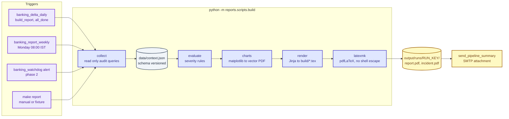
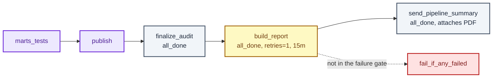

# Reporting: Banking Delta Lakehouse

Dynamic PDF reporting for the pipeline. When a run finishes, an alert fires or a digest is
due, a Python builder reads the `audit` schema, scores what happened, renders LaTeX from
Jinja templates, compiles `reports/main.tex` with pdfLaTeX and produces `report.pdf`.
Airflow attaches the PDF to the summary mail. The report adapts to the news: a healthy
night is a short verdict with a few charts, a bad night adds incident chapters, evidence
and runbook pointers, and a serious one also produces a separate incident PDF.

Colour legend: `docs/PIPELINE.md`. Rules for agents in `AGENTS.md` always win on conflict;
this page adds the reporting specific ones. Related: `docs/AUDIT.md` (data source),
`docs/AIRFLOW.md` (DAG and mail), `docs/RUNBOOK.md` (actions linked from incidents),
`docs/TESTING.md` (test tiers).

## 1. Goals and non goals

Goals:

- Page one answers in ten seconds: is the pipeline healthy, what broke, what do I do next.
- Fully dynamic: chapters, charts, flow colours and wording come from data, never from
  hand edited text. Any minor or major event changes the report.
- One design system: Jinja for structure, LaTeX for typography, matplotlib for charts,
  TikZ for the pipeline flow.
- Delivered by the existing Airflow summary mail as an attachment, with no new mail stack.
- Reproducible: the same `context.json` always produces the same PDF.

Non goals:

- It does not replace the DQ gates, the watchdog or the Streamlit dashboard.
- It never changes pipeline state. It is a read only consumer of `audit.*` and the
  warehouse metadata.
- It never shows row values, PII or credentials. Counts, names and statuses only, the same
  contract as `audit_reader.py`.
- A failed report never turns a green pipeline run red.

## 2. How it fits



"Event driven" here means severity is evaluated at defined trigger points, not that a file
watcher runs LaTeX. The trigger points are: the end of every daily run (`all_done`, so
failed runs are reported too), watchdog alerts for runs that never reach their end
(`[MISSED]`, `[STUCK]`), the weekly digest schedule, and a human running `make report`.

## 3. Rules for agents

1. Read `AGENTS.md`, `docs/AUDIT.md` and `sql/scripts/02_audit_tables.sql` before writing a
   query. Use column names from the DDL, never from this page.
2. Read only. The collector may `SELECT` from `audit.*`, the registry and `MAX(_loaded_at)`
   style freshness probes. No `INSERT`, `UPDATE`, `CALL` or DDL. Open the connection with
   `default_transaction_read_only = on`.
3. No row values, PII, secrets or connection strings in `context.json`, charts, LaTeX or
   mail. Every free text field (error messages, violation messages) goes through the
   existing redaction (`redact.py` and `src.utils.audit._redact`) and is cut to 300
   characters. Do not copy the regexes. If importing across packages is awkward, ask before
   promoting the helper to `src/utils/redact.py`.
4. Every value that reaches LaTeX is escaped by the Jinja `finalize` hook (section 8).
   Raw LaTeX is allowed only through the explicit `raw` filter on values built by Python
   code, never on data from the warehouse.
5. Compile with `-no-shell-escape -halt-on-error`. Never enable `\write18` or
   `--shell-escape`, and never `\input` a path built from data.
6. A missing or unknown state is never rendered as success. Same principle as
   `summary.decide_status`. Use `UNKNOWN` (grey) when a step has no audit evidence.
7. The report derives status from `audit.pipeline_runs`, `audit.table_runs`,
   `audit.dq_run` and `audit.pipeline_errors`. It does not read `context["task_states"]`
   from Airflow, because that is the open false `[FAILED]` banner bug (`docs/AIRFLOW.md`).
   Do not fix that bug as part of this work.
8. Do not "correct" timestamps. Times are shown as stored with their zone label, and the
   appendix links the open timezone offset issue (`docs/TROUBLESHOOTING.md`, open issue 3).
9. Thresholds and severity mappings live in `reports/config/report.yaml`. Lowering a
   severity or loosening a threshold needs a human decision, the same way DQ thresholds do.
10. A report failure degrades, it does not block. Section failures render a visible
    "section unavailable" box, a compile failure retries in safe mode (section 10), and the
    Airflow task never sits in the failure gate.
11. Output is deterministic. Sort every list, fix the random seed, set
    `SOURCE_DATE_EPOCH` from the run end time, never print `now()` inside the document body.
12. Dependencies are added with `uv` only (`uv add --group reports ...`). No pip, no
    conda, no hand edited lock file.
13. Style: one short header comment at the top of each file, no paragraph comments and no
    comments between code lines. SQL is uppercase keywords, one column per line, four space
    indent. Python passes `ruff`. Documentation prose uses no hyphens.
14. Windows safe: `pathlib`, `sys.executable`, `encoding="utf-8"` on every open and
    `read_text`, no POSIX only calls, forward slashes inside LaTeX paths.
15. Do not edit or import anything under `reports/legacy/`. It is reference material only.

### Permissions

| Action | Allowed without asking | Ask first | Never |
| --- | --- | --- | --- |
| Edit `reports/`, `docs/REPORTING.md`, tests, fixtures on a feature branch | yes | | |
| `make report-fixture`, `make report-pdf`, `make report-docker`, `make ci` | yes | | |
| `make report`, `report-incident`, `report-weekly` (read the real warehouse) | | yes | |
| Change `airflow/Dockerfile`, compose files, the DAG, `.env.airflow.example` | | yes | |
| Change `notify.py` or `summary.py` (shared mail code) | | yes | |
| Add or change severity thresholds, add a new commit scope | | yes | |
| Commit `.env`, secrets, real report PDFs, real `context.json` | | | never |
| Enable shell escape, write to the warehouse from the report code | | | never |

## 4. Folder layout

Existing folders keep their names. New folders are marked.

```text
reports/
├── main.tex                 static entry point, never generated
├── latexmkrc                pdfLaTeX settings, TEXINPUTS for template/
├── Dockerfile               local and CI TeX builder image (no secrets)
├── apt-packages.txt         NEW  TeX package list shared by both Dockerfiles
├── README.md                short pointer to docs/REPORTING.md
├── .gitignore
├── template/                design system, static LaTeX plus document level Jinja
│   ├── bankingreport.sty    colours, fonts, page geometry, boxes, tables, TikZ styles
│   ├── meta.tex.j2          kind, verdict, run ids, dates as \newcommand values
│   └── manifest.tex.j2      ordered \input list of the enabled chapters
├── chapters/                one Jinja template per chapter, plus partials
│   ├── 01_summary.tex.j2
│   ├── 02_flow.tex.j2
│   ├── 03_timeline.tex.j2
│   ├── 04_volumes.tex.j2
│   ├── 05_dq.tex.j2
│   ├── 06_freshness.tex.j2
│   ├── 07_incidents.tex.j2
│   ├── 08_trends.tex.j2
│   ├── 09_appendix.tex.j2
│   └── partials/            kpi cards, event table, flow tikz, section unavailable box
├── scripts/                 Python package: collect, severity, charts, render, build
│   ├── __init__.py
│   ├── build.py             CLI and orchestration
│   ├── collect.py           read only audit queries to context dict
│   ├── severity.py          rule engine, events, verdict
│   ├── charts.py            matplotlib style and figure functions
│   ├── flow.py              grid layout for the TikZ pipeline flow
│   ├── render.py            Jinja environment, escape filter, number filters
│   ├── compile.py           latexmk wrapper, safe mode retry, log redaction
│   └── paths.py             run key, output paths, retention
├── config/                  NEW
│   ├── report.yaml          kinds, chapters, thresholds, trend window, timezone
│   └── slo.yaml             freshness windows per table when the contract has none
├── data/                    generated context (ignored) and tracked fixtures
│   ├── context.schema.json  NEW  JSON Schema for context.json
│   └── fixtures/            NEW  synthetic contexts: healthy, minor, major, critical, weekly
├── figures/                 generated charts and the static logo (generated files ignored)
├── fonts/                   bundled font files and their licence texts
├── build/                   NEW  rendered .tex, aux files, logs (ignored)
├── output/                  NEW  final PDFs, runs/RUN_KEY/ and a latest copy (ignored)
├── mail/                    NEW  mail body templates, report.html.j2 and report.txt.j2
└── legacy/                  untouched
```

`reports/` also needs `__init__.py` so `python -m reports.scripts.build` works, the same
way `contracts/` does.

`reports/.gitignore`:

```gitignore
# Generated report artefacts, never commit real data.
build/
output/
figures/*.pdf
figures/*.png
data/context.json
data/context.*.json
!data/fixtures/
*.aux
*.log
*.fdb_latexmk
*.fls
*.synctex.gz
```

## 5. Report kinds and chapters

| Kind | File | Produced when | Audience question |
| --- | --- | --- | --- |
| `daily` | `report.pdf` | every `banking_delta_daily` run, always | what happened last night |
| `incident` | `incident.pdf` | any event with severity MAJOR or CRITICAL, plus watchdog alerts | what broke, why, what now |
| `weekly` | `weekly.pdf` | `banking_report_weekly`, Monday 08:00 `Asia/Kolkata` | is the platform trending well |

The `incident` PDF is produced in addition to `report.pdf`, so the daily report stays
consistent every day. Both are attached to the same mail.

| Chapter template | Content | Charts and visuals | Included in |
| --- | --- | --- | --- |
| `01_summary` | verdict banner, KPI cards, top events, next actions | none, cards only | all kinds |
| `02_flow` | the 9 gated steps and 3 extracts as a coloured flow | TikZ flow | daily, incident |
| `03_timeline` | task durations, retries, critical path | task timeline | daily, incident |
| `04_volumes` | rows extracted and landed per table, deviation from trailing median | volumes dumbbell, layer bars | daily, weekly |
| `05_dq` | DQ gate results per layer and check, violation counts | DQ heatmap | daily when any DQ row exists, incident, weekly |
| `06_freshness` | table age against its window, watermark lag, last success age | freshness bullet chart | daily, weekly |
| `07_incidents` | one block per MINOR or higher event with evidence and runbook link | event table, error category bars | when events exist |
| `08_trends` | last N runs: duration, rows, failures, DQ failures | small multiples | weekly, daily appendix |
| `09_appendix` | run metadata, full table run list, versions, known open issues, regeneration command | tables | all kinds |

Chapter selection is configuration, not code:

```yaml
# Report kinds and sensitivity settings. Changes to severities need approval.
schema_version: 1
timezone: Asia/Kolkata
trend_runs: 14
kinds:
  daily:
    chapters: [summary, flow, timeline, volumes, dq, freshness, incidents, appendix]
    drop_when_empty: [dq, incidents]
  incident:
    chapters: [summary, flow, incidents, dq, timeline, appendix]
  weekly:
    chapters: [summary, trends, volumes, dq, freshness, incidents, appendix]
thresholds:
  volume_deviation_ratio: 0.5
  duration_regression_ratio: 1.5
  freshness_default_window: PT24H
  max_message_chars: 300
```

Page budget: daily 4 to 8 pages, incident 2 to 5, weekly 4 to 6. A healthy daily report
must fit page one plus the appendix.

## 6. Events and severity

Every report starts from a list of events. An event is one fact about the run with a
severity, a place and an impact.

| Severity | Meaning | Verdict label | Banner colour |
| --- | --- | --- | --- |
| `INFO` | normal, worth a line (for example a table skipped, no new data) | HEALTHY | green |
| `MINOR` | self healed or low impact (retry used, small deviation) | ATTENTION | amber |
| `MAJOR` | a gate or step failed, data late or partial | ACTION REQUIRED | red |
| `CRITICAL` | run failed, nothing published, or status unknown | INCIDENT | dark red |

The run verdict is the maximum event severity. Mail subjects keep the existing
`[SUCCESS|WARNING|FAILED]` marker from `summary.py`; the report verdict appears in the body
and in the attachment file name, for example
`Banking-Delta_daily_20261021_ATTENTION.pdf`.

### Rule catalogue

Rules live in `reports/scripts/severity.py`, one function per rule, each with a test.

| Rule | Signal (source) | Condition | Severity |
| --- | --- | --- | --- |
| R001 | `audit.pipeline_runs.status` | `FAILED` | CRITICAL |
| R002 | `audit.pipeline_runs.status` | `PARTIAL` | MAJOR |
| R003 | `audit.dq_run` | a layer suite has status `FAIL` | MAJOR |
| R004 | publish `table_runs` or DQ `row_count_source_vs_published` | publish not `SUCCESS`, or published rows differ from source | MAJOR |
| R005 | `audit.pipeline_errors.error_category` | `CONNECTION` or `SPARK` on the final attempt | MAJOR |
| R006 | `audit.pipeline_errors.error_category` | `CONCURRENCY` that a retry resolved | MINOR |
| R007 | `audit.table_runs.attempt_number` | greater than 1 for any table | MINOR |
| R008 | `audit.data_quality_results` | `WARNING` severity check not passing | MINOR |
| R009 | `table_runs.rows_landed` vs trailing median | deviation above `volume_deviation_ratio` | MINOR |
| R010 | full load table with zero rows landed | always | MAJOR |
| R011 | run duration vs trailing median | above `duration_regression_ratio` | MINOR |
| R012 | freshness from `MAX(_loaded_at)` and the contract window | window exceeded | contract severity (`WARNING` maps to MINOR, `ERROR` to MAJOR) |
| R013 | DQ `schema_contract` or `contracts/` drift | any violation | MAJOR |
| R014 | watchdog `[MISSED]` or `[STUCK]` | alert raised | MAJOR |
| R015 | watchdog `[WATCHDOG-ERROR]` or a step with no audit evidence | status unknown | CRITICAL |
| R016 | collector section raised an error | the section degraded | MINOR |
| R017 | `table_runs.status` | `SKIPPED` because no new data | INFO |

Event shape inside `context.json`:

```json
{
  "event_id": "R003:analytics:09_duplicate_rows",
  "rule": "R003",
  "severity": "MAJOR",
  "layer": "analytics",
  "subject": "audit.dq_analytics_duplicate_rows",
  "category": "DATA",
  "first_seen": "2026-10-21T02:41:07+05:30",
  "message": "violation_count=12",
  "impact": "analytics gate blocked marts_load and publish",
  "runbook": "RUNBOOK.md#a-run-failed-triage"
}
```

`event_id` is stable (`rule:layer:subject`) so weekly reports can count recurrences and
detect flapping. `runbook` is a link target the report prints as a pointer, for example the
triage branch for the failed task.

## 7. Data collection

`reports/scripts/collect.py` builds one dictionary and writes `data/context.json`. Each
section is collected in its own `try` block so one failure degrades only that section and
is recorded in `sections_failed` (rule R016).

| Section | Source | Content |
| --- | --- | --- |
| `meta` | arguments, `src/utils/config.py`, git | kind, ids, env, git sha, versions |
| `run` | `audit.pipeline_runs` | status, counts, start, end, duration |
| `steps` | `audit.table_runs`, `audit.dq_run` | the 9 gated steps and 3 extracts with state and duration |
| `tables` | latest attempt per table in `audit.table_runs` | status, rows extracted, rows landed, watermark start and end, attempts |
| `dq` | `audit.v_dq_latest`, `audit.dq_run`, `audit.data_quality_results` | per layer, per check status and violation count |
| `errors` | `audit.pipeline_errors` | category, severity, redacted message |
| `freshness` | registry plus `MAX(_loaded_at)` per landing table | age in seconds, window, breach flag |
| `trends` | last `trend_runs` rows of `audit.pipeline_runs` | duration, status, rows, failures per run |
| `events` | output of `severity.py` | the event list and the verdict |

Query shapes (confirm the real names in the DDL first):

```sql
-- Shape only, parameterised. Never format values into SQL text.
SELECT
    status,
    total_tables,
    successful_tables,
    failed_tables,
    started_at,
    ended_at
FROM audit.pipeline_runs
WHERE dag_id = %(dag_id)s
  AND dag_run_id = %(dag_run_id)s;
```

```sql
-- Latest attempt per table, the same rule finish_pipeline_run uses.
SELECT DISTINCT ON (processing_layer, target_table)
    processing_layer,
    target_table,
    attempt_number,
    status,
    rows_landed,
    watermark_start,
    watermark_end
FROM audit.table_runs
WHERE pipeline_run_id = %(pipeline_run_id)s
ORDER BY processing_layer, target_table, attempt_number DESC;
```

Table names for freshness probes come from `audit.source_tables` and are composed with
`psycopg2.sql.Identifier`, never with f strings.

### context.json

The context is a versioned contract, validated against `data/context.schema.json` before
rendering. Breaking changes bump `schema_version` and update every fixture in the same PR.

```json
{
  "schema_version": 1,
  "meta": {
    "kind": "daily",
    "generated_at": "2026-10-21T02:58:12+05:30",
    "env": "prod",
    "git_sha": "a1b2c3d",
    "airflow_version": "3.3.2",
    "dag_id": "banking_delta_daily",
    "dag_run_id": "scheduled__2026-10-20T20:30:00+00:00"
  },
  "run": {
    "status": "PARTIAL",
    "duration_s": 3412,
    "total_tables": 10,
    "successful_tables": 9,
    "failed_tables": 1
  },
  "steps": [
    {"id": "n04", "name": "staging_load", "layer": "staging", "state": "ok", "duration_s": 212, "attempts": 1}
  ],
  "tables": [
    {"layer": "raw", "table": "card_transactions", "status": "SUCCESS", "rows_landed": 1840, "attempts": 1}
  ],
  "events": [],
  "verdict": {"severity": "MAJOR", "label": "ACTION REQUIRED"},
  "sections_failed": []
}
```

### Fixtures

`data/fixtures/` holds synthetic contexts only, with invented table counts and no real
values: `healthy`, `minor_retry`, `major_dq_fail`, `critical_failed_run`, `weekly`.
They drive tests, the CI render check, template development and design reviews, so the
whole report can be built with no database.

## 8. Rendering with Jinja and LaTeX

LaTeX uses braces and percent signs everywhere, so the Jinja environment uses custom
delimiters.

| Purpose | Delimiter | Example |
| --- | --- | --- |
| Statement | `\BLOCK{ ... }` | `\BLOCK{for e in events}` |
| Output | `\VAR{ ... }` | `\VAR{run.status}` |
| Comment | `\#{ ... }` | removed from output |
| Line statement | `%%` | `%% if events` |
| Line comment | `%#` | removed from output |

Limits that follow from this: no dict or set literals with braces inside `\VAR{}` or
`\BLOCK{}`, because the first `}` closes the tag. Compute such values in Python.
`StrictUndefined` is on, so a typo in a template fails the build loudly in tests rather
than printing a blank in a bank report.

`reports/scripts/render.py`:

```python
# LaTeX safe Jinja environment for the report templates.
from pathlib import Path

import jinja2

_TEX_MAP = {
    "\\": r"\textbackslash{}",
    "&": r"\&",
    "%": r"\%",
    "$": r"\$",
    "#": r"\#",
    "_": r"\_",
    "{": r"\{",
    "}": r"\}",
    "~": r"\textasciitilde{}",
    "^": r"\textasciicircum{}",
}


class RawTeX(str):
    pass


def tex_escape(value: object) -> str:
    if isinstance(value, RawTeX):
        return str(value)
    text = "" if value is None else str(value)
    return "".join(_TEX_MAP.get(ch, ch) for ch in text)


def ident(value: object) -> RawTeX:
    text = tex_escape(value)
    return RawTeX(text.replace(r"\_", r"\_\allowbreak{}").replace(".", r".\allowbreak{}"))


def make_env(*template_dirs: Path) -> jinja2.Environment:
    env = jinja2.Environment(
        loader=jinja2.FileSystemLoader([str(p) for p in template_dirs]),
        block_start_string=r"\BLOCK{",
        block_end_string="}",
        variable_start_string=r"\VAR{",
        variable_end_string="}",
        comment_start_string=r"\#{",
        comment_end_string="}",
        line_statement_prefix="%%",
        line_comment_prefix="%#",
        trim_blocks=True,
        lstrip_blocks=True,
        autoescape=False,
        undefined=jinja2.StrictUndefined,
    )
    env.finalize = tex_escape
    env.filters.update({"raw": RawTeX, "ident": ident})
    return env
```

`finalize` escapes every `\VAR{}` output automatically, so escaping is the default and
opting out is explicit. Additional filters to implement and test: `fmt_int` (thin space
thousands), `fmt_pct`, `fmt_dur` (`1h 05m`), `fmt_ts` (with zone label), `state_colour`,
`severity_colour`, `plural`.

Template conventions:

- One chapter per file, each starting with `\section{...}` and ending with a blank line.
- Use partials for anything repeated twice: KPI card, event row, status pill, the
  "section unavailable" box.
- Identifiers in tables use `\texttt{\VAR{x | ident}}` so long names such as
  `raw.card_transactions` break cleanly.
- No logic that belongs in Python. Templates loop, branch on presence and format. Sorting,
  thresholds, joins and colour decisions are computed before rendering.
- Free text from the warehouse is always plain `\VAR{}`. Only Python built values use `raw`.

Chapter excerpt (`chapters/partials/event_table.tex.j2`):

```tex
\BLOCK{if events}
\begin{longtable}{@{}p{2.4cm}p{3.6cm}p{9.6cm}@{}}
\toprule
\textbf{Severity} & \textbf{Where} & \textbf{What happened} \\
\midrule
\BLOCK{for e in events}
\severitytag{\VAR{e.severity | lower}} & \texttt{\VAR{e.subject | ident}} & \VAR{e.message} \\
\BLOCK{endfor}
\bottomrule
\end{longtable}
\BLOCK{else}
No events above INFO. All gates passed.
\BLOCK{endif}
```

### main.tex stays static

`main.tex` is hand written and never generated. Python writes `build/meta.tex` and
`build/manifest.tex`, so changing which chapters appear never touches the entry point.

```tex
% Static entry point. Generated inputs live in build/.
\documentclass[a4paper,11pt]{article}
\usepackage{bankingreport}
\input{build/meta}
\begin{document}
\input{build/manifest}
\end{document}
```

`latexmkrc`:

```perl
# Build settings for the pipeline report: no shell escape, output in build/.
$pdf_mode = 1;
$pdflatex = 'pdflatex -interaction=nonstopmode -halt-on-error -no-shell-escape %O %S';
$out_dir = 'build';
$aux_dir = 'build/aux';
$max_repeat = 3;
$ENV{'max_print_line'} = '1000';
ensure_path('TEXINPUTS', './template//');
@default_files = ('main.tex');
```

`$aux_dir` is a folder of its own so latexmk never rewrites the redacted compile log in
`build/report.log`.

Compile command used everywhere (`-jobname` fixes the output name):

```bash
latexmk -jobname=report main.tex      # writes build/report.pdf
```

## 9. Design system

All design tokens live in `template/bankingreport.sty`. Charts and TikZ read the same
palette from `reports/scripts/charts.py`; keep both in step and test that they match.

### Colour

Layer colours are reused from `docs/PIPELINE.md` so a reader recognises them across docs,
diagrams and the PDF. Layer colours mean a layer. Status colours mean a status. Never mix
the two roles.

| Role | Name | Stroke | Fill |
| --- | --- | --- | --- |
| Layer | source | `#1D4ED8` | `#DBEAFE` |
| Layer | orchestration | `#6D28D9` | `#EDE9FE` |
| Layer | raw | `#C2410C` | `#FFEDD5` |
| Layer | staging | `#0E7490` | `#CFFAFE` |
| Layer | analytics | `#15803D` | `#DCFCE7` |
| Layer | marts | `#BE185D` | `#FCE7F3` |
| Layer | publish | `#A16207` | `#FEF9C3` |
| Layer | audit | `#475569` | `#F1F5F9` |
| Status | ok, SUCCESS | `#15803D` | `#DCFCE7` |
| Status | warn, PARTIAL, MINOR | `#A16207` | `#FEF9C3` |
| Status | bad, FAILED, MAJOR | `#B91C1C` | `#FEE2E2` |
| Status | critical | `#7F1D1D` | `#FECACA` |
| Status | idle, UNKNOWN, SKIPPED | `#475569` | `#F1F5F9` |

Rules: status is always printed as a word or glyph next to the colour, so the page works in
greyscale and for colour blind readers. Text on a fill uses the dark stroke colour. No
gradients, shadows or decorative images.

### Typography

| Use | Font | Notes |
| --- | --- | --- |
| Body, tables, headings | Inter (Regular, Italic, SemiBold, SemiBold Italic) | tabular numerals on, so digit columns align |
| Identifiers, SQL, ids | JetBrains Mono (Regular, Bold) | table names, run ids, error categories |
| Cover title only | Inter SemiBold, large | no second display font |

Both families are open licence. Put the `.ttf` files and licence texts in `reports/fonts/`
and commit them, because CI and the Airflow image have no network to fetch fonts. If a
file is missing the build must still succeed:

```tex
% Font setup with a fallback so a missing file never breaks the build.
\usepackage{fontspec}
\IfFileExists{fonts/Inter-Regular.ttf}{
  \setmainfont{Inter-Regular.ttf}[Path=fonts/, BoldFont=Inter-SemiBold.ttf,
    ItalicFont=Inter-Italic.ttf, BoldItalicFont=Inter-SemiBoldItalic.ttf,
    Numbers=Monospaced]
}{
  \setmainfont{TeX Gyre Heros}
}
```

Do the same for the mono font with `TeX Gyre Cursor` as the fallback. Never ship a font
without its licence. If the font files are absent, ask a human to add them; do not invent
or download them from an unknown source.

**Current state (pending decision 2 in section 16).** The font files are not in the
repository, so the builder compiles with pdfLaTeX and the scalable Latin Modern family
(`\usepackage{lmodern}`), which `microtype` needs to expand. Latin Modern is metric
compatible with the layout, so switching to Inter later changes the glyphs, not the page
structure. The `fontspec` block above is the target state, not the shipped state: it
arrives with the font files, the XeLaTeX switch in `latexmkrc` (`$pdf_mode = 5`) and the
`fonts-inter` package already listed in `reports/apt-packages.txt`.

Scale: base 10.5 pt, line spacing 1.2, section titles 16 pt, subsection 12 pt, table text
9 pt, captions 8.5 pt. A4, margins 20 mm left and right, 22 mm top and bottom, text width
about 170 mm.

### Components (macros in the style file)

| Macro | Use |
| --- | --- |
| `\statusbanner{state}{label}` | full width verdict band on page one |
| `\kpicard{title}{value}{subtitle}{state}` | four across metric cards |
| `\severitytag{sev}` | coloured pill with the severity word |
| `\statuspill{state}` | table cell status with word and colour |
| `\callout[ok\|warn\|bad]{title}{text}` | boxed note, built on `tcolorbox` |
| `\sectionunavailable{name}` | visible box when a section failed to collect |

Tables use `booktabs` and `longtable`: thin rules, no vertical lines, light slate zebra
rows, numbers right aligned, header repeated across pages. Header carries the report kind
and run id, footer carries `Internal`, the generation time with zone and `Page x of y`.
Set PDF title, author, subject and keywords through `hyperref`, enable bookmarks and
clickable cross references.

### Page one

Order is fixed: verdict banner, four KPI cards (tables ok, rows landed, DQ checks passed,
duration against trailing median), "What needs attention" (top five events by severity,
each with one runbook pointer), then the compact flow strip. If the run is healthy the
attention block says so in one sentence and the space goes to the flow and one chart.

### Charts

Charts are matplotlib figures saved as vector PDF into `figures/`, created at the final
printed size so fonts stay at their real size (full width 6.7 in by about 2.6 in, half
width 3.3 in). The same fonts are registered from `fonts/`, `pdf.fonttype` is 42 so text
stays selectable, and the fallback family is DejaVu Sans.

```python
# Shared matplotlib style for report figures.
from pathlib import Path

import matplotlib

matplotlib.use("Agg")
import matplotlib.pyplot as plt
from matplotlib import font_manager


def apply_style(font_dir: Path) -> None:
    for path in sorted(font_dir.glob("*.ttf")):
        font_manager.fontManager.addfont(str(path))
    plt.rcParams.update(
        {
            "font.family": ["Inter", "DejaVu Sans"],
            "font.size": 8.5,
            "pdf.fonttype": 42,
            "axes.spines.top": False,
            "axes.spines.right": False,
            "axes.edgecolor": "#475569",
            "axes.grid": True,
            "grid.color": "#E2E8F0",
            "grid.linewidth": 0.6,
            "axes.axisbelow": True,
            "savefig.bbox": "tight",
        }
    )
```

Chart rules: no 3D, no pie or donut, bars start at zero, at most four colours per chart,
direct labels instead of legends where possible, one message per chart with the title
stating it, threshold and median drawn as thin dashed lines, anomalies annotated with the
value and the rule id. If a chart has no data, render a small "no data" placeholder box
rather than an empty axis, and never fail the build for a missing chart.

| Figure file | Type | Shows | Chapter |
| --- | --- | --- | --- |
| `task_timeline.pdf` | horizontal timeline | start and end per task, layer colour, retries hatched, failures outlined | 03 |
| `volumes_dumbbell.pdf` | dumbbell | rows landed today against trailing median per table | 04 |
| `layer_rows.pdf` | grouped bars | rows touched per layer in this run against median | 04 |
| `dq_heatmap.pdf` | matrix | check by layer with PASS, WARN, FAIL word in each cell | 05 |
| `freshness_bullet.pdf` | bullet chart | table age against its window | 06 |
| `error_categories.pdf` | horizontal bars | errors by category, final attempt marked | 07 |
| `trend_duration.pdf` | line with band | run duration over the last N runs, status markers | 08 |
| `trend_failures.pdf` | small multiples | failures, retries and DQ fails per source | 08 |
| `publish_reconcile.pdf` | paired bars | source rows against published rows per mart, gap highlighted | 04 |

`publish_reconcile` exists because of the known publish lookback gap (for example the
`mart_support_performance` 193 row difference in `docs/RUNBOOK.md`): a gap like that should
be visible in the report the day it appears.

### Pipeline flow diagram

The flow is a TikZ picture generated from the steps list, so node colours and badges follow
the run. Node fill is the layer colour, node border and badge are the status colour, the
label carries the step name and duration. Node ids are slugs made by `flow.py`
(`n01`, `n02`, and so on) so they never need escaping. Coordinates come from a fixed grid
in `flow.py`: three extract nodes stacked on the left, then the gated chain, then publish
and finalize.

```tex
\begin{tikzpicture}[every node/.style={font=\footnotesize}]
\BLOCK{for node in flow.nodes}
\node[flowstep, \VAR{node.layer | raw}, \VAR{node.state | raw}] (\VAR{node.id | raw}) at (\VAR{node.x | raw}, \VAR{node.y | raw}) {\VAR{node.label}\\{\scriptsize\VAR{node.duration}}};
\BLOCK{endfor}
\BLOCK{for edge in flow.edges}
\draw[flowarrow] (\VAR{edge.src | raw}) -- (\VAR{edge.dst | raw});
\BLOCK{endfor}
\end{tikzpicture}
```

`flowstep`, the layer names (`raw`, `staging`, `analytics`, `marts`, `publish`, `audit`) and
the state names (`ok`, `warn`, `bad`, `idle`) are TikZ styles defined in the style file.
The node style is called `flowstep` and not `step`, because `step` is a PGF key that
already means something else. Values passed with `raw` are validated by Python against an
allow list before rendering.

## 10. The builder

```bash
uv run python -m reports.scripts.build --kind daily --dag-id banking_delta_daily --dag-run-id "<id>"
uv run python -m reports.scripts.build --kind incident --dag-run-id "<id>"
uv run python -m reports.scripts.build --kind weekly
uv run python -m reports.scripts.build --fixture reports/data/fixtures/major_dq_fail.json
```

| Flag | Meaning |
| --- | --- |
| `--kind daily\|incident\|weekly` | which chapter set to build |
| `--dag-id`, `--dag-run-id` | which run to report, defaults to the latest |
| `--fixture PATH` | skip the database and use a context file |
| `--all-fixtures` | build every tracked fixture, one report each |
| `--no-pdf` | stop after rendering `.tex` (hermetic, no TeX needed) |
| `--no-charts` | safe mode, no figures and no TikZ flow |
| `--out DIR` | output root, wins over `REPORT_OUTPUT_DIR` |
| `--strict` | treat any degraded section as an error, for tests |

Steps, in order, with a total budget under 60 seconds in CI and under 2 minutes in Airflow:

1. Collect and write `data/context.json`, validate against the schema. The same document is
   copied next to the PDF as `runs/RUN_KEY/context.json`.
2. Evaluate rules, attach `events` and `verdict`, decide which kinds to build.
3. Draw charts into `figures/`, skipping any that fail.
4. Render `build/meta.tex`, `build/manifest.tex` and the chapters. A chapter that still
   holds a `\VAR{` or `\BLOCK{` tag fails the build with exit code 2.
5. Compile with `latexmk -jobname=report main.tex`. On failure retry once with
   `--no-charts` (safe mode) and mark the report "degraded" on page one.
6. Copy to `output/runs/RUN_KEY/<kind>.pdf` and `output/<kind>.pdf` (latest). Write the
   redacted compile log to `build/<kind>.log`. Prune runs older than
   `REPORT_RETENTION_DAYS`.
7. Print a one line JSON result (`kind`, `verdict`, `pages`, `path`, `degraded`).

Exit codes: `0` built, `2` render or schema error, `3` compile failed even in safe mode,
`1` usage error. `RUN_KEY` is the run id reduced to `[A-Za-z0-9_]` by `paths.py`.

## 11. Airflow and mail integration

### DAG change

`banking_delta_daily` gets one new task between `finalize_audit` and
`send_pipeline_summary`. It runs after `finalize_audit` because that task reaps orphaned
`RUNNING` rows and rolls up the final status the report must show.



| Task | Command | Retries and timeout | Notes |
| --- | --- | --- | --- |
| `build_report` | `python -m reports.scripts.build --kind daily --dag-id ... --dag-run-id ...` | 1 and 15m | `trigger_rule=all_done`; builds `incident.pdf` too when any event is MAJOR or higher |

Use the same command builder module the other tasks use, so `airflow/tests/test_commands.py`
keeps proving that no secrets and no unquoted ids reach a command line. Template ids with
`{{ dag.dag_id }}` and `{{ run_id }}`. Skeleton:

```python
# build_report task wiring for banking_delta_daily.
build_report = BashOperator(
    task_id="build_report",
    bash_command=report_command(kind="daily"),
    trigger_rule="all_done",
    retries=1,
    retry_delay=timedelta(minutes=2),
    execution_timeout=timedelta(minutes=15),
)
finalize_audit >> build_report >> send_pipeline_summary
```

Rules for the wiring:

- `build_report` is not an upstream of `fail_if_any_failed`. A PDF problem must not make a
  green pipeline red. The mail says "report unavailable" instead.
- `send_pipeline_summary` is `all_done`, so it still sends when `build_report` failed.
- Find the files by the deterministic path `output/runs/RUN_KEY/`, not through XCom.
- Mount a named volume `report_output` at the worker's report output directory. With one
  worker the files are local; with several workers the volume (or object storage) is
  required, because the mail task may run on a different host.
- Update `airflow/tests/test_dag_integrity.py`: the task exists, `trigger_rule` is
  `all_done`, it sits after `finalize_audit` and before `send_pipeline_summary`, it is not
  linked to the failure gate, and the retries and timeout match.

### Mail

Extend the existing `notify.py` and `summary.py`, never add a second SMTP path.

- `notify` gains an `attachments` list. Attach with `EmailMessage.add_attachment` using
  `application/pdf`, file name `Banking-Delta_<kind>_<YYYYMMDD>_<VERDICT>.pdf`.
- Skip an attachment larger than `REPORT_MAX_ATTACH_MB` (default 10) and say so in the body.
- The body shows the verdict, the top three events (names and counts only) and a line
  stating whether the report was degraded or missing.
- A missing file is a warning in the body, never an exception.
- Recipients default to `ALERT_EMAIL_TO`, with `REPORT_EMAIL_TO` as an optional override.
- Add tests to `test_notify_render.py`: attachment present, wrong size skipped, no
  attachment path still sends, subject marker unchanged.

### Weekly DAG and watchdog

- `banking_report_weekly`: schedule `0 8 * * 1` `Asia/Kolkata`, `catchup=False`,
  `max_active_runs=1`, one task `build_weekly_report` then a mail task reusing the mail
  helper. Created paused like the others, un pause deliberately.
- Phase 2: when `banking_watchdog` raises `[MISSED]`, `[STUCK]` or `[WATCHDOG-ERROR]`, it
  calls `--kind incident` and attaches the PDF. The watchdog stays silent when healthy and
  must keep working if report building fails.

### Image and compose

TeX Live is large (roughly 500 to 800 MB). Recommended option: install it in the Airflow
worker image, so the task runs exactly what `python main.py` and `make report` run, with
no Docker socket mounted into Airflow. Both Dockerfiles read the same package list.

```dockerfile
# TeX toolchain for the report builder, shared package list.
COPY reports/apt-packages.txt /tmp/apt-packages.txt
USER root
RUN apt-get update \
    && xargs -a /tmp/apt-packages.txt apt-get install -y --no-install-recommends \
    && rm -rf /var/lib/apt/lists/* /tmp/apt-packages.txt
USER airflow
```

Also copy `reports/` into the image and run `uv sync --frozen --group reports`. Never mount
`/var/run/docker.sock` into an Airflow container for this feature. `reports/apt-packages.txt`
starts with `latexmk`, `texlive-xetex`, `texlive-latex-recommended`,
`texlive-latex-extra`, `texlive-pictures`, `texlive-fonts-recommended` and `fontconfig`;
trim or extend it after the first clean compile. `texlive-fonts-recommended` provides
Latin Modern, which the pdfLaTeX build needs for `microtype`; `fonts-inter` is there for
the XeLaTeX switch that waits on decision 2 in section 16.

`reports/Dockerfile` is the standalone builder: it installs the same package list, adds
the report runtime (`jinja2`, `jsonschema`, `pyyaml`, `matplotlib`, `psycopg2-binary`,
`python-dotenv`) and copies `src/` and `reports/` into `/work`. The entry point compiles
every fixture, so `docker run` needs no arguments.

### Environment variables

Add every variable to `.env.example` and `airflow/.env.airflow.example`
(`tests/smoke/test_env_contract.py` enforces it). Read them only in `src/utils/config.py`.

| Variable | Default | Meaning |
| --- | --- | --- |
| `REPORT_ENABLED` | `true` | master switch for the Airflow task |
| `REPORT_OUTPUT_DIR` | `reports/output` | root for PDFs |
| `REPORT_TIMEZONE` | `Asia/Kolkata` | zone label used in the document |
| `REPORT_RETENTION_DAYS` | `30` | prune older run folders |
| `REPORT_MAX_ATTACH_MB` | `10` | skip larger attachments |
| `REPORT_EMAIL_TO` | empty | optional override of `ALERT_EMAIL_TO` |
| `REPORT_TREND_RUNS` | `14` | runs shown in trend charts |

## 12. Make and tasks.bat targets

`tests/smoke/test_make_parity.py` fails when a Makefile target is missing from `tasks.bat`
or when `ci` picks up a non hermetic target, so add every target to both files.

| Target | What it does | Tier | Agent may run |
| --- | --- | --- | --- |
| `report-fixture` | render every fixture to `.tex` with `--no-pdf`, no TeX and no database | hermetic, part of `make ci` | yes |
| `report-pdf` | compile every fixture to PDF with a local TeX Live | `tex` tier, not in `ci` | yes, when TeX is installed |
| `report-tex` | run the `tex` tier: every fixture compiles, the log is clean, the page budget holds | `tex` tier, not in `ci` | yes, when TeX is installed |
| `report-docker` | build `reports/Dockerfile` and compile the fixtures inside it | `tex` tier | yes |
| `report` | build the daily report against the environment `.env` points at | reads the warehouse | ask first |
| `report-incident RUN=<id>` | build an incident report for a run | reads the warehouse | ask first |
| `report-weekly` | build the weekly digest | reads the warehouse | ask first |
| `report-clean` | remove `reports/build`, `reports/output` and the generated figures | local | yes |

On Windows, avoid installing MiKTeX: use the container.

```powershell
docker build -t banking-report -f reports/Dockerfile .
docker run --rm -v "${PWD}/reports/output:/work/reports/output" banking-report
```

The image carries the TeX toolchain and the report runtime, so `docker run` compiles every
fixture with no extra flags. The build context is the repository root because the image
also copies `src/`.

## 13. Tests

Mirror source paths: `reports/scripts/render.py` is tested in
`tests/unit/reports/test_render.py`. Mark every test (`unit`, `smoke`, or the new `tex`
marker registered in `pyproject.toml`), otherwise it silently never runs.

| Test | Guards against |
| --- | --- |
| `tex_escape` handles all ten special characters, `None`, unicode | broken compiles from error text |
| escape neutralises `\input{...}`, `\write18`, `\immediate` in free text | LaTeX injection through audit messages |
| `RawTeX` is the only escape bypass, `StrictUndefined` raises on a missing key | silent blanks, accidental raw output |
| severity rules, one table driven test per rule R001 to R017 | wrong or downgraded severity |
| verdict is the maximum severity, UNKNOWN never renders as ok | false green report |
| latest attempt per table decides the table status | a retry that succeeded reported as failed |
| redaction applied to every free text field, 300 character cap | secrets in mail or PDF |
| `context.json` validates against the schema for every fixture | contract drift |
| chapter selection per kind and `drop_when_empty` | wrong chapters appearing |
| deterministic render: same context gives byte identical `.tex` | flaky diffs |
| palette in `charts.py` equals the colours in the style file | design drift |
| chart functions return a figure for empty data | build failure on quiet days |
| `build --fixture X --no-pdf` leaves no `\VAR{` or `\BLOCK{` in `build/` | unrendered template text |
| `tex` tier: every fixture compiles, the log has no `!` errors, pages within budget | broken LaTeX |
| `tex` tier: safe mode compiles when the figures directory is empty | degraded path rot |
| mail: attachment added, oversize skipped, missing file still sends | lost summary mail |
| DAG integrity for `build_report` and the weekly DAG | orchestration regressions |
| a read only guard test: collector issues only `SELECT` statements | accidental writes |

Never weaken a test to get green. A fix ships with a regression test that failed first.

## 14. Build plan for agents

One concern per branch (`feature/report-...`), small PRs, tests with the code, PR opened
and then stop. Commit scope `reports` is not in the allowed list in `docs/GITWORKFLOWS.md`
yet: ask a human to add it to the doc and the `commit-msg` hook, or use `repo` meanwhile.

| Phase | Deliverable | Done when |
| --- | --- | --- |
| 0 | read `AGENTS.md`, the docs listed at the top, the audit DDL and `legacy/` for visual hints | a written list of real column names and open questions in the PR description |
| 1 | `config/`, `context.schema.json`, five fixtures, `paths.py` | schema validates all fixtures, unit tests green |
| 2 | `render.py`, `bankingreport.sty`, templates, `main.tex`, `latexmkrc`, `report-fixture` | `make ci` green, no unrendered tags |
| 3 | `charts.py`, `flow.py`, figures wired into chapters | charts render from fixtures, empty data placeholders work |
| 4 | `compile.py`, `reports/Dockerfile`, `apt-packages.txt`, `report-pdf`, `report-docker` | all fixtures compile in the container within the page budget |
| 5 | `collect.py` | read only guard test green, run once against a disposable or approved database with approval |
| 6 | `severity.py` and rule tests | every rule has a passing and a failing case |
| 7 | Airflow task, mail attachment, compose volume, image change, env vars | DAG integrity and mail tests green, one approved real run attached to mail |
| 8 | incident kind, weekly DAG, watchdog hook | incident PDF appears on a seeded failing fixture run |
| 9 | docs sync | every item in the checklist below is done |

Docs to update in the same PRs: `docs/AIRFLOW.md` (DAG diagram, task table, volume),
`docs/DEPLOYMENT.md` (TeX image, env vars), `docs/TESTING.md` (`tex` tier, new regression
rows), `docs/CI-CD.md` (optional nightly `report-pdf` job), `docs/RUNBOOK.md` (how to
regenerate and read a report), `docs/TROUBLESHOOTING.md` (symptoms below),
`docs/GITWORKFLOWS.md` (scope), `reports/README.md` (pointer to this page) and `AGENTS.md`
(link and the rules in section 3).

## 15. Troubleshooting

| Symptom | Likely cause | Fix |
| --- | --- | --- |
| `Undefined control sequence` in the log | unescaped text, or a macro missing from the style file | check the `.tex` line named in the log, make sure the value went through `\VAR{}` |
| `Missing character` or tofu glyphs | font lacks a glyph | keep status glyphs to words, or add the glyph to the fallback chain |
| `File 'bankingreport.sty' not found` | `TEXINPUTS` not set | run through `latexmk` with the repo `latexmkrc`, from `reports/` |
| `Overfull \hbox` in tables | long identifier | use the `ident` filter or a narrower column |
| Blank figure or empty chart | no data for that section | expected: the placeholder box shows, check `sections_failed` |
| Charts use the wrong font | fonts not registered | confirm `fonts/*.ttf` exist, matplotlib font cache may need clearing |
| Build works locally, fails in Airflow | package missing from the image | compare `apt-packages.txt`, rebuild the image |
| Mail arrives without PDF | build failed or file over the size limit | check `build_report` logs and `REPORT_MAX_ATTACH_MB`, the body names the reason |
| Report says `UNKNOWN` for a step | no audit evidence for it | expected by rule 6, investigate the missing audit rows, do not default to ok |
| Times look 5.5 hours off | known timezone offset issue | see open issue 3 in `docs/TROUBLESHOOTING.md`, do not patch inside the report |
| PDF differs between runs | `now()` leaked into the body or unsorted data | fix determinism, set `SOURCE_DATE_EPOCH` |

## 16. Decisions for a human

These block specific phases. Do not guess; list them in the PR and ask.

1. TeX inside the Airflow worker image (recommended) against a separate builder service.
   Needs an image size and build time decision.
2. Final font files (Inter and JetBrains Mono) committed to `reports/fonts/` with licences.
   Until they exist the builder compiles with pdfLaTeX and Latin Modern; the XeLaTeX
   switch (`$pdf_mode = 5`) and the `fontspec` block wait for this decision. The
   `lastpage.sty` package is optional for the same reason: without it the footer shows
   "Page x" instead of "Page x of y".
3. Recipients and the weekly schedule, and whether incident PDFs go to a wider list.
4. Retention of PDFs and whether archived reports should also go to a bucket or volume.
5. Whether the report should include a short "known open issues" appendix read from
   `config/` or only link `docs/TROUBLESHOOTING.md`.
6. Any severity downgrade or threshold change from the defaults in section 5 and 6.

## Rules that must not break

- The report only reads. It never writes to the warehouse, Databricks or `audit.*`.
- No row values, PII, secrets or credentials in context, figures, LaTeX, logs or mail.
- Every value is escaped by default; shell escape stays off.
- Unknown is never shown as success; a failed report never fails the pipeline.
- Same context in, same PDF out.
- Thresholds and severities change only with human approval.
- The mail path is the existing one; attachments extend it, they do not replace it.

## Definition of done

- [ ] `make ci` green, including `report-fixture`; `make report-pdf` green where TeX exists
- [ ] every new test is marked and actually runs under its make target
- [ ] all five fixtures render and compile within the page budget
- [ ] schema, fixtures and templates agree on `schema_version`
- [ ] `tasks.bat` has the same targets as the Makefile
- [ ] new environment variables are in both example env files
- [ ] DAG integrity and mail tests cover the new task and attachment
- [ ] one approved real run produced a PDF in the mail, with the verdict matching
      `audit.pipeline_runs.status`
- [ ] docs listed in section 14 updated in the same PRs
- [ ] restricted actions were approved and the approval is quoted in the PR
