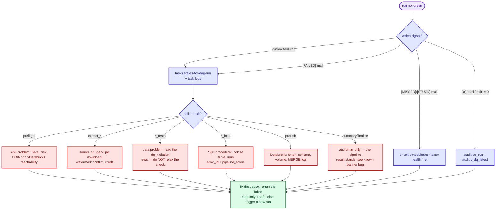

# Runbook — Banking-Delta

Day-to-day operations: run it, watch it, recover it. Diagram colour legend:
`docs/PIPELINE.md` (red = failure paths, green = healthy, slate = audit, violet = actions).

## How a run happens

| Path | Trigger | Notes |
|---|---|---|
| Scheduled | Airflow `banking_delta_daily`, `0 2 * * *` Asia/Kolkata | created **paused** — un-pause deliberately |
| Manual (Airflow) | `airflow dags trigger banking_delta_daily` | `--conf '{"publish_full": true}'` for a full republish |
| Manual (host) | `python main.py` or `make daily` | same 9 gated steps, stops at first failure |

`max_active_runs=1`: a trigger fired while a run is active **waits** and then runs the
whole pipeline again — it does not run concurrently.

## Daily health check

```bash
# Airflow side
docker compose -f airflow/docker-compose.yml exec airflow-scheduler \
  airflow dags list-runs -o table
docker compose -f airflow/docker-compose.yml exec airflow-scheduler \
  airflow tasks states-for-dag-run banking_delta_daily "<run_id>"

# Audit side (source of truth for the summary mail)
psql -c "SELECT status, total_tables, successful_tables, failed_tables, started_at, ended_at
         FROM audit.pipeline_runs ORDER BY started_at DESC LIMIT 5;"
psql -c "SELECT layer, script_name, status, violation_count, run_at
         FROM audit.dq_run ORDER BY run_at DESC LIMIT 10;"
```

Watchdog mail (every 3 h, silent when healthy):

| Subject marker | Meaning | Action |
|---|---|---|
| `[MISSED]` | no successful run in `WATCHDOG_MAX_AGE_HOURS` (30) | investigate last runs below |
| `[STUCK]` | a run is `RUNNING`/`PARTIAL` older than `WATCHDOG_STUCK_HOURS` (5) | see "Recovery" |
| `[WATCHDOG-ERROR]` | warehouse unreachable from the watchdog | check DB/network first |

## A run failed — triage



Rules while triaging:
- **Never relax a DQ threshold to make a layer pass** — investigate the data or ask
  (`AGENTS.md`).
- Read statuses, counts and names — not row values (`docs/AUDIT.md`).
- The summary banner can say `[FAILED]` on a green run (known Airflow-context bug,
  `docs/AIRFLOW.md`) — cross-check `audit.pipeline_runs.status` before believing it.

## Running one layer (debugging)

```bash
python main.py --list                        # the 9 step names
python main.py --only staging-load           # one step
python scripts/run_jobs.py --sources mongo   # one extract
python scripts/run_staging_tests.py --list   # what a DQ runner would do
python scripts/run_staging_tests.py --only 03 -v

make staging && make dq-staging              # via Make
make analytics && make dq-analytics
make marts && make dq-marts
make publish
```

Pipeline targets hit the environment `.env` points at — confirm it is the right one first.
These actions need approval for non-dev environments (`AGENTS.md`).

## First incremental run of a new table

```bash
python scripts/seed_watermarks.py --dry-run   # show what would be seeded
python scripts/seed_watermarks.py             # MAX at source -> audit.extract_watermarks
```

Skip this and the first run re-lands the whole table as an append. MySQL is deliberately
absent (full loads). Never rewind a watermark unless `--force` + a human decision; watermarks
advance only inside the load transaction.

## Republishing marts

```bash
python src/jobs/publish_marts.py --tables mart_support_performance   # one mart
python src/jobs/publish_marts.py --full                             # everything, ignores watermarks
python src/jobs/publish_marts.py --lookback 3                       # re-read last 3 months
# or trigger the DAG with the publish_full param
```

Why: with `PUBLISH_LOOKBACK_MONTHS=0` (default) late/edited rows in older months are not
republished (caused the `mart_support_performance` 193-row gap). Durable fix — non-zero
lookback and/or periodic `--full` — is an **open item**, not applied.

## Recovery

| Situation | What to do |
|---|---|
| Killed worker, `table_runs` stuck `RUNNING` | `finalize_audit` (Airflow `all_done` task, or `python -m banking_airflow.finalize_audit`) reaps then recomputes; `fail_stale_runs(6h)` runs at the start of the next job |
| Duplicate trigger queued by `max_active_runs=1` | expected — it runs after the current one finishes; unqueue it from the UI only if you really mean to skip it |
| Watermark conflict (`WatermarkConflict`) | another run advanced the watermark first; let the retry re-read the window — never hand-edit the watermark |
| Partial load (`PARTIAL`) | find failed `table_runs`, fix, re-run that layer's load step; raw/watermarks are untouched on failure |
| Need the pipeline from scratch on a disposable DB | re-apply `sql/scripts` in order (`make sql-smoke` pattern) and seed watermarks |

Mail path check (read-only, safe):

```bash
docker compose -f airflow/docker-compose.yml exec airflow-worker \
  python -m banking_airflow.notify --test
```

## Escalation

Anything that touches the real warehouse, Databricks, merges to `main`, timezone/watermark
behaviour changes, or DQ thresholds: **ask a human first** (`AGENTS.md`). Open known issues
are listed in `docs/TROUBLESHOOTING.md`.
