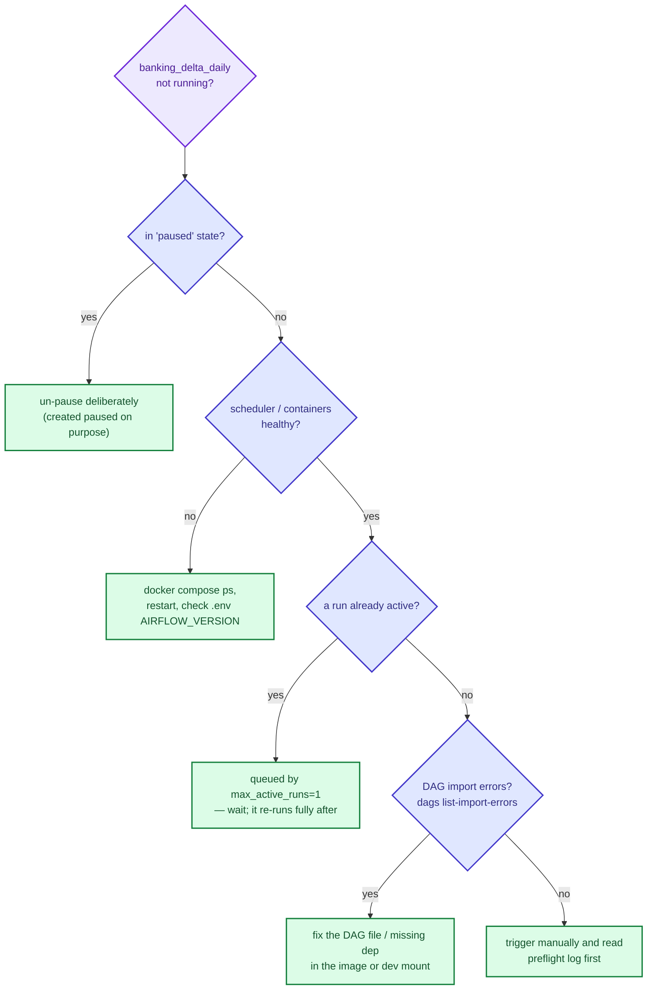

# Troubleshooting — Banking-Delta-Lakehouse

Symptom → cause → fix. Related: `docs/RUNBOOK.md` (failed-run triage),
`docs/AIRFLOW.md` (stack + known banner bug), `docs/TESTING.md` (test-suite symptoms).
Colour legend: `docs/PIPELINE.md`.

## Pipeline and data

| Symptom | Likely cause | Fix |
|---|---|---|
| First incremental run landed everything | watermark not seeded | `python scripts/seed_watermarks.py` (never for MySQL); then re-run |
| Boundary row re-lands every run | lower bound was `>=` | already fixed: `spark_io._dbx_where` uses strict `>` — do not regress it |
| Duplicate rows in `raw.*` | expected: incremental appends keep history | staging `ROW_NUMBER()` dedupe collapses them — check staging, not raw |
| `WatermarkConflict` | another run advanced first | let the retry re-read the window; never hand-edit watermarks |
| Staging lands "unchanged" for MySQL | by design: MySQL is full-load, only Mongo/Databricks are incremental | nothing |
| `mart_*` missing old corrections after publish | incremental publish + `PUBLISH_LOOKBACK_MONTHS=0` | `--lookback N`, `--full`, or set the env var (open item §16.2) |
| Age/tenure bands drift, analytics DQ may fail | bands derive from `CURRENT_DATE`, loads are incremental | force-refresh derived dims or make bands date-independent (open item §16.3 #4) |
| Times stored 5.5 h off real time | PG session TZ `Asia/Calcutta`, Spark UTC naive strings, no TZ on JDBC URL | set `TimeZone=UTC` on JDBC + psycopg (open item §16.3 #3 — **needs approval**) |
| `#` comment text reaches Maven | raw `SPARK_JARS_PACKAGES` | already fixed: `engine._clean_packages` / `_COORD_RE` |
| Raw DQ schema check trips on `_stg_%` | transient landing tables | excluded via `c.relname NOT LIKE '\_stg\_%'` — keep the exclusion |
| `03_register_sources.sql` seems to do nothing | `ON CONFLICT DO NOTHING` cannot flip rows | use `05_switch_mongo_databricks_incremental.sql` |

## Airflow

| Symptom | Likely cause | Fix |
|---|---|---|
| DAG not scheduled at all | created **paused** | un-pause deliberately (UI toggle or `airflow dags unpause banking_delta_daily`) |
| Manual trigger seems to do nothing | `max_active_runs=1` — it queued behind a running run | check `airflow dags list-runs`; wait or clear the running one deliberately |
| `docker compose config` fails | `airflow/.env` missing `AIRFLOW_VERSION` | add it (`.env.airflow.example` documents `.env.airflow`; interpolation uses `.env`) |
| Green run mails `[FAILED]` | **known bug**: summary reads `context["task_states"]`, Airflow 3 does not provide it | verify against `audit.pipeline_runs.status`; fix needs approval (`docs/AIRFLOW.md`) |
| Mail says `env=unknown \| build=unknown` | DAG never passes `env`/`git_sha` into the context | same open item as above |
| Watchdog `[STUCK]` | run older than `WATCHDOG_STUCK_HOURS=5` (or scheduler dead) | inspect the run; `finalize_audit` reaps orphans after a kill |
| Worker OOM / killed | Spark inside the 6 GB `mem_limit` | raise `WORKER_MEM_LIMIT`, lower `EXTRACT_SPARK_DRIVER_MEMORY` |
| Jars re-download every start | `spark_cache` volume missing | ensure the compose `spark_cache:/opt/banking/.spark` mount |
| `preflight` fails fast | Java missing/unsupported, <5 GB disk, source unreachable, Maven blocked | fix what it names; SMTP failures are warnings only |
| Task cannot reach host services | running outside dev override | use `docker-compose.dev.yml` (adds `host.docker.local:host-gateway`) |

## Python / tests / tooling

| Symptom | Likely cause | Fix |
|---|---|---|
| `make unit` runs 0 tests | tests lack the `unit` marker or `testpaths` misses the folder | add `pytestmark`; check `pyproject.toml` `testpaths` |
| `Unknown marker` | marker not registered (strict markers) | register it under `[tool.pytest.ini_options] markers` |
| `RuntimeError: network access is forbidden` | unit/smoke test opened a socket | fake the driver (`tests/conftest.py` `no_network`) — never connect |
| `ModuleNotFoundError: src` | not run via `uv run` / wrong cwd | run from the repo root with `uv run pytest` |
| `fcntl` / `register_at_fork` import error (Windows) | Airflow imported without stubs | reuse `airflow/tests/conftest.py` stubs |
| `UnicodeEncodeError` on Windows console | cp1252 stdout | `encoding="utf-8"`, `chcp 65001`; `main.py` pins UTF-8 before the Rich console |
| ruff/format fails in the hook | style drift | `make format`, then re-stage |
| pre-commit rejects a file | secret-like filename or ruff failure | remove the file / fix the style — never `--no-verify` |
| `make leaks` fails immediately | `.gitleaks.toml` / `gitleaks` absent | known gap (§16.3 #5): add config + install; don't drop the target |
| `make sql-lint` red | a rule outside the `.sqlfluff` baseline | fix the new SQL; don't widen `exclude_rules` (`docs/TESTING.md`) |
| `make cov` fails: no `--cov` | `pytest-cov` missing from the dev group | it is pinned in `pyproject.toml`; run `make install` |
| `make help` errors on `awk` | Windows make + no awk in PATH | `make help` now runs `scripts/make_help.py`; on an older checkout use `tasks.bat help` |
| sqlfluff flags a procedure | dialect/case/style | uppercase keywords, `snake_case`, explicit column lists (`AGENTS.md`) |
| Spark test won't start | unsupported Java / jar download blocked | Java 8/11/17/21; `repo1.maven.org:443` reachable |
| Dashboard chart blank | `SELECT *` loader vs renamed/removed mart column | restore the column or fix the loader (`docs/DEPLOYMENT.md`) |

## Report PDF

| Symptom | Likely cause | Fix |
|---|---|---|
| `make report-pdf` fails with `latexmk: not found` | no TeX distribution on the host | install TinyTeX or TeX Live, or use `make report-docker` |
| Report build exits `2` with `render error` | a chapter template left a `\VAR{` or `\BLOCK{` tag | fix the template in `reports/chapters/`; the build refuses to ship an unfinished chapter |
| Report build exits `3` | the LaTeX compile failed, also in safe mode | read the redacted log in `reports/build/report.log` (daily), `incident.log` or `weekly.log`; `docs/REPORTING.md` §15 lists the usual causes |
| Report build exits `3` with `Missing \begin{document}` in the log | a broken `.aux` of an earlier run | the builder deletes the LaTeX state before it compiles; if it happens, clear `reports/build/aux` and rebuild |
| Report says "degraded report" | a figure or a section could not be built | check `sections_failed` in `reports/output/runs/<run key>/context.json` |
| Footer shows "Page 3" without "of 3" | `lastpage.sty` is not installed | install `texlive-latex-extra`; the page count is otherwise correct |
| A table cell sticks out past the margin (`Overfull \hbox` in the log) | a long identifier or a message that cannot wrap | use the `ident` or `breakable` filter in `reports/chapters/`, or a narrower column; the `tex` tier fails on any overfull box |
| `Underfull \hbox (badness 10000)` in the log | an empty line inside a page, no content | harmless, the `tex` tier only fails on errors and overfull boxes |
| Numbers look wrong in the PDF | the fixture was edited | regenerate from the fixture: `make report-fixture`, then `make report-pdf` |
| Watchdog mail has no incident PDF | incident report build failed | check `build_report` logs in the watchdog DAG; `REPORT_MAX_ATTACH_MB` limit may have been exceeded |
| Weekly DAG never runs | `banking_report_weekly` is paused | un-pause deliberately; schedule is `0 8 * * 1` Asia/Kolkata |

## Stuck DAG — quick flow

## Known open issues (do not "silently fix")

1. Summary banner false `[FAILED]` + `env/build=unknown` — needs approval
   (`docs/AIRFLOW.md`).
2. Publish lookback gap for late/old rows — `PUBLISH_LOOKBACK_MONTHS` / periodic `--full`.
3. Timezone off-by-offset on stored timestamps — needs approval + backfill decision.
4. Analytics band drift from `CURRENT_DATE` — design decision pending.
5. Stale links to a non-existent `airflow/AIRFLOW_AGENT_GUIDE.md`.
6. `make leaks` needs `gitleaks` on PATH (config is `.gitleaks.toml`).
