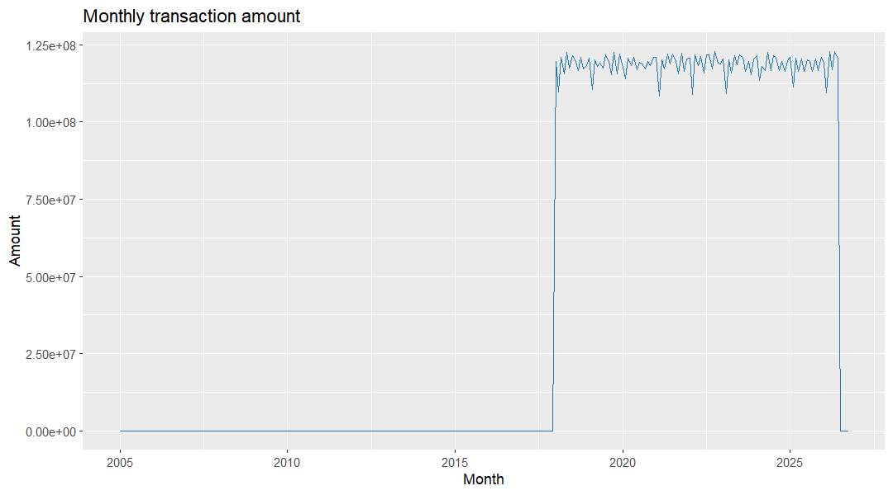

### Do a small group of customers drive most transaction value?

**Business question:** Head of Retail Banking / CRM lead would ask this to decide where retention and cross-sell budget goes.

**Data used:** `marts.mart_customer_360` (grain: one row per customer)

**Finding:** Among customers with transaction activity, the top 10% by transaction value account for 22.55% of total transaction value (2,727,440,949.25 of 12,096,774,249.05). 

**Segment view:** By income band, Upper-Mid (36.12%) and High (32.88%) hold 69.00% of value from 32,786 of 47,640 active customers, but average value is flat at 250,806.60-255,284.46 across all five bands. So what: rank on value, not income - an income-tier campaign would over-serve low-value customers in high bands. Query: `docs/insights/queries/customer_segments.sql`.

**So what:** Prioritise retention, fee-waiver and cross-sell offers for the top decile, and run a reactivation journey for the 12,361 customers with no transaction activity.

**Reproduce:** `docs/insights/queries/customer_concentration.sql` with `psql -U postgres -d banking_delta -f docs/insights/queries/customer_concentration.sql`
