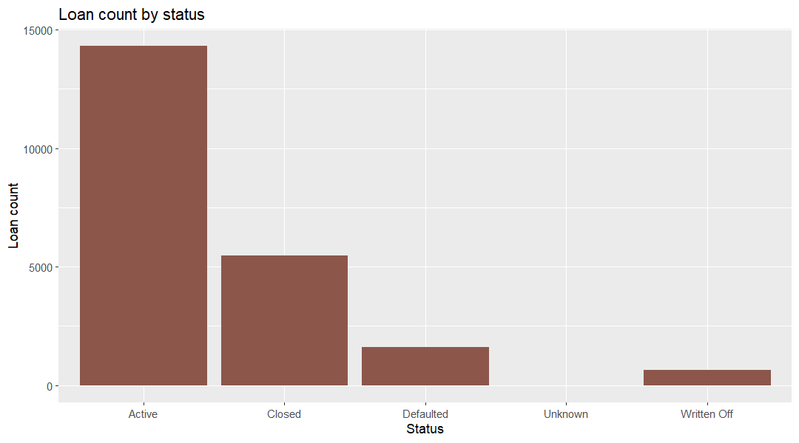

### How late is the loan book paying?

**Business question:** Chief Risk Officer / Head of Collections would ask this to size provisioning and collection capacity.

**Data used:** `marts.mart_loan_portfolio` (grain: one row per loan type x status x loan amount band x term band x disbursement year)

**Finding:** 12.01% of 600,005 loan payments are late (72,038), against a total loan book of 9,214,897,690.78 spread evenly across six loan types (16.49-16.80% each). 

**Segment view:** Late rates stay flat by loan size (11.88% under 1L, 12.04% for 1-5L) and by type (11.85% Business Loan to 12.19% Auto Loan). So what: there is no size or product segment to prioritize; reminders and collections should cover the whole book. Query: `docs/insights/queries/loan_segments.sql`.

**So what:** Add automated payment reminders and a 30-day collections queue for late payers; product mix is already diversified, so collections, not rebalancing, is the lever.

**Reproduce:** `docs/insights/queries/loan_late_payment.sql` with `psql -U postgres -d banking_delta -f docs/insights/queries/loan_late_payment.sql`
