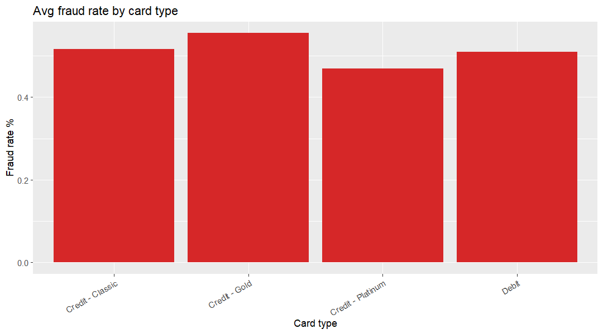

### How much fraud is in card spend?

**Business question:** Fraud Operations lead would ask this to set detection thresholds and investigator staffing.

**Data used:** `marts.mart_card_fraud` (grain: one row per month x card type x card category x card tier x merchant category)

**Finding:** Fraud accounts for 0.499% of 3,005,000 card transactions (15,006 transactions, 28,608,185.59), with rates between 0.497% and 0.524% across merchant categories. 

**So what:** Shift fraud controls to velocity and amount thresholds rather than merchant-category blocking, and size the investigator queue to ~15,000 alerts per period.

**Reproduce:** `docs/insights/queries/card_fraud.sql` with `psql -U postgres -d banking_delta -f docs/insights/queries/card_fraud.sql`
