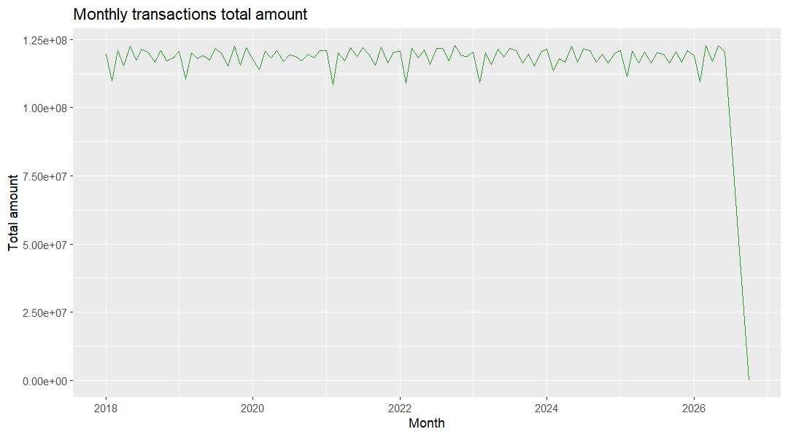

### Is transaction value concentrated in a few channels?

**Business question:** Head of Digital Channels / payments lead would ask this to guide channel investment and cost negotiation.

**Data used:** `marts.mart_monthly_transactions` (grain: one row per month x transaction type x channel x merchant category x direction x region)

**Finding:** Total transaction value is 12,096,774,249.05 across 103 months, split almost evenly across six channels (16.62% to 16.70% each). 

**So what:** Negotiate per-channel processing costs and migrate low-value traffic to cheaper channels without risking share, since no single channel dominates.

**Reproduce:** `docs/insights/queries/transaction_channels.sql` with `psql -U postgres -d banking_delta -f docs/insights/queries/transaction_channels.sql`
