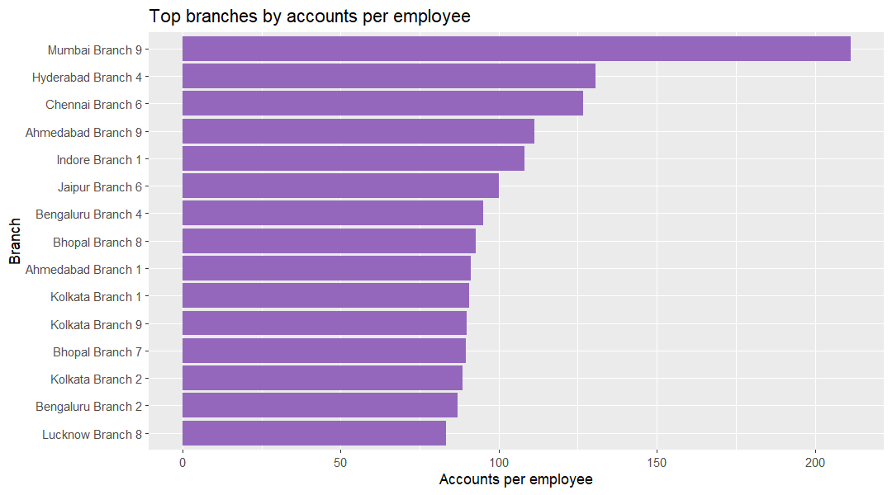

### Are branches evenly loaded?

**Business question:** Head of Branch Network / COO would ask this to rebalance staffing and service levels.

**Data used:** `marts.mart_branch_performance` (grain: one row per branch)

**Finding:** Across 151 branches, accounts per employee ranges from 27.55 to 211.33 (average 58.27) and branch late-payment rates range from 10.60% to 13.77%. 

**Segment view:** Regionally, West branches average 65.38 accounts per employee against North 53.11, while late-payment rates stay within 11.96-12.14%. So what: move staff toward West and Central offices; a 0.18pp regional late-rate spread does not justify separate collections playbooks. Query: `docs/insights/queries/branch_segments.sql`.

**So what:** Rebalance staff and automate servicing in high-load branches, and replicate collection practices from branches at the low end of the late-payment range.

**Reproduce:** `docs/insights/queries/branch_workload.sql` with `psql -U postgres -d banking_delta -f docs/insights/queries/branch_workload.sql`
