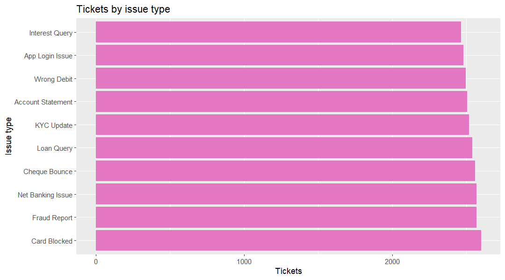

### Is customer support meeting its SLA?

**Business question:** Head of Customer Service would ask this to prioritise issue types and service recovery.

**Data used:** `marts.mart_support_performance` (grain: one row per month opened x issue type x status x customer state x income band)

**Finding:** Of 25,300 support tickets, 79.67% (20,156) are resolved, average satisfaction is 3.00/5, and 39.95% (10,108) scored 2 or below. 

**So what:** Launch service recovery for the 10,108 low-satisfaction tickets and root-cause the "Account Statement" issue type, which has the lowest resolution rate at 78.61%.

**Reproduce:** `docs/insights/queries/support_sla.sql` with `psql -U postgres -d banking_delta -f docs/insights/queries/support_sla.sql`
